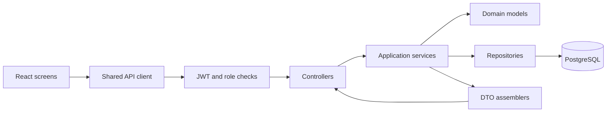

<p align="center">
  
</p>

# Study Buddy Matcher

A web application for **IS442 Object Oriented Programming at SMU**. Students find
study partners from their courses, weekly availability and study preferences, then connect
and form study groups. Administrators manage accounts and configure matching rules.

**Java 21 · Spring Boot · React · Vite · PostgreSQL**

[Quick start](#getting-started) · [Architecture](#architecture) · [Matching](#matching-engine) ·
[Testing](#testing) · [Documentation](#documentation) · [Libraries](#libraries)

## Overview

| Feature | What you can do |
| --- | --- |
| Profiles and availability | Register, sign in, manage courses and preferences, and edit a weekly schedule |
| Matching | Compare scored candidates, shared hours and preferences; filter and sort results |
| Connections | Send and answer requests, view accepted buddies' contacts and end a connection |
| Study groups | Browse/create groups, apply to join and manage membership as a leader |
| Collaborative study | Use private rooms, a shared Pomodoro, original music/ambience, weather scenes and dated sessions with calendar export |
| Administration | Manage account status and usage, and configure matching criteria, weights and strategy |

Contact details are returned only to their owner or an active accepted buddy.
Group membership and administrator authority do not grant contact read access. Group
leadership is a per-group permission; Student and Administrator are the account roles.

## Getting Started

### Prerequisites

| Requirement | Use |
| --- | --- |
| JDK 21 selected in `JAVA_HOME` | Compile and run the backend |
| Node.js 22 and npm | Matches the frontend CI runtime |
| Git | Obtain the source |
| `psql` and OpenSSL | Apply migrations and generate private signing keys |
| A reachable PostgreSQL database | The team uses shared Supabase; access is provided privately |
| Bash | Run the migration and test scripts |
| Running Docker | Full backend tests only; the harness creates disposable PostgreSQL 17 |

### 1. Install dependencies

```bash
git clone https://github.com/aryan12singh/study-buddy-matcher.git
cd study-buddy-matcher

cd frontend
cp .env.example .env
npm ci
cd ..
```

### 2. Configure the backend

Create **`backend/src/main/resources/application-local.yml`**. It is ignored by Git and
loads automatically because the default Spring profile is `local`.

```yaml
spring:
  datasource:
    url: jdbc:postgresql://<host>:5432/postgres
    username: <database-user>
    password: <database-password>
jwt:
  secret: <random-signing-key>
```

Use the database owner/backend role with migration privileges; browser roles such as
`anon` and `authenticated` are not suitable. Generate the signing key with
`openssl rand -base64 48`. Keep database credentials, signing keys and demo passwords private.
Frontend `VITE_` values are public bundle configuration;
never use them for secrets.

The copied **`frontend/.env`** contains:

```dotenv
VITE_API_BASE_URL=http://localhost:8080/api
```

### 3. Prepare the database

Apply the existing ordered migrations to the same target as the backend datasource. Set
`PGHOST`, `PGPORT`, `PGDATABASE`, `PGUSER` and `PGPASSWORD` privately, then run:

```bash
scripts/migrate-database.sh
```

For the shared database, follow the operator's
[deployment and recovery record](docs/DATABASE_OPERATIONS.md). Do not reset it to provision
local tests. Hibernate `update` does not replace the migration constraints, legacy adoption,
indexes or RLS/grants. The test profile validates a freshly migrated schema.

Local application YAML configures the running app; it does not provision the test database.
Use the isolated harness in [Testing](#testing).

### 4. Start both applications

```bash
# Terminal 1: from the repository root
cd backend
./mvnw spring-boot:run
```

```bash
# Terminal 2: from the repository root
cd frontend
npm run dev
```

Open [http://localhost:5173](http://localhost:5173). The backend API is
[http://localhost:8080/api](http://localhost:8080/api).

<details>
<summary>Optional demo data</summary>

The opt-in seeder adds **10 courses, 50 varied synthetic student profiles and one admin**.
Use `DEMO_SEED_ENABLED=true`, `DEMO_STUDENT_PASSWORD` and `DEMO_ADMIN_PASSWORD` for one approved
startup, then disable seeding. Passwords belong in private configuration or the process
environment. Repeat runs add only missing data; existing passwords, profiles and groups
are preserved.

Demo identities include `priya@demo.example.test`, `jamie@demo.example.test`,
`alex@demo.example.test`, `student04@demo.example.test` through `student50@demo.example.test`,
and `admin@demo.example.test`. Contacts are synthetic and must not be used to contact anyone.
See [safe seeding](docs/DATABASE_OPERATIONS.md#safe-demo-seed).

</details>

<details>
<summary>Troubleshooting</summary>

| Symptom | Check |
| --- | --- |
| Java compiler/release error | Select JDK 21 and verify `java -version` in the same terminal |
| Tests cannot connect after `clean install` | Run the isolated harness; local YAML is not test provisioning |
| Backend cannot connect or a mapped column is missing | Verify the private datasource and the target's ordered migrations |
| Test container cannot start | Start Docker; check `psql`/OpenSSL and access to `postgres:17` |
| Browser requests fail | Check `VITE_API_BASE_URL`, backend startup and CORS; restart Vite after changing `.env` |
| Courses/demo students are absent | Run the opt-in seed procedure on the approved target |

</details>

## Matching Engine

Matching compares five criteria, each scored from 0 to 1. The weighted total describes
compatibility; missing preferences receive a neutral 0.5.

| Criterion | Compares |
| --- | --- |
| Course | Current course focus against a candidate's target and enrolments |
| Availability | Shared weekly minutes relative to the caller's available minutes |
| Study mode | In-person, online or either |
| Study goals | Overlap between selected goals |
| Group size | Overlap between preferred numeric ranges |

Students choose one-to-one, small group or either; these map to ranges of 2–2,
3–maximum or 2–maximum. Weekly availability uses Asia/Singapore time. Administrators
configure enabled criteria, weights and balanced, availability-first or course-first
ranking. Search excludes self, inactive accounts and existing active buddies.

Scoring formulas, filtering and configuration behavior are described in
[matching decisions](docs/DESIGN_DECISIONS.md#matching-decisions-team-a) and the
[API contract](docs/API_CONTRACT.md).

## Collaborative Study

Accepted group members enter a private room with a shared Pomodoro, host/co-host controls,
original layered music/ambience and live campus-weather scenes with selectable fallback.
Local volume/mute preferences are remembered; playback requires explicit enable. Accessible
phase cues mark focus/break transitions, and room access follows current membership.

Group leaders and connected buddies schedule, edit and cancel dated sessions. Mutual
availability suggestions fit a chosen duration, while manual scheduling remains available.
Current/upcoming sessions appear on Home and group agendas with safe room shortcuts.
Calendar downloads support single or bounded weekly dates with timezone/DST handling.
They are snapshots: re-export after changes and check your calendar for old or duplicate
copies. See [E2 documentation](docs/E2_TESTING.md) for details and calendar compatibility.

## Architecture

The backend uses feature packages and conventional layered OO design. Controllers validate
input and call services. Services apply domain rules and return DTOs assembled at the API
boundary; controllers never access repositories, and persistence entities never become API
payloads.



Immutable `TimeSlot`/`MatchScore` values, independent criterion scorers and polymorphic
matching strategies separate the matching responsibilities. Database access stays behind
the backend's JWT-protected API.

```text
backend/   Spring Boot, feature services/domain/DTOs, SQL migrations and tests
frontend/  React screens under src/features; client/auth/UI under src/shared
scripts/   Ordered migration runner and isolated PostgreSQL test harness
docs/      Contracts, decisions, coverage, diagrams and verification
```

See [platform diagrams](docs/diagrams/PLATFORM.md), [matching diagrams](docs/diagrams/TEAM_A.md)
and [connection/group diagrams](docs/diagrams/TEAM_C.md) for class and sequence detail.

## Testing

```bash
# Repository root: complete backend suite in disposable PostgreSQL 17
scripts/test-backend.sh
```

```bash
# Frontend: interaction tests, lint, types and production build
cd frontend
npm test
npm run lint
npm run build
```

The backend harness creates its own credentials and database, checks fresh/repeated/legacy
migrations, runs HTTP/JWT/database tests and removes its container. Never run destructive
test fixtures against shared Supabase. CI runs both backend and frontend jobs on every PR.

<details>
<summary>Backend build and focused unit checks</summary>

Package the backend without running database tests:

```bash
cd backend
./mvnw -DskipTests package
```

This package command skips tests. A focused unit-only run omits context/database integration
checks:

```bash
cd backend
./mvnw test -Dtest='!com.studybuddy.integration.**,!StudyBuddyApplicationTests' \
  -Dsurefire.failIfNoSpecifiedTests=false
```

</details>

## Configuration

Backend secrets belong in `application-local.yml` or the process environment; frontend
settings belong in `frontend/.env`. Expand the relevant reference for defaults.

<details>
<summary>Backend, authentication, profiles and demo data</summary>

| Key | Default / requirement | Purpose |
| --- | --- | --- |
| `SPRING_PROFILES_ACTIVE` | `local` | Loads `application-local.yml` in development |
| `SPRING_DATASOURCE_URL` / `_USERNAME` / `_PASSWORD` | Required unless set in `application-local.yml` | Backend database connection |
| `JWT_SECRET` / `jwt.secret` | Required, at least 32 characters | Signs login tokens; use a random value |
| `JWT_EXPIRATION_MS` / `jwt.expiration-ms` | `86400000` (24 hours) | Token lifetime in milliseconds |
| `CORS_ALLOWED_ORIGINS` | `http://localhost:5173,http://127.0.0.1:5173` | Comma-separated frontend origins |
| `app.auth.secret`, `app.auth.token-lifetime`, `app.auth.allowed-origins` | Bound from the three settings above | Typed authentication config (`AuthProperties`) |
| `PROFILE_GROUP_SIZE_MAX` / `app.profile.group-size-max` | `5` (min `3`) | Largest group a "small group" or "either" preference covers |
| `PROFILE_MAX_COURSES` / `app.profile.max-courses` | `8` | Most courses a student can list as currently taken |
| `DEMO_SEED_ENABLED` / `app.demo-seed.enabled` | `false` | Opt in to the demo seeder for one startup |
| `DEMO_STUDENT_PASSWORD` / `app.demo-seed.student-password` | Required only when seeding | Password for newly seeded demo students |
| `DEMO_ADMIN_PASSWORD` / `app.demo-seed.admin-password` | Required only when seeding | Password for the newly seeded demo admin |

</details>

<details>
<summary>Matching configuration</summary>

| Key | Default / requirement | Purpose |
| --- | --- | --- |
| `app.matching.default-strategy` | `BALANCED` | Strategy used until an admin chooses one (`BALANCED`, `AVAILABILITY_FIRST`, `COURSE_FIRST`) |
| `app.matching.default-weights.<strategy>.*` | balanced: course `0.30`, availability `0.30`, study-mode `0.20`, study-goal `0.10`, group-size `0.10`; availability-first: availability `0`, course `0.40`, study-mode `0.30`, study-goal `0.15`, group-size `0.15`; course-first: course `0`, availability `0.40`, study-mode `0.30`, study-goal `0.15`, group-size `0.15` | Every strategy has all five weights, each from 0 to 1. Enabled weights add up to 1; disabled weights must be 0. The priority criterion is editable, including 0 |
| `app.matching.default-enabled-criteria` | All five criteria | Global startup enabled criteria; disabled criteria must have zero weights |
| `app.matching.default-min-score` | `0` | Minimum total compatibility returned, before a student's additional quality filter |
| `app.matching.default-result-limit` / `app.matching.max-result-limit` | `20` / `50` | Default and largest search result count, applied after filtering and sorting |
| `app.matching.quality.strong` / `app.matching.quality.good` | `0.75` / `0.50` | Weighted-total cut-offs for the Strong and Good match labels; anything lower is Fair |

</details>

<details>
<summary>Rooms, sessions and campus weather</summary>

| Key | Default / requirement | Purpose |
| --- | --- | --- |
| `ROOM_DEFAULT_FOCUS_MINUTES` / `app.study-room.default-focus-minutes` | `25` | Initial focus duration |
| `ROOM_DEFAULT_BREAK_MINUTES` / `app.study-room.default-break-minutes` | `5` | Initial break duration |
| `ROOM_MAX_FOCUS_MINUTES` / `app.study-room.max-focus-minutes` | `180` | Maximum focus duration |
| `ROOM_MAX_BREAK_MINUTES` / `app.study-room.max-break-minutes` | `60` | Maximum break duration |
| `ROOM_LEASE_LIFETIME` / `app.study-room.lease-lifetime` | `30s` | Expiring browser presence |
| `ROOM_POLL_INTERVAL` / `app.study-room.poll-interval` | `2s` | Shared room refresh interval |
| `SESSION_MAXIMUM_OCCURRENCES` / `app.study-session.maximum-occurrences` | `52` | Maximum bounded weekly occurrences (1 means one-off) |
| `SESSION_MAXIMUM_DURATION_HOURS` / `app.study-session.maximum-duration-hours` | `24` | Maximum elapsed duration per occurrence |
| `app.study-session.availability-time-zone` | `Asia/Singapore` | Fixed campus timezone for weekly suggestions |
| `WEATHER_ENABLED` / `app.weather.enabled` | `true`; test profile `false` | Enable approved campus weather provider |
| `WEATHER_LATITUDE` / `app.weather.latitude` | `1.297` | Server-configured campus latitude |
| `WEATHER_LONGITUDE` / `app.weather.longitude` | `103.849` | Server-configured campus longitude |
| `WEATHER_LOCATION` / `app.weather.location` | `SMU campus` | Display label for configured coordinates |
| `WEATHER_TIMEOUT` / `app.weather.timeout` | `4s`, at most `10s` | Bounded provider connection/request timeout |
| `WEATHER_CACHE_LIFETIME` / `app.weather.cache-lifetime` | `15m`, at least `30s` | Shared successful weather cache |
| `WEATHER_RETRY_INTERVAL` / `app.weather.retry-interval` | `1m`, at least `30s` | Backoff after provider failure |
| `WEATHER_MAXIMUM_STALE_AGE` / `app.weather.maximum-stale-age` | `24h`, no shorter than cache lifetime | Last-known observation age limit |

</details>

<details>
<summary>Frontend configuration</summary>

| Key | Default / requirement | Purpose |
| --- | --- | --- |
| `VITE_API_BASE_URL` | `/api` when unset | Backend API base URL |
| `VITE_REFRESH_INTERVAL_MS` | `30000` (min `15000`, max `300000`) | Background refresh interval for lists and details |

</details>

The isolated test harness supplies `STUDYBUDDY_TEST_DATABASE_URL`,
`STUDYBUDDY_TEST_DATABASE_USERNAME`, `STUDYBUDDY_TEST_DATABASE_PASSWORD` and
`STUDYBUDDY_TEST_JWT_SECRET` automatically. The migration runner uses the standard
`PGHOST`, `PGPORT`, `PGDATABASE`, `PGUSER` and `PGPASSWORD` variables.

## Documentation

| Document | Purpose |
| --- | --- |
| [API contract](docs/API_CONTRACT.md) | Endpoints, DTO/input shapes, authorization and errors |
| [Design decisions](docs/DESIGN_DECISIONS.md) | Matching formulas, privacy rules and accepted design choices |
| [Requirement coverage](docs/REQUIREMENT_COVERAGE.md) | Feature mapping and delivery records |
| [E2 verification](docs/E2_TESTING.md) | Room/session/audio/weather/calendar checks and current evidence |
| [Baseline verification](docs/BASELINE_VERIFICATION.md) | Test coverage and workflow evidence |
| [Database operations](docs/DATABASE_OPERATIONS.md) | Migration, seed, access and recovery procedures |
| [Platform](docs/diagrams/PLATFORM.md) · [Matching](docs/diagrams/TEAM_A.md) · [Groups/connections](docs/diagrams/TEAM_C.md) | System, class and sequence diagrams |
| [AI usage](docs/AI_USAGE.md) | Where development assistance was retained |
| [Repository conventions](AGENTS.md) | Ownership, OO/layering rules and review process |

## Libraries

<details>
<summary>Dependency and service inventory</summary>

Versions below match the resolved Maven dependencies and npm lockfile. Licences apply
to the listed third-party libraries and services.

| Library/tool | Resolved version | Purpose | Licence / primary source |
| --- | --- | --- | --- |
| Spring Boot JPA, Security, Validation, WebMVC and test starters | 4.1.1 | Fixed stack, wiring and tests | Apache-2.0, [Spring Boot](https://github.com/spring-projects/spring-boot) |
| Spring Framework / Data JPA / Security | 7.0.9 / 4.1.1 / 7.1.1 | Transactions, repositories, web/security | Apache-2.0, [Spring](https://github.com/spring-projects) |
| Hibernate ORM | 7.4.5.Final | JPA persistence | Apache-2.0, [Hibernate](https://github.com/hibernate/hibernate-orm) |
| PostgreSQL JDBC | 42.7.13 | Server-side JDBC | BSD-2-Clause, [pgJDBC](https://github.com/pgjdbc/pgjdbc) |
| JJWT API/impl/Jackson | 0.12.6 | JWT signing/verification | Apache-2.0, [JJWT](https://github.com/jwtk/jjwt) |
| Jackson 3 / Jackson 2 | 3.1.5 / 2.21.5 (annotations 2.21) | Spring JSON / JJWT JSON | Apache-2.0, [Jackson](https://github.com/FasterXML) |
| JUnit Jupiter / Mockito | 6.0.3 / 5.23.0 | Backend tests/mocks | EPL-2.0 / MIT, [JUnit](https://github.com/junit-team/junit-framework), [Mockito](https://github.com/mockito/mockito) |
| Maven / wrapper | 3.9.16 / 3.3.4 | Existing build bootstrap | Apache-2.0, [Maven](https://maven.apache.org/) |
| React / React DOM | 19.3.0 | Components/rendering | MIT, [React](https://github.com/facebook/react) |
| React Router DOM | 7.18.4 | Routes and guards | MIT, [React Router](https://github.com/remix-run/react-router) |
| Axios | 1.20.0 | Shared HTTP client | MIT, [Axios](https://github.com/axios/axios) |
| Vite / React plugin | 8.3.0 / 6.1.1 | Existing dev/build pipeline | MIT, [Vite](https://github.com/vitejs/vite), [plugin](https://github.com/vitejs/vite-plugin-react) |
| TypeScript | 6.0.3 | API/component typing | Apache-2.0, [TypeScript](https://github.com/microsoft/TypeScript) |
| Tailwind CSS / Vite plugin | 4.3.3 | Existing entry styling | MIT, [Tailwind](https://github.com/tailwindlabs/tailwindcss) |
| Oxlint | 1.83.0 | Lint | MIT, [Oxc](https://github.com/oxc-project/oxc) |
| Vitest / jsdom | 5.0.1 / 30.1.0 | Frontend tests/DOM | MIT, [Vitest](https://github.com/vitest-dev/vitest), [jsdom](https://github.com/jsdom/jsdom) |
| Testing Library React / jest-dom | 16.3.3 / 7.0.1 | Rendered interactions/assertions | MIT, [React Testing Library](https://github.com/testing-library/react-testing-library), [jest-dom](https://github.com/testing-library/jest-dom) |
| @types/node / react / react-dom | 24.13.6 / 19.3.0 / 19.3.0 | Development declarations | MIT, [DefinitelyTyped](https://github.com/DefinitelyTyped/DefinitelyTyped) |
| Open-Meteo weather service | Current weather API | Approved fixed-campus decorative weather; no SDK or key | CC BY 4.0 data, non-commercial free API; [documentation](https://open-meteo.com/en/docs), [terms](https://open-meteo.com/en/terms) |
| source-map-js (transitive) | 1.2.2 | Existing source-map support; patched lock entry | BSD-3-Clause, [source-map-js](https://github.com/7rulnik/source-map-js), [advisory](https://github.com/advisories/GHSA-68fv-2mgg-jv7q) |

Supabase provides hosted PostgreSQL; the browser does not use a Supabase SDK. Tests use
the official PostgreSQL 17 container. Open-Meteo supplies optional campus weather, with
visible CC BY 4.0 attribution and no student/device-location data sent to the provider.

</details>

<details>
<summary>Original assets and font licences</summary>

| Asset / service | Origin and distribution record |
| --- | --- |
| `frontend/public/favicon.svg` | Original project pixel-book SVG; reused as the application favicon and README identity |
| Shared/landing pixel icons, avatar initials and CSS patterns | Original project drawings in `PixelIcon.tsx`, `Avatar.tsx` and `desktop.css`; no external icon set |
| Room scenery and music/ambient synthesis | Original project CSS pixel scenery and native Web Audio; no external sound assets |
| Open-Meteo weather | Approved non-commercial API, CC BY 4.0 attribution linked on the room screen; backend sends configured campus coordinates only |
| Google Fonts stylesheet | Existing Inter/Fraunces remote import; SIL OFL 1.1 sources linked in this section, with system fallback |
| Supabase / PostgreSQL | Hosted database reached only by backend JDBC; local/CI tests use the official PostgreSQL 17 container |

The retro interface uses original pixel drawings and CSS patterns with system fonts.
The existing Google Fonts import uses Inter and Fraunces under SIL OFL 1.1
([Inter licence](https://raw.githubusercontent.com/google/fonts/main/ofl/inter/OFL.txt),
[Fraunces licence](https://raw.githubusercontent.com/google/fonts/main/ofl/fraunces/OFL.txt));
network failure falls back to system fonts. No external music assets are required.

</details>

## Team

| Team | Members | Responsibility |
| --- | --- | --- |
| A | Natthida, Chong Yee, Joanne | Matching engine, discovery and matching configuration |
| B | Angel, Averyl, Guang Hao | Platform, authentication, own profile, availability, seed, dashboard and shell |
| C | Aryan, Charlize | Requests/connections, contact privacy, groups, notifications, admin accounts and collaborative study |
