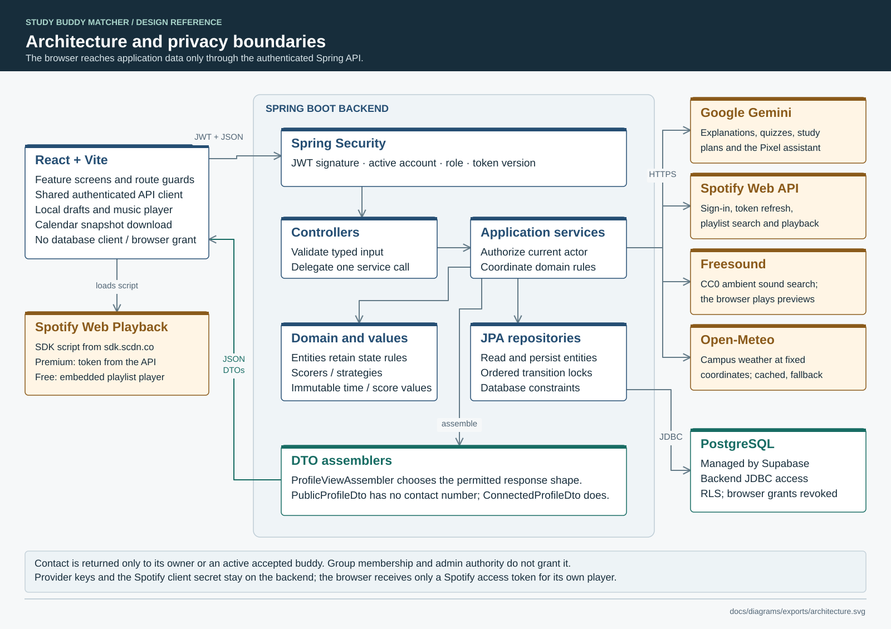

<p align="center">
  
</p>

<h1 align="center">Study Buddy Matcher</h1>

<p align="center">
  Find the right study partner, connect safely and study together.<br />
  Coursework for <strong>IS442 Object Oriented Programming</strong> at Singapore Management University.
</p>

<p align="center">
  <strong>Java 21</strong> · <strong>Spring Boot</strong> · <strong>Spring Security (JWT)</strong> ·
  <strong>React + Vite</strong> · <strong>PostgreSQL (Supabase)</strong>
</p>

---

## Contents

| | | |
| --- | --- | --- |
|  [Features](#features) |  [Getting started](#getting-started) |  [Architecture](#architecture) |
|  [Matching engine](#matching-engine) |  [Collaborative study](#collaborative-study) |  [Privacy and relationships](#privacy-and-relationships) |
|  [Configuration](#configuration) |  [Testing](#testing) |  [Documentation](#documentation) |
|  [Libraries and assets](#libraries-and-assets) |  [Team and workflow](#team-and-workflow) |  [Known limitations and future work](#known-limitations-and-future-work) |

---

## Features

| | Area | What it does |
| --- | --- | --- |
|  | **Matching** | Scores other students on course, weekly availability, study mode, goals and group size, with three ranking strategies and a breakdown of every score |
|  | **Connections and privacy** | Match requests become connections on acceptance; a contact number is revealed only to an active, accepted buddy |
|  | **Study groups** | Create, browse and apply to groups; leaders approve applicants, remove members and close groups |
|  | **Collaborative study** | Private group rooms with a shared Pomodoro timer, personal Spotify and ambient sound music, and live campus weather scenes |
|  | **Study sessions** | One-off or weekly group and buddy sessions with mutual-availability suggestions and calendar (`.ics`) export |
|  | **Notifications** | Recipient-scoped updates for requests, groups, membership and sessions |
|  | **Help and getting started** | A current-data next action, profile-to-session guide, contextual topic links and searchable answers about matching, AI, privacy, groups and rooms |
|  | **Administration** | Create and edit accounts, view usage, deactivate, reactivate or delete accounts, and tune matching weights |

### Roles

| Role | Can |
| --- | --- |
| Student | Register and sign in; edit profile, courses, preferences and weekly availability; search and compare matches; send and answer requests; end connections; browse, create and apply to groups; join private study rooms; schedule buddy sessions; read notifications |
| Group leader | Everything a student can, plus edit their group, decide applications, remove members, close the group, schedule group sessions and assign study-room hosts |
| Administrator | Manage accounts and their status, view basic usage, and configure matching criteria, weights and strategy |

A group leader is a student with authority over one group, not a separate account role.
Compulsory scope and the selected E1/E2 extensions are mapped in the
[requirement coverage map](docs/REQUIREMENT_COVERAGE.md#selected-extras-and-delivery).
The baseline and E2 design views are checked against revision `9592fd2` (18 October 2026).
E1 AI explanations have a separate contract and delivery record on
[PR #61](https://github.com/aryan12singh/study-buddy-matcher/pull/61).
The [16 October E2 database rollout](docs/DATABASE_OPERATIONS.md#e2-rollout--16-october-2026)
is recorded; team acceptance and persistent application hosting are separate from that record.

---

## Getting started

### Prerequisites

| Requirement | Used for |
| --- | --- |
| JDK 21, selected in `JAVA_HOME` | Building and running the backend |
| Node.js 22 and npm | The frontend (matches the CI runtime) |
| `psql` and OpenSSL | Applying migrations and generating signing keys |
| A reachable PostgreSQL database | The team uses shared Supabase; access is shared privately |
| Bash and a running Docker | The full backend test suite only |

### 1. Clone and install

```bash
git clone https://github.com/aryan12singh/study-buddy-matcher.git
cd study-buddy-matcher/frontend
cp .env.example .env
npm ci
cd ..
```

The copied `frontend/.env` points the frontend at the local backend:

```dotenv
VITE_API_BASE_URL=http://localhost:8080/api
```

### 2. Configure backend credentials

Create `backend/src/main/resources/application-local.yml`. It is git-ignored and loads
automatically because the default Spring profile is `local`.

```yaml
spring:
  datasource:
    url: jdbc:postgresql://<host>:5432/postgres
    username: <database-user>
    password: <database-password>
jwt:
  secret: <random-signing-key>
```

Generate the signing key with `openssl rand -base64 48`.

> [!IMPORTANT]
> Secrets live only in `application-local.yml` or the process environment. Anything prefixed
> `VITE_` is bundled into the public frontend, so never put a secret there.

### 3. Prepare the database

Set `PGHOST`, `PGPORT`, `PGDATABASE`, `PGUSER` and `PGPASSWORD` for the same database as the
backend datasource, then apply the ordered migrations:

```bash
scripts/migrate-database.sh
```

The migrations own the schema. The backend runs with `ddl-auto: validate`, so it never
changes the database and refuses to start if a mapped table or column is missing. Validation
does not check constraints, indexes or row-level security, so always apply every migration
first. For the shared database, follow the
[deployment and recovery record](docs/DATABASE_OPERATIONS.md) and never reset it for tests.

### 4. Run

```bash
# Terminal 1: backend on http://localhost:8080/api
cd backend
./mvnw spring-boot:run
```

```bash
# Terminal 2: frontend on http://localhost:5173
cd frontend
npm run dev
```

<details>
<summary><strong>Demo data</strong></summary>

<br />

The opt-in seeder adds **14 courses across six schools, 50 synthetic students and one admin**,
all read from [`demo-data.json`](backend/src/main/resources/demo-seed/demo-data.json).
Every study mode, group-size preference and study goal is represented, and timetables are
built from shared weekly blocks so most pairs genuinely overlap. Three students have no
timetable, to show the empty state.

Students are created through the normal registration and profile rules. On a fresh database
the seeder then replays a demo history through the real services, so notifications and
business rules behave exactly as in live use.

| Sign in as | Ready to demo |
| --- | --- |
| `priya@demo.example.test` (presenter) | An incoming request from Marcus to accept (his contact number then appears), an outgoing request to Sofia, an active connection with Jamie and an ended one with Alex. Leads *IS442 Design Patterns Clinic* (3/5) with two applications to decide. For the strategy demo, search IS442 and switch strategy as admin: Chen Xin Yi shares all six of Priya's free hours but only takes IS442, so she rises under Availability first and falls under Course first |
| `appendix.a@demo.example.test` / `appendix.b@demo.example.test` | The brief's Appendix A pair. Searching IS442 as Student A shows Student B with 2 shared hours, scoring 0.85 STRONG under Balanced |
| `hannah@demo.example.test` | Leads a full group (*Stats Finals Crunch*, 3/3) |
| `ethan@demo.example.test` | Leads a closed group (*IS212 Sprint Retro*) |
| `admin@demo.example.test` | `ryan@demo.example.test` is already deactivated, so account status shows both states |

Set `DEMO_SEED_ENABLED=true`, `DEMO_STUDENT_PASSWORD` and `DEMO_ADMIN_PASSWORD` for one
approved startup, then disable seeding. Repeat runs only add missing courses and accounts and
never change existing data; the demo history replays only when none of the 50 students existed.
Contacts use the fictional +1 202-555-01xx range. See
[safe seeding](docs/DATABASE_OPERATIONS.md#safe-demo-seed).

</details>

<details>
<summary><strong>Troubleshooting</strong></summary>

<br />

| Symptom | Check |
| --- | --- |
| Java compiler or release error | Select JDK 21 and confirm `java -version` in the same terminal |
| Backend cannot connect, or a mapped column is missing | Check the private datasource and that the target has every ordered migration |
| Tests cannot connect after `./mvnw clean install` | Local YAML does not provision tests; use `scripts/test-backend.sh` |
| Test container cannot start | Start Docker; check `psql`, OpenSSL and access to `postgres:17` |
| Browser requests fail | Check `VITE_API_BASE_URL`, backend startup and CORS; restart Vite after editing `.env` |
| Courses or demo students are missing | Run the opt-in seed procedure on the approved database |

</details>

---

## Architecture

Feature packages follow a conventional layered design. Controllers validate input and call
one service method; services apply domain rules and return DTOs built by assemblers.
Controllers never touch repositories, and entities never leave the service layer. This is
also the privacy mechanism: a contact number is withheld by choosing a DTO, not hidden in React.

[](docs/diagrams/exports/architecture.svg)

| Design point | How it is applied |
| --- | --- |
| Composition over account inheritance | `Student` references `User` through a one-to-one `@MapsId` association; a group leader is an ordinary student |
| Immutable values | `TimeSlot` and `MatchScore` have no setters |
| Polymorphism over `switch` | Independent `CriterionScorer` implementations and `MatchingStrategy` implementations |
| Externalised configuration | Weights, limits and timings bind to typed configuration objects |
| Concurrency | Relationship/room/session transitions follow the account-before-parent lock order and observed versions; room polling and existing-lease renewal avoid group-row locks |
| Database access | The browser never reads application tables; Supabase browser roles are revoked |

```text
backend/    Spring Boot feature packages, SQL migrations and tests
frontend/   React screens in src/features; client, auth and shared UI in src/shared
scripts/    Migration runner and disposable PostgreSQL test harness
docs/       API contract, decisions, coverage, diagrams and verification records
```

The [diagram index](docs/diagrams/README.md) contains the scalable architecture, UML
use-case, class and matching-sequence exports, editable sources and rebuild instructions.
Detailed E2 and database views remain separate so each diagram stays readable.

---

## Matching engine

Find buddies and Home use `GET /api/matches`. A search needs a current course or study goal;
optional study-mode, group-size, shared-time and quality filters narrow the results. Students
never see themselves, inactive accounts or existing buddies, and a pending request disables
a duplicate send. Home shows up to three candidates.

Each enabled criterion scores from 0 to 1, and compatibility is their weighted sum, not a
probability of success. A preference either student left empty is *unknown*: it scores
`app.matching.scoring.unknown-score` (0 by default) and shows as "Not shared", so missing
data never outranks real compatibility.

| Criterion | Rule |
| --- | --- |
| Course | With a course in focus (the searched course, else the caller's target): candidate wants a buddy for it 1; only takes it `takes-course-score` (0.5); neither 0. Without one: shared courses divided by the smaller course list |
| Availability | Shared weekly minutes divided by the smaller timetable. Only shared blocks of at least `min-session-minutes` (60) count |
| Study mode | Same mode, or either student chose `EITHER`: 1; in-person versus online: 0 |
| Study goals | Shared goals divided by the smaller goal set. A goal search adds the searched goal to the caller's saved goals |
| Group size | Preferred numeric ranges overlap: 1; disjoint: 0 |

Availability and saved-goal scores are symmetric; course scores and a searched goal follow
the searcher's focus, so they can differ by direction.

| Strategy | Ranking |
| --- | --- |
| Balanced | Weighted total |
| Availability first | Shared-hour bands from `app.matching.priority-tiers.availability-hours` (3 h or more, 1 to 3 h, under 1 h), then weighted total |
| Course first | Course-score bands (1, then `takes-course-score`, then lower), then weighted total |

An unknown priority criterion always ranks in the lowest band, and disabling it falls back to
the total. Alternative sorts start with shared hours or same-year preference. Remaining ties
break on shared hours, then name and ID. The server filters and sorts before applying the
result limit. The API's deterministic explanation comes from a `MatchExplainer` that sees
only the score and enabled criteria. Main cards show compatibility, criterion bars and
shared time; they do not currently render that explanation sentence.

**Explain this match** optionally asks Gemini to word anonymous matching evidence. A
server-issued evaluation ID ties the answer to the clicked card; changed scoring inputs
require a refresh first. Search and numeric scores do not depend on Gemini. Disabled AI,
quota exhaustion, provider failure, rejected output or a cache-read failure show the labelled
standard explanation. A cache-write failure retains the already validated AI answer. AI text
is labelled as potentially inaccurate; bounded output checks do not prove every statement.
The [E1 contract](docs/API_CONTRACT.md#match-explanation-e1) and
[test guide](docs/E1_TESTING.md) describe identity, privacy, cache policy and acceptance.

Weekly slots use recurring Asia/Singapore time with half-open boundaries, so touching slots
share no minutes. The categorical group-size choice maps to ranges: one-to-one 2–2, small group
3–maximum, either 2–maximum. The brief's undefined "learning style" is interpreted through the
defined study preferences. Administrators enable criteria and edit each strategy's weights and
minimum score; enabled weights sum to 1 and stale saves are rejected. Formulas and alternatives
are in the [matching decisions](docs/DESIGN_DECISIONS.md#matching-decisions-team-a).

---

## Collaborative study

**Study rooms.** The **Study Room** navigation tab opens a personal Pomodoro beside one panel
listing all your groups. The personal timer starts at 25 minutes of focus and 5 minutes of break,
supports pause/resume, confirmed reset and adjustable whole-minute durations (focus 1–180,
break 1–60), and restores its elapsed time in the same browser tab for the signed-in account.
Group loading or errors do not interrupt it. Open groups link to their private rooms; closed
groups link to their history. Each open group has one private room for its accepted members. Members share a
Pomodoro timer that survives refreshes and restarts, the leader assigns a host and co-host,
and present hosts can change durations and capacity. Both study rooms have a Music tab in
their settings menu with a Spotify player and a Freesound ambient mixer, and the personal room
shows a mini player in the timer's corner; what a student plays is heard only in their own browser. Pixel weather scenes follow live
campus conditions, with selectable themes as a fallback. Accessible cues announce focus and
break changes. Removal from the group, deactivation or group closure ends room access immediately.

**Study sessions.** Group leaders and connected buddies schedule, edit and cancel one-off or
bounded weekly sessions with a timezone, agenda, location and room link. Suggestions fit a
chosen duration into everyone's shared availability, and manual times are always allowed.
Upcoming sessions appear on Home and in group agendas.

**Achievements.** Students can open their private badge page or its compact summary on their own
profile. Six original medallions and a pixel grove reflect existing connection, request, group and
planned-session records. Tiers and levels are current standings and may decrease when eligible
records change; sent requests and created groups remain counted while retained, including closed
groups for Founder. The grove counts consecutive planned-session weeks in the configured zone,
including a session later this week, rather than attendance or completed focus. New memberships
and buddy connections do not inherit earlier occurrences. Each badge links to an existing next
action, and all Gold caps the level. See the [metric contract](docs/API_CONTRACT.md#achievementsdto)
and [verification guide](docs/ACHIEVEMENTS_TESTING.md).

**Calendar export.** Each session downloads as a private `.ics` snapshot with correct timezone
and daylight-saving handling. Snapshots do not sync, so re-export after changes. Calendar
compatibility and evidence are in [E2 verification](docs/E2_TESTING.md).

---

## Help and getting started

Students can open **Help** (`/help`) from navigation, Home or an empty matching, connection,
group or session view. One recommended next action follows the existing profile setup checks,
then current requests, dated sessions and accepted group or buddy relationships. Guide links
remain usable when a check fails, and only failed sources are retried.

Five checks describe current saved records: courses/study mode, availability, a pending sent
request or active connection, an open group membership, and an ongoing/upcoming session.
Loading, failed and untracked states have explicit labels. Search history, room visits,
calendar downloads and attendance are not inferred from other activity. Group room links
open a preview and require an explicit join. The guide also explains deterministic scores,
optional AI wording and its privacy/accuracy limits, scheduling permissions and calendar
snapshots. See [Help verification](docs/HELP_TESTING.md) for scope and repeatable checks.

---

## Privacy and relationships

| Rule | Behaviour |
| --- | --- |
| Contact visibility | Returned only to the owner or an active accepted buddy. Group membership and admin authority do not grant it |
| Contact format | An 8-digit Singapore number starting 6, 8 or 9 (stored with `+65`), or `+` and 7–15 digits. Spaces, hyphens, brackets and dots are removed. This checks format only |
| Connections | Accepting a request creates a connection; ending it removes contact access and cancels its upcoming sessions |
| Groups | Leaders decide applications, count toward capacity, remove members and close groups |
| Deactivation | Revokes sign-in and ends active relationships, keeping history. Reactivation restores none of them |
| Deletion | Permanent; removes the account and its dependent records |
| Profile drafts | Profile details and availability save separately; a failed refresh keeps the other draft, while sign-out or lost access clears it |

Full endpoint rules are in the [API contract](docs/API_CONTRACT.md).

---

## Configuration

Every tunable value is bound to a typed configuration object. Set the environment variable,
or the property in `application-local.yml`.

<details>
<summary><strong>Platform and security</strong></summary>

<br />

| Key | Default | Purpose |
| --- | --- | --- |
| `SPRING_PROFILES_ACTIVE` | `local` | Loads `application-local.yml` in development |
| `SPRING_DATASOURCE_URL` / `_USERNAME` / `_PASSWORD` | Required unless set locally | Backend database connection |
| `DB_MAX_POOL_SIZE` / `spring.datasource.hikari.maximum-pool-size` | `5` | Most database connections one backend keeps open. Spring's default of 10 would let one developer fill most of the shared Supabase Session pooler's 15 clients |
| `JWT_SECRET` / `jwt.secret` | Required, at least 32 characters | Signs sign-in tokens |
| `JWT_EXPIRATION_MS` / `jwt.expiration-ms` | `86400000` (24 hours) | Token lifetime |
| `CORS_ALLOWED_ORIGINS` | `http://localhost:5173,http://127.0.0.1:5173` | Allowed frontend origins |
| `app.auth.secret`, `app.auth.token-lifetime`, `app.auth.allowed-origins` | Bound from the three keys above | Typed authentication settings (`AuthProperties`) |
| `LOGIN_MAX_FAILURES` / `app.auth.login-throttle.max-failures` | `5` | Wrong passwords in a row for one email before its sign-in pauses |
| `LOGIN_LOCKOUT` / `app.auth.login-throttle.lockout` | `15m` | How long sign-in for that email is refused, counted from its last unsuccessful attempt. Kept in memory, so a restart clears it |
| `PROFILE_GROUP_SIZE_MAX` / `app.profile.group-size-max` | `5` (minimum `3`) | Largest group a "small group" or "either" preference covers |
| `PROFILE_MAX_COURSES` / `app.profile.max-courses` | `8` | Most courses a student can list |
| `app.achievements.week-zone` | `Asia/Singapore` | Zone whose Monday starts each planned-session week; later this week counts, future weeks wait |
| `app.achievements.points-per-level` | `3` | Positive badge points per level; only the highest tier counts (bronze 1, silver 2, gold 3); the attainable final step caps at all Gold |
| `app.achievements.connections` / `requests-sent` / `groups-joined` / `groups-led` | `1/3/5`, `1/5/10`, `1/2/3`, `1/2/3` | Bronze/silver/gold counts for the Connector, First Move, Team Player and Founder badges |
| `app.achievements.sessions-planned` / `streak-weeks` | `1/5/10`, `2/4/8` | Bronze/silver/gold counts for the Planner and Grove Keeper badges |

</details>

<details>
<summary><strong>Matching</strong></summary>

<br />

| Key | Default | Purpose |
| --- | --- | --- |
| `app.matching.default-strategy` | `BALANCED` | Strategy until an admin chooses one (`BALANCED`, `AVAILABILITY_FIRST`, `COURSE_FIRST`) |
| `app.matching.default-weights.<strategy>.*` | Balanced: course `0.30`, availability `0.30`, study-mode `0.20`, study-goal `0.10`, group-size `0.10`. Availability first: availability `0.40`, course `0.25`, study-mode `0.15`, study-goal `0.10`, group-size `0.10`. Course first: course `0.40`, availability `0.25`, study-mode `0.15`, study-goal `0.10`, group-size `0.10` | All five weights per strategy, each 0 to 1. Enabled weights sum to 1; disabled weights are 0. A priority strategy gives its own criterion the largest share |
| `app.matching.priority-tiers.availability-hours` | `[3.0, 1.0]` | Shared-hour band boundaries for Availability first, highest first |
| `app.matching.default-enabled-criteria` | All five | Criteria enabled at startup |
| `app.matching.default-min-score` | `0` | Minimum compatibility returned |
| `app.matching.default-result-limit` / `max-result-limit` | `20` / `50` | Default and largest result count |
| `app.matching.quality.strong` / `quality.good` | `0.75` / `0.50` | Cut-offs for the Strong and Good labels; lower is Fair |
| `app.matching.scoring.unknown-score` | `0.0` | Score for a criterion either student left empty |
| `app.matching.scoring.takes-course-score` | `0.5` | Course score when the candidate takes the course but wants a buddy for another; also the lower Course-first band |
| `app.matching.scoring.min-session-minutes` | `60` | Shortest shared block that counts as time to meet |

</details>

<details>
<summary><strong>AI match explanations</strong></summary>

<br />

| Key | Default | Purpose |
| --- | --- | --- |
| `app.ai.explanation.enabled` | `false` | Turns on Gemini match explanations; also needs `api-key`. Off means the standard explanation is always used |
| `app.ai.explanation.api-key` | none; set only in `application-local.yml` | Gemini API key. Never committed, logged or sent to the browser |
| `app.ai.explanation.base-url` | `https://generativelanguage.googleapis.com/v1beta` | Gemini API base URL |
| `app.ai.explanation.model` | `gemini-3.5-flash` | Gemini model ID; part of the explanation cache key. `gemini-2.5-flash` returns 404 for new projects |
| `app.ai.explanation.timeout` | `5s` | Connect timeout and read timeout, each; the worst-case wait is about twice this before falling back to the standard explanation. 3s was too short: a first call on a fresh connection took over 3s |
| `app.ai.explanation.max-output-tokens` | `200` | Upper bound on Gemini's reply length |
| `app.ai.explanation.max-characters` | `600` | Longest AI explanation shown; fresh and cached text are checked, with standard fallback on rejection |
| `app.ai.explanation.daily-call-limit` | `18` | Gemini calls per day before falling back; just under the free tier's 20 requests per day per project and model (checked 18 Oct). In memory and resets at Singapore midnight, while Google's limit resets on Pacific time, so they can drift apart. Usage is visible at https://ai.dev/rate-limit |
| `app.ai.explanation.daily-call-limit-per-student` | `5` | Gemini calls one student can trigger per day, so one student cannot use up the shared allowance. Cached explanations cost nothing. In memory, resetting at Singapore midnight with the shared limit |
| `app.ai.explanation.quota-zone` | `Asia/Singapore` | Time zone whose midnight resets the daily limit |
| `app.ai.explanation.rate-limit-cooldown` | `60s` | After Gemini answers 429 (too many requests), no further calls are made for this long; students get the standard explanation meanwhile |
| `app.ambient.api-key` | none; set only in `application-local.yml` | Freesound API key for the study rooms' Music tab. Without it a sound request returns 503 `AMBIENT_UNAVAILABLE`. Never committed, logged or sent to the browser |
| `app.ambient.base-url` | `https://freesound.org/apiv2` | Freesound API base URL |
| `app.ambient.timeout` | `5s` | Connect and read timeout for Freesound |
| `app.ambient.candidate-count` | `15` | Search results a random sound is picked from |
| `app.ambient.min-duration-seconds` / `max-duration-seconds` | `30` / `600` | Sound lengths asked for; shorter clips loop audibly, longer ones start slowly |
| `app.ambient.license` | `Creative Commons 0` | Freesound licence sounds must have. CC0 needs no credit; changing it to one that does means crediting each author on screen again |
| `app.ambient.categories` | rain, cafe, forest, ocean, fireplace, wind | Channels in the study rooms' Music tab: `id`, display `label` and the Freesound search `query` |
| `app.spotify.client-id` / `client-secret` | none; set only in `application-local.yml` | Spotify app credentials from the developer dashboard. Without both, the Premium player says Spotify sign-in is not set up. The secret is never committed, logged or sent to the browser |
| `SPOTIFY_REDIRECT_URI` / `app.spotify.redirect-uri` | `http://127.0.0.1:8080/api/spotify/callback` | Where Spotify returns after sign-in; must be registered in the Spotify dashboard. Spotify rejects `localhost` |
| `SPOTIFY_RETURN_URL` / `app.spotify.return-url` | `http://localhost:5173/study-room` | The Study Room page the browser returns to (its Music settings tab opens), with `?spotify=connected/denied/expired/failed` |
| `app.spotify.accounts-url` / `api-url` | `https://accounts.spotify.com` / `https://api.spotify.com/v1` | Spotify sign-in and Web API base URLs |
| `app.spotify.scopes` | `streaming`, `user-read-email`, `user-read-private`, `user-modify-playback-state` | Permissions asked for; the first three are required by the Web Playback SDK |
| `app.spotify.timeout` | `5s` | Connect and read timeout for Spotify |
| `app.spotify.authorization-lifetime` | `10m` | How long a started sign-in stays valid |
| `app.spotify.token-refresh-margin` | `60s` | Renew a student's Spotify token this long before it expires |
| `app.spotify.search-limit` | `10` | Playlists per search; Spotify's maximum since February 2026 |
| `app.spotify.max-query-length` | `100` | Longest playlist search accepted |
| `app.spotify.embed-playlist-id` | `3bZTQGrvewbkJJe6UpTFKc` (the team's study playlist) | Playlist in the embedded player for students without Premium; works without app credentials |

The cache uses rounded anonymous evidence plus prompt version (`v5`) and model, separately
from the exact card evaluation ID. Two evaluations may reuse equivalent wording after each
has passed the freshness check. Cache hits are revalidated against current evidence and the
length policy; rejected cached text falls back without a provider call. Simultaneous misses
may each call Gemini; unique insertion prevents duplicate rows, not duplicate provider calls.

</details>

<details>
<summary><strong>AI study assistant</strong></summary>

<br />

| Key | Default | Purpose |
| --- | --- | --- |
| `app.ai.assistant.enabled` | `false` | Turns on the assistant's Gemini calls; also needs `api-key`. Off means every AI action returns 503 `AI_UNAVAILABLE` and the screen offers the manual path |
| `app.ai.assistant.api-key` | none; set only in `application-local.yml` | Gemini API key from a different Google project than E1's, so the two features do not share a quota. Never committed, logged or sent to the browser |
| `app.ai.assistant.base-url` | `https://generativelanguage.googleapis.com/v1beta` | Gemini API base URL |
| `app.ai.assistant.model` | `gemini-3.5-flash` | Gemini model ID, the same as E1 |
| `app.ai.assistant.timeout` | `30s` | Connect timeout and read timeout, each. Longer than E1's because reading a PDF and writing a roadmap takes far longer than one sentence |
| `app.ai.assistant.max-output-tokens` | `4000` | Upper bound on Gemini's reply length |
| `app.ai.assistant.daily-call-limit` | `18` | Assistant calls per day before returning `AI_UNAVAILABLE`; just under the free tier's 20 requests per day per project and model. In memory and resets at midnight in `quota-zone` |
| `app.ai.assistant.daily-call-limit-per-student` | `5` | Assistant calls one student can trigger per day, so one student cannot use up the shared allowance |
| `app.ai.assistant.quota-zone` | `Asia/Singapore` | Time zone whose midnight resets the daily limits |
| `app.ai.assistant.rate-limit-cooldown` | `60s` | After Gemini answers 429 (too many requests), no further assistant calls are made for this long |
| `app.ai.assistant.study-plan.max-upload-size` | `10MB` | Most that all of one plan's files may add up to; more gets 413. Spring's `spring.servlet.multipart` limits read this value. Base64 makes attached PDFs a third larger, which stays inside Gemini's inline request limit |
| `app.ai.assistant.study-plan.max-files` | `6` | Most files for one plan, such as one week's slides each |
| `app.ai.assistant.study-plan.max-topics-characters` | `4000` | Longest pasted topics text |
| `app.ai.assistant.study-plan.max-text-file-characters` | `100000` | Most text all of one plan's `.txt` and `.md` files may hold together (about 25,000 tokens), since their text goes into the prompt; more gets 413 |
| `app.ai.assistant.study-plan.max-source-topics` | `40` | Most topics Gemini may list from the material |
| `app.ai.assistant.study-plan.max-entries-per-block` | `5` | Most entries in one week or meeting of a roadmap |
| `app.ai.assistant.study-plan.max-tasks-per-entry` | `5` | Most tasks in one roadmap entry |
| `app.ai.assistant.study-plan.max-weeks` | `16` | Most weeks a personal plan covers, so the exam can be at most this far away |
| `app.ai.assistant.study-plan.max-hours-per-week` | `40` | Most study hours per week a student can plan |
| `app.ai.assistant.study-plan.time-zone` | `Asia/Singapore` | Calendar that decides "today", the first day of a personal plan |
| `app.ai.assistant.quiz.question-count` | `10` | Exactly how many questions every group quiz has; stated in the prompt, and a reply with any other number is rejected |
| `app.ai.assistant.quiz.open-duration` | `15m` | How long a group quiz stays open before it reads as closed; the host can close it sooner |
| `app.ai.assistant.quiz.max-focus-characters` | `200` | Longest optional focus a student can give a quiz ("what should it ask about?"); it also titles the quiz, so it may be at most 255. The material itself (uploaded files or pasted notes) uses the `study-plan` upload limits above |

A roadmap covers one or more weeks (personal) or upcoming meetings (session), so one week's
slides can give a plan for that week or that meeting, and several weeks' slides a roadmap to the
exam. When the material is shorter than the plan, the later weeks revise and practise earlier
topics. A student may keep several plans; a new one never replaces an old one.

Study material is one or more PDF, `.txt` or `.md` files, or pasted topics, never both. Each
file's type is checked from its contents as well as its extension: a `.pdf` must start with the
PDF signature and a text file must be UTF-8, otherwise 415. PDFs are attached to the Gemini
request in upload order; text goes into the prompt. Only the file names are stored.

The roadmap prompt (`prompts/study-plan-v1.txt`) states these limits and the time each week or
meeting can hold. Gemini's reply is then checked against them: every week or meeting has at
least one entry, no entry falls outside the plan, a block's minutes fit its limit and every text
fits its column. Any other reply is rejected with `AI_UNAVAILABLE`. These checks bound the
shape and size of a roadmap; they do not prove its advice is good.

</details>

<details>
<summary><strong>Study rooms, sessions and weather</strong></summary>

<br />

| Key | Default | Purpose |
| --- | --- | --- |
| `ROOM_DEFAULT_FOCUS_MINUTES` / `app.study-room.default-focus-minutes` | `25` | Initial focus duration |
| `ROOM_DEFAULT_BREAK_MINUTES` / `app.study-room.default-break-minutes` | `5` | Initial break duration |
| `ROOM_MAX_FOCUS_MINUTES` / `app.study-room.max-focus-minutes` | `180` | Longest focus duration |
| `ROOM_MAX_BREAK_MINUTES` / `app.study-room.max-break-minutes` | `60` | Longest break duration |
| `ROOM_LEASE_LIFETIME` / `app.study-room.lease-lifetime` | `90s` | How long a browser stays present without a heartbeat; above the one-minute timer limit browsers apply to background tabs |
| `ROOM_POLL_INTERVAL` / `app.study-room.poll-interval` | `2s` | Shared room refresh interval |
| `SESSION_MAXIMUM_OCCURRENCES` / `app.study-session.maximum-occurrences` | `52` (1 to 52) | Most weekly occurrences; 1 means one-off |
| `SESSION_MAXIMUM_DURATION_HOURS` / `app.study-session.maximum-duration-hours` | `24` | Longest single occurrence |
| `WEATHER_ENABLED` / `app.weather.enabled` | `true` (`false` in tests) | Turns the campus weather provider on |
| `WEATHER_LATITUDE` / `WEATHER_LONGITUDE` | `1.297` / `103.849` | Campus coordinates sent to the provider |
| `WEATHER_LOCATION` / `app.weather.location` | `SMU campus` | Display label for those coordinates |
| `WEATHER_TIMEOUT` / `app.weather.timeout` | `4s`, at most `10s` | Provider connection and request timeout |
| `WEATHER_CACHE_LIFETIME` / `app.weather.cache-lifetime` | `15m`, at least `30s` | How long a successful reading is reused |
| `WEATHER_RETRY_INTERVAL` / `app.weather.retry-interval` | `1m`, at least `30s` | Wait after a failed request |
| `WEATHER_MAXIMUM_STALE_AGE` / `app.weather.maximum-stale-age` | `24h`, not below the cache lifetime | Oldest reading still shown |

</details>

<details>
<summary><strong>Demo seed and frontend</strong></summary>

<br />

| Key | Default | Purpose |
| --- | --- | --- |
| `DEMO_SEED_ENABLED` / `app.demo-seed.enabled` | `false` | Runs the demo seeder for one startup |
| `DEMO_STUDENT_PASSWORD` / `app.demo-seed.student-password` | Required only when seeding | Password for new demo students |
| `DEMO_ADMIN_PASSWORD` / `app.demo-seed.admin-password` | Required only when seeding | Password for the new demo admin |
| `VITE_API_BASE_URL` | `/api` when unset | Backend API base URL |
| `VITE_REFRESH_INTERVAL_MS` | `30000` (`15000` to `300000`) | Background refresh for lists and details |

</details>

The test profile reads `STUDYBUDDY_TEST_DATABASE_URL`, `_USERNAME`, `_PASSWORD` and
`STUDYBUDDY_TEST_JWT_SECRET`, and the migration runner reads the standard `PG*` variables.
`scripts/test-backend.sh` sets all of them itself.

---

## Testing

```bash
# Full backend suite in a disposable PostgreSQL 17 container (repository root)
scripts/test-backend.sh
```

```bash
# Frontend tests, lint, type check and production build
cd frontend
npm test
npm run lint
npm run build
```

The backend harness generates its own credentials, checks fresh, repeated and legacy
migrations, runs the real HTTP, JWT and database suite, then removes its container. Never point
destructive fixtures at shared Supabase. CI runs a backend job and a frontend job on every pull
request into `main`.

For a quick unit-only backend run without Docker:

```bash
cd backend
./mvnw test -Dtest='!com.studybuddy.integration.**,!StudyBuddyApplicationTests' \
  -Dsurefire.failIfNoSpecifiedTests=false
```

Dated results and regression evidence are recorded in
[baseline verification](docs/BASELINE_VERIFICATION.md) and [E2 verification](docs/E2_TESTING.md).


---

## Known limitations and future work

Deliberate boundaries of the current build, each with the owner who would extend it and how the
design already allows it.

**Buddy requests and study groups (Team C)**

| Limitation | Current behaviour | Planned approach |
| --- | --- | --- |
| Leader transfer and reopening a group | A leader can only close a group, and closing is final | Handover and reopen transitions on `StudyGroup` |
| Re-request cooldown | A declined sender may ask again at once | A configurable cooldown checked by `MatchRequestService` |
| Group course changes and full groups | A leader can change the course after members join; applications to a full group stay pending | Lock the course once members join; reject or notify leftover applicants |

**Matching (Team A)**

| Enhancement | Why not now | How the design extends |
| --- | --- | --- |
| Preferred learning style | Named in the brief's objective, but no taxonomy is defined | One new `CriterionScorer`, one `MatchingCriterion` value and one weight; existing scorers are unchanged |
| Related courses (equivalent, corequisite) | The brief defines a course match as the same course | Admin-curated `CourseRelation(courseA, courseB, type)` that the course scorer and filter read |
| Completed courses and mentoring | Profiles record courses currently taken | A separate completed-courses list and an opt-in "can mentor" search, kept apart from peer matching |
| Required ("dealbreaker") criteria | Admins can only enable, disable and weight criteria | Each criterion becomes off, weighted or required; required ones act as filters |
| Admin ranking preview | Weight changes are visible only after saving | Run a sample search with the unsaved weights |

**Accounts and operations (Team B, admin parts Team C)**

| Enhancement | Notes |
| --- | --- |
| Change, forgot and admin-reset password; self-service deactivation or deletion | Reuse `User.revokeTokens()` so other sessions end, and the existing admin lifecycle services |
| Admin role changes and moderation of groups and requests | The brief limits the admin to accounts and matching |
| Upper bounds for year of study and group capacity | Only lower bounds are enforced today; add configured maximums |
| Course catalogue as a migration | A fresh install has no courses unless the opt-in demo seed runs |
| Shared state across several backend instances | Sign-in throttling, the AI allowance and the weather cache live in memory, which suits one instance |

**Notifications (Team C)**

| Enhancement | Notes |
| --- | --- |
| Real-time delivery | Pages poll about every 30 seconds; server-sent events or WebSocket later |
| Email, SMS and reminders | Deferred in [design decisions](docs/DESIGN_DECISIONS.md) |
| Pagination | Notifications, groups and admin users return full lists, which suits the demo cohort |

---

## Documentation

| Document | Contents |
| --- | --- |
| [API contract](docs/API_CONTRACT.md) | Endpoints, request and response shapes, authorization and errors |
| [Design decisions](docs/DESIGN_DECISIONS.md) | Agreed contracts, alternatives considered and scope boundaries |
| [Requirement coverage](docs/REQUIREMENT_COVERAGE.md) | Each requirement mapped to source and tests |
| [Baseline verification](docs/BASELINE_VERIFICATION.md) | Repeatable checks and delivery evidence |
| [Database operations](docs/DATABASE_OPERATIONS.md) | Migrations, seeding, access and recovery |
| [Matching engine changes](docs/MATCHING_ENGINE_CHANGES.md) | Matching fixes and the decisions behind them |
| [Team A testing guide](docs/TEAM_A_TESTING.md) | Matching algorithm, API, matching page and admin configuration checks |
| [Team C verification](docs/TEAM_C_TESTING.md) | Requests, connections, groups, notifications and admin account checks |
| [E1 verification](docs/E1_TESTING.md) | AI match explanation checks and acceptance |
| [E2 scope](docs/E2_SCOPE.md) | What E2 delivered and its boundaries |
| [Achievements verification](docs/ACHIEVEMENTS_TESTING.md) | Private current standings, planned-week metrics, owner-summary privacy and regression checks |
| [E2 verification](docs/E2_TESTING.md) | Room, session, weather and calendar checks |
| [Help verification](docs/HELP_TESTING.md) | Current-state onboarding, next-action priority, contextual links, permissions and responsive keyboard checks |
| [Diagram index and exports](docs/diagrams/README.md) | Architecture, UML use cases/classes and matching sequence; editable sources and rebuild instructions |
| [AI usage](docs/AI_USAGE.md) | Where development assistance was used |
| [Repository conventions](AGENTS.md) | Ownership, layering rules and review process |

---

<a id="libraries"></a>

## Libraries and assets

Versions match the resolved Maven dependencies and the npm lockfile. No library outside this
table may be added without team agreement.

<details>
<summary><strong>Libraries and services</strong></summary>

<br />

| Library or service | Version | Purpose | Licence and source |
| --- | --- | --- | --- |
| Spring Boot JPA, Security, Validation, WebMVC and test starters | 4.1.1 | Application stack and tests | Apache-2.0, [Spring Boot](https://github.com/spring-projects/spring-boot) |
| Spring Framework / Data JPA / Security | 7.0.9 / 4.1.1 / 7.1.1 | Transactions, repositories, web and security | Apache-2.0, [Spring](https://github.com/spring-projects) |
| Hibernate ORM | 7.4.5.Final | JPA persistence | Apache-2.0, [Hibernate](https://github.com/hibernate/hibernate-orm) |
| PostgreSQL JDBC | 42.7.13 | Database driver | BSD-2-Clause, [pgJDBC](https://github.com/pgjdbc/pgjdbc) |
| JJWT API / impl / Jackson | 0.12.6 | JWT signing and verification | Apache-2.0, [JJWT](https://github.com/jwtk/jjwt) |
| Jackson 3 / Jackson 2 | 3.1.5 / 2.21.5 | Spring JSON / JJWT JSON | Apache-2.0, [Jackson](https://github.com/FasterXML) |
| JUnit Jupiter / Mockito | 6.0.3 / 5.23.0 | Backend tests and mocks | EPL-2.0 / MIT, [JUnit](https://github.com/junit-team/junit-framework), [Mockito](https://github.com/mockito/mockito) |
| Maven / wrapper | 3.9.16 / 3.3.4 | Build | Apache-2.0, [Maven](https://maven.apache.org/) |
| React / React DOM | 19.3.0 | Components and rendering | MIT, [React](https://github.com/facebook/react) |
| React Router DOM | 7.18.4 | Routes and guards | MIT, [React Router](https://github.com/remix-run/react-router) |
| Axios | 1.20.0 | Shared HTTP client | MIT, [Axios](https://github.com/axios/axios) |
| Vite / React plugin | 8.3.0 / 6.1.1 | Development server and build | MIT, [Vite](https://github.com/vitejs/vite), [plugin](https://github.com/vitejs/vite-plugin-react) |
| TypeScript | 6.0.3 | Typing | Apache-2.0, [TypeScript](https://github.com/microsoft/TypeScript) |
| Tailwind CSS / Vite plugin | 4.3.3 | Entry styling | MIT, [Tailwind](https://github.com/tailwindlabs/tailwindcss) |
| Oxlint | 1.83.0 | Lint | MIT, [Oxc](https://github.com/oxc-project/oxc) |
| Vitest / jsdom | 5.0.1 / 30.1.0 | Frontend tests and DOM | MIT, [Vitest](https://github.com/vitest-dev/vitest), [jsdom](https://github.com/jsdom/jsdom) |
| Testing Library React / jest-dom | 16.3.3 / 7.0.1 | Rendered interactions and assertions | MIT, [React Testing Library](https://github.com/testing-library/react-testing-library), [jest-dom](https://github.com/testing-library/jest-dom) |
| @types/node / react / react-dom | 24.13.6 / 19.3.0 / 19.3.0 | Type declarations | MIT, [DefinitelyTyped](https://github.com/DefinitelyTyped/DefinitelyTyped) |
| source-map-js (transitive) | 1.2.2 | Source maps; patched lock entry | BSD-3-Clause, [source-map-js](https://github.com/7rulnik/source-map-js), [advisory](https://github.com/advisories/GHSA-68fv-2mgg-jv7q) |
| Supabase | Hosted service | Managed PostgreSQL, reached only by backend JDBC; no browser SDK | [Supabase](https://supabase.com/) |
| Google Gemini API (free tier) | model set by `app.ai.explanation.model` | Optional AI wording of match explanations (E1); off without a key | Google [Gemini API terms](https://ai.google.dev/gemini-api/terms). On the free tier Google uses submitted content to improve its products and human reviewers may read it, so only anonymous `ExplanationEvidence` is sent. Users must be 18 or older |
| Freesound API | Hosted API, `apiv2` | Ambient sounds in the Study Room; off without a key | [API terms](https://freesound.org/help/tos_api/). Searches are limited to CC0 (public domain) sounds, which need no credit, so the mixer shows no per-sound attribution |
| Spotify Web API and Web Playback SDK | Hosted API; SDK script loaded from `sdk.scdn.co` at runtime | Students connect their own Spotify account and play music in the Study Room (a free embedded playlist needs no account); off without app credentials | [Developer terms](https://developer.spotify.com/terms). Development mode needs the app owner on Premium and allows 5 listed users; playback needs each student on Premium. Tokens are kept in server memory only |
| Open-Meteo | Hosted API | Campus weather for the study room; no SDK or key | CC BY 4.0 data, non-commercial; [documentation](https://open-meteo.com/en/docs), [terms](https://open-meteo.com/en/terms) |

</details>

<details>
<summary><strong>Visual and audio assets</strong></summary>

<br />

The interface follows a retro desktop style built entirely from original work. Icons are SVG or
CSS pixel drawings rather than emoji or a third-party icon set.

| Asset | Origin |
| --- | --- |
| Logo and favicon (`frontend/public/favicon.svg`) | Original pixel-book SVG |
| README icons (`docs/assets/icons/`) | Original pixel SVGs in the logo palette |
| Interface icons, avatar initials and patterns | Original drawings in `PixelIcon.tsx`, `Avatar.tsx` and `desktop.css` |
| Achievement medallions and grove | Original SVG medallions and pixel-tree patterns in `features/achievements/`; no external image or icon dependency |
| Study room scenery | Original CSS pixel scenes, including the personal timer's meadow backdrop. Room music comes from the Spotify and Freesound services above. The timer's start and end chimes are synthesised in the browser with Web Audio; no sound files are shipped |
| Weather data | Open-Meteo, with CC BY 4.0 attribution on the room screen; only the configured campus coordinates are sent |
| Fonts | Tahoma, Verdana and system fonts; `index.css` also imports Inter and Fraunces from Google Fonts under SIL OFL 1.1 ([Inter](https://raw.githubusercontent.com/google/fonts/main/ofl/inter/OFL.txt), [Fraunces](https://raw.githubusercontent.com/google/fonts/main/ofl/fraunces/OFL.txt)), falling back to system fonts offline |

</details>

---

## Team and workflow

| Team | Members | Responsibility |
| --- | --- | --- |
| A | Natthida, Chong Yee, Joanne | Matching engine, discovery and matching configuration |
| B | Angel, Averyl, Guang Hao | Platform, authentication, own profile, availability, seed, dashboard and shell |
| C | Aryan, Charlize | Requests and connections, contact privacy, study groups, notifications, admin accounts and collaborative study |

Within Team C, Charlize built the group and join-request rules, queries, DTOs and services.
Aryan built requests, connections, profile privacy, notifications, admin accounts and their
controllers, screens, migrations and tests, and the E2 collaborative study extension. Each
member must confirm their retained contributions and be able to explain the implementation in the viva.

**Contributing.** Read [AGENTS.md](AGENTS.md), branch from an up-to-date `main` and keep commits
focused. Open a pull request with the related issue, test evidence and any shared-file effects,
get a review from another team, then **Squash and merge**. Secrets and build output stay
untracked.

| Milestone | Target |
| --- | --- |
| Internal feature freeze | 24 October |
| Extras integration | 25 October |
| Materials and rehearsal | 8 November |
| Final handoff | 15 November 2026, 23:59 SGT (team target; the brief specifies Week 13) |

The exact LMS deadline and submission receipt remain unconfirmed in the
[schedule record](docs/DESIGN_DECISIONS.md#schedule-and-submission-record).
