<p align="center">
  
</p>

<h1 align="center">Study Buddy Matcher</h1>

<p align="center">
  Find the right study partner, connect safely and study together.<br />
  Coursework for <strong>IS442 Object Oriented Programming</strong> at Singapore Management University.
</p>

<p align="center">
  <a href="https://github.com/aryan12singh/study-buddy-matcher/actions/workflows/ci.yml"></a>
  
  
  
  
</p>

<table>
  <tr>
    <td><video src="https://github.com/user-attachments/assets/b61562f1-9b3e-4dad-9248-62ebdade1c34" width="100%" controls muted></video></td>
  </tr>
  <tr>
    <td align="center"><strong>▶ The 1-minute launch film</strong> · a student's lonely exam week, then the app that fixes it. Turn the sound on.</td>
  </tr>
</table>

<p align="center">
  <a href="#walkthrough"><strong>Watch the 4-minute walkthrough</strong></a> ·
  <a href="#run-it-locally-about-5-minutes"><strong>Run it in 5 minutes</strong></a> ·
  <a href="#two-extensions"><strong>The two extensions</strong></a>
</p>

---

**Contents:** [Walkthrough](#walkthrough) · [Features](#features) · [Two extensions](#two-extensions) ·
[Architecture](#architecture) · [Design in detail](#design-in-detail) (UML, sequence, state and ER diagrams) ·
[Matching engine](#matching-engine) · [Privacy](#privacy-and-relationships) ·
[Getting started](#getting-started) · [Testing](#testing) · [Documentation](#documentation) ·
[Libraries](#libraries) · [Team](#team-and-workflow)

## Walkthrough

Every feature in order, following Priya, a third-year student, through one week. Recorded from
the real app with the seeded demo data.

<table>
  <tr>
    <td width="64%"><video src="https://github.com/user-attachments/assets/36b07fa6-ba35-4e16-8216-f65f12789976" width="100%" controls muted></video></td>
    <td>
      <strong>Chapters</strong><br /><br />
      <code>0:00</code> Welcome<br />
      <code>0:12</code> Study profile<br />
      <code>0:25</code> Matching and AI explanation<br />
      <code>0:58</code> Requests and privacy<br />
      <code>1:21</code> Study sessions<br />
      <code>1:46</code> Study groups<br />
      <code>1:59</code> Quiz Buddy<br />
      <code>2:13</code> Study plans and Pixel<br />
      <code>2:26</code> Group study room<br />
      <code>2:54</code> Personal Study Room<br />
      <code>3:04</code> Notifications<br />
      <code>3:11</code> Administration<br />
      <code>3:37</code> Design and tests
    </td>
  </tr>
</table>

<p align="center">
  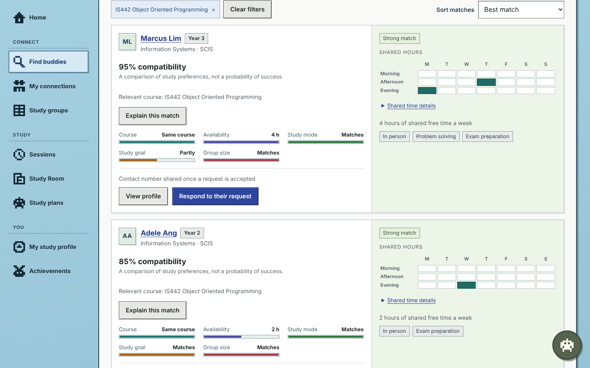
  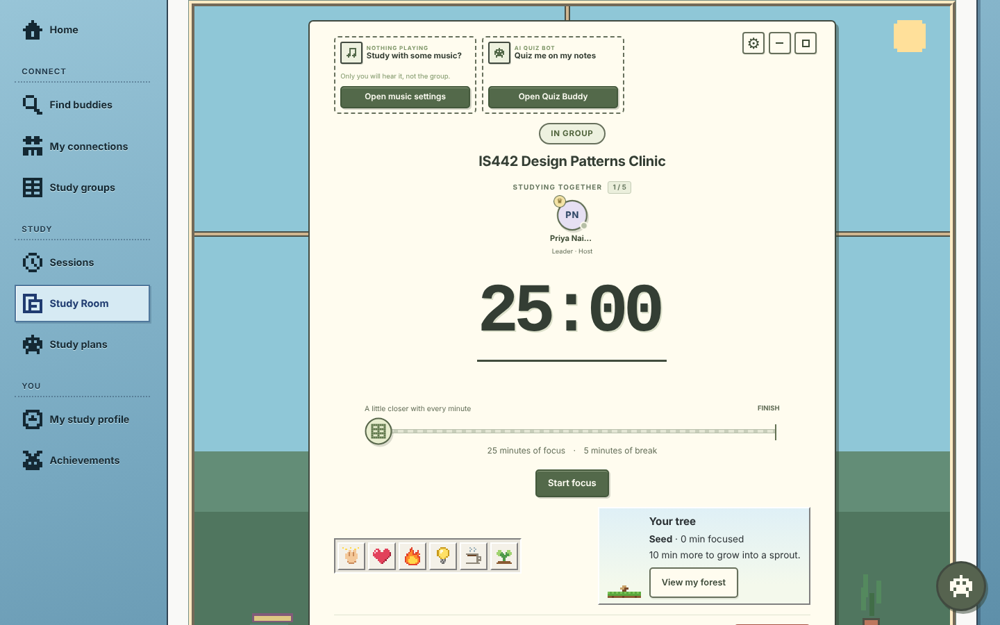
</p>

<sub>Narration is a synthetic voice and the music was generated in code (see [AI usage](docs/AI_USAGE.md)).
Full 1080p downloads: [launch film](docs/assets/video/study-buddy-launch-film.mp4) ·
[walkthrough](docs/assets/video/study-buddy-walkthrough.mp4).</sub>

## Features

| | Area | What it does |
| --- | --- | --- |
|  | **Matching** | Scores students on course, weekly availability, study mode, goals and group size, ranks them with one of three strategies and shows a breakdown of every score |
|  | **Connections and privacy** | Requests with an optional message become connections on acceptance; a contact number is revealed only to an active, accepted buddy |
|  | **Study groups** | Leaders create a group for a course, decide applications, remove members, update details and close the group |
|  | **Administration** | Create, edit, deactivate, reactivate and delete accounts, see basic usage, and configure matching criteria, weights and strategy |
|  | **Notifications and help** | Recipient-scoped updates in the menu bar, and a guide that recommends each student's next step from their real records |
|  | **E1: AI study assistance** | Match explanations, Quiz Buddy quizzes, personal and session study plans, and the Pixel assistant |
|  | **E2: Collaborative study** | Group study rooms, dated sessions with calendar export, a personal Study Room with music, reactions, a focus forest and achievements |

| Role | Can |
| --- | --- |
| Student | Edit profile, courses, preferences and weekly availability; search, compare and request buddies; end connections; browse, create and apply to groups; study in rooms; schedule buddy sessions; take quizzes, make study plans and ask Pixel; see achievements and their forest |
| Group leader | Everything a student can, plus edit the group, decide applications, remove members, close the group, schedule group sessions and their roadmap, assign room hosts and run group quizzes |
| Administrator | Manage accounts and their status, view basic usage, and configure matching criteria, weights and strategy |

A group leader is a student with authority over one group, not a separate account role. Every
requirement in the brief is mapped to its classes and tests in the
[requirement coverage map](docs/REQUIREMENT_COVERAGE.md).

## Two extensions

The course asks for two extra features beyond the compulsory requirements. Ours are one AI
extension and one collaboration extension, each built as a set of parts on a shared design.

### E1: AI study assistance

AI that explains and supports studying, grounded in the app's own data. Four parts share one
AI layer: an `AiClient` interface, per-feature `AiQuota` allowances, versioned `PromptTemplate`
files and an output validator per feature. Every AI reply is checked before it is saved or
shown, every part has a path that works without AI, and the AI provider never receives names,
emails or contact numbers. Google Gemini is the default provider; Anthropic Claude is an optional
second one that can be asked first or only when Gemini cannot answer
([switching AI provider](docs/CONFIGURATION.md#switching-ai-provider)). Disclosure and data handling are in [AI usage](docs/AI_USAGE.md).

| Part | What it adds |
| --- | --- |
| **Match explanations** | "Explain this match" words a card's anonymous score evidence; the deterministic explanation is the fallback |
| **Quiz Buddy** | Ten-question group or personal quizzes from uploaded PDF, `.txt` or `.md` notes; a group quiz can be for an upcoming session |
| **Study plans** | Week-by-week roadmaps to an exam, or a shared roadmap for a session's next meetings |
| **Pixel** | One message box that finds buddies, meeting times, to-dos, quizzes, plans and pages. Common questions are answered by rules with no AI call |

<p align="center">
  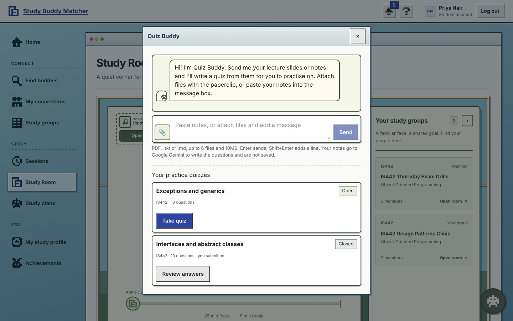
  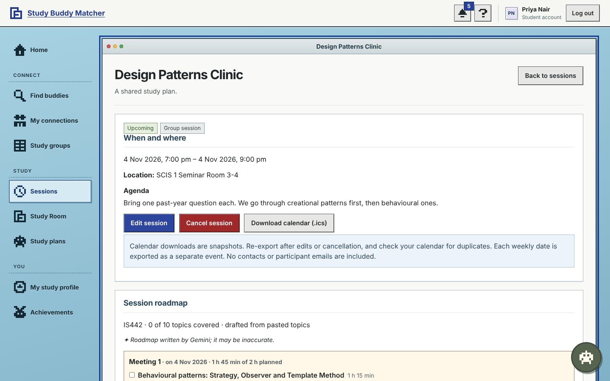
  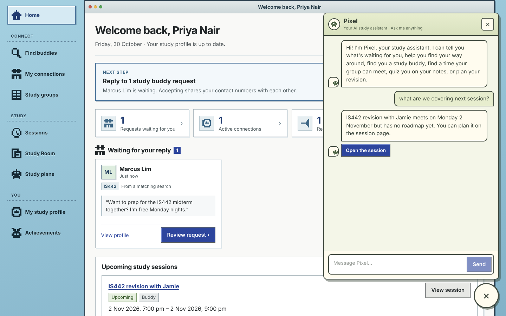
</p>

### E2: Collaborative study experience

Once students have found each other, the app gives them a place and a schedule to study together.
Each part has its own service, domain object and access check, and room and session access is
checked again on every request, so leaving a group ends access at once.

| Part | What it adds |
| --- | --- |
| **Group study rooms** | A shared Pomodoro per open group with a host and co-host, presence, reactions and weather scenes |
| **Study sessions** | One-off or weekly group and buddy sessions, times suggested from everyone's free hours, `.ics` export |
| **Study Room tab** | A personal Pomodoro beside every group room, with Spotify or Freesound ambient music in the student's own browser |
| **Focus forest and achievements** | One tree per room visit, grown by focused minutes, and seven private badges from real records |

<p align="center">
  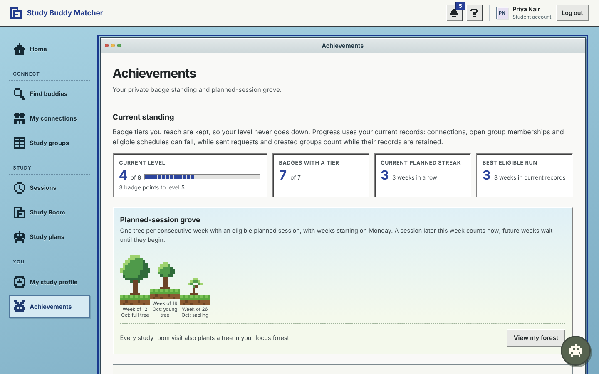
  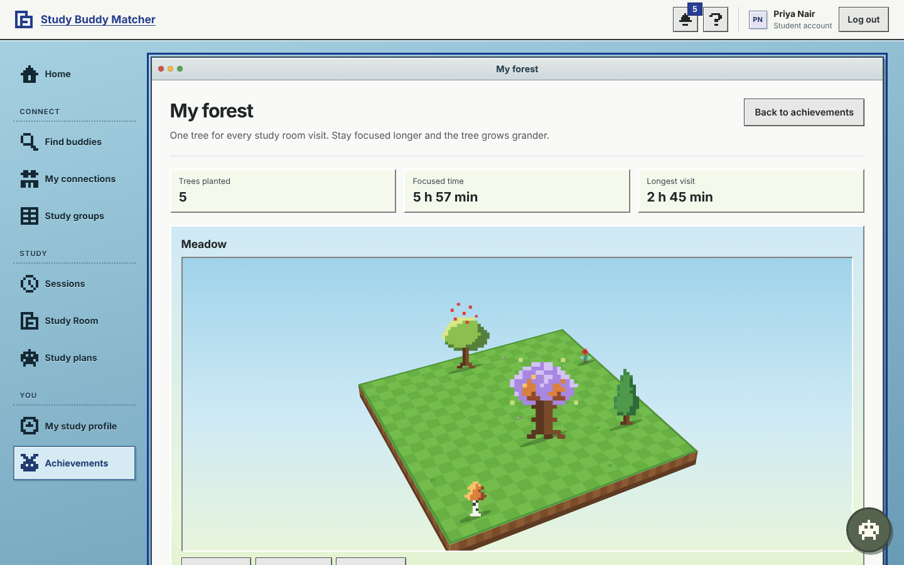
</p>

## Architecture

The backend is 25 feature packages under `com.studybuddy`, each layered the same way. Two rules
are checked on every pull request:

1. **Controllers never touch repositories.** A controller validates input, calls one service
   method and returns a DTO.
2. **Services never return entities to the API.** Entities stay behind the service; an
   assembler builds the DTO.

```text
Controller -> DTO / Assembler -> Service -> Domain model -> Repository -> PostgreSQL
```

Rule 2 is also the privacy mechanism: a contact number is withheld by choosing a DTO on the
server, never hidden in React.

[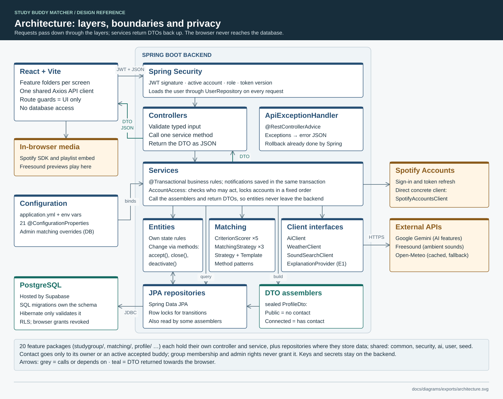](docs/diagrams/exports/architecture.svg)

[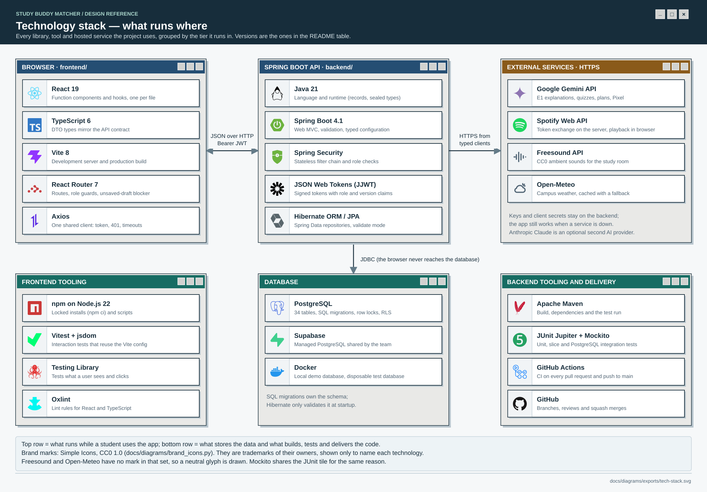](docs/diagrams/exports/tech-stack.svg)

### How the design meets the marking criteria

| The brief asks for | Where to see it |
| --- | --- |
| Modular code | One package per feature (`matching`, `matchrequest`, `studygroup`, `quiz`, `studyroom` and 20 more), each with its own controller, service, entities, repository, assembler and DTOs. Frontend screens mirror them in `frontend/src/features/` |
| Layered design | The two rules above, in every package. Access checks are their own classes (`RoomAccess`, `SessionAccess`, `QuizAccess`, `StudyPlanAccess`), and one `ApiExceptionHandler` turns domain exceptions into HTTP problems |
| Single responsibility | One class per job: five `CriterionScorer`s, assemblers apart from services, separate prompt builders and output validators per AI feature, `StudentDeactivation` apart from `StudentDeletion` |
| Polymorphism over `switch` | `CriterionScorer`, `MatchingStrategy` (with the `PriorityTierStrategy` template method), `AssistantIntent`, `AiClient`, `ExplanationProvider`, `WeatherClient`, `SoundSearchClient` |
| Encapsulation | Entities own their state machines: `MatchRequest`, `Connection`, `GroupJoinRequest`, `StudyGroup` and `Quiz` expose `accept()`, `decline()`, `end()`, `close()` and no status setter. `TimeSlot`, `MatchScore`, `MatchingWeights` and `PomodoroTimer` are immutable records |
| Composition over inheritance | `Student` shares its key with `User` (`@MapsId`) instead of extending it; a group leader is an ordinary student that a `StudyGroup` refers to |
| Externalised configuration | Weights, thresholds, limits, timings and provider settings live in `application.yml`, bound to typed objects such as `MatchingProperties`, `AuthProperties` and `QuizProperties`. Every key is in [configuration](docs/CONFIGURATION.md); secrets stay in a git-ignored file |
| Consistency under concurrency | Transitions lock accounts before their parent row and check observed versions (`DatabaseMutationLock`, `AccountAccess`); the races are covered by tests |
| Java conventions and clean code | Standard naming, constructor injection only, no magic numbers, names that say what the class is (`AvailabilityOverlapScorer`). The rules are in [AGENTS.md](AGENTS.md) |
| Tested | Over 130 backend test classes and 60 frontend test files, run by CI on every pull request. See [Testing](#testing) |

```text
backend/    Spring Boot feature packages, SQL migrations and tests
frontend/   React screens in src/features; client, auth and shared UI in src/shared
scripts/    Migration runner and disposable PostgreSQL test harness
docs/       API contract, design decisions, coverage, testing, database, configuration, diagrams
```

Each folder has its own short map: [backend](backend/README.md), [frontend](frontend/README.md),
[scripts](scripts/README.md) and [docs](docs/README.md).

## Design in detail

Open a section for its UML diagrams and the reasoning behind them. Every panel is an SVG in
[`docs/diagrams/exports/`](docs/diagrams/exports/); click one to open it full size. Notation,
editable sources are in the [diagram index](docs/diagrams/README.md); the full set of views,
in one document, is in the [design diagrams](docs/DESIGN_DIAGRAMS.md).

<details>
<summary><strong>System structure:</strong> use cases, packages and deployment</summary>

<br />

**Use cases.** Three actors: Student, Study Group Leader and System Administrator. A leader is
the student a group refers to, not a third account role; the only roles are `STUDENT` and
`ADMIN`. Every permission is checked on the server, so a hidden button grants nothing.

[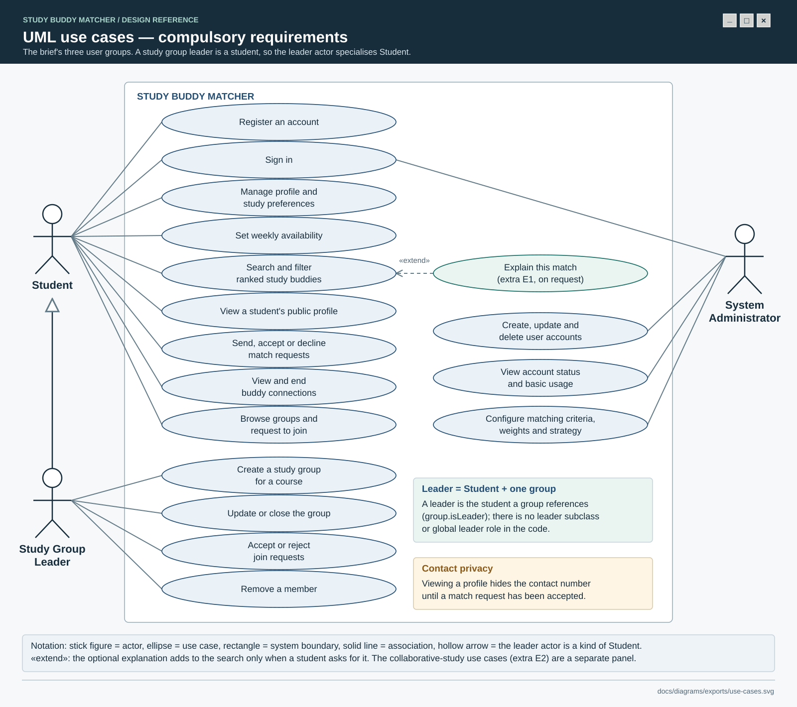](docs/diagrams/exports/use-cases.svg)

**Packages.** The 25 packages grouped by owning team, with one opened up to show the layers
inside it.

[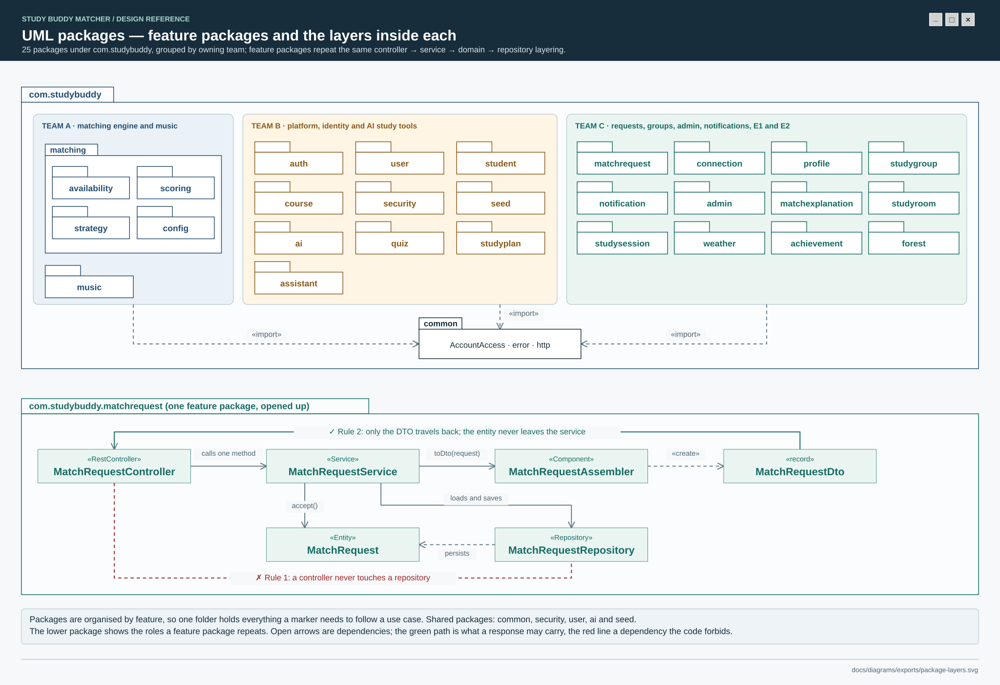](docs/diagrams/exports/package-layers.svg)

**Deployment.** The browser talks only to the Spring API. The database denies browser roles
(row-level security with no browser policies), so backend JDBC is the single access path.

[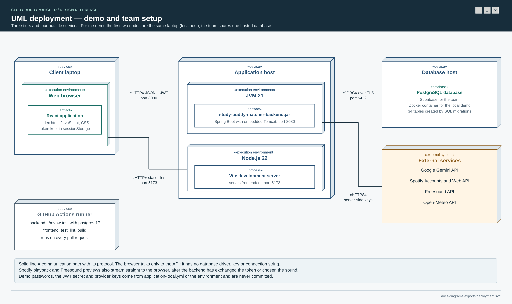](docs/diagrams/exports/deployment.svg)

| External service | Called by | Used for |
| --- | --- | --- |
| Google Gemini | Backend | Match explanations, quizzes, study plans and Pixel |
| Anthropic Claude (optional, off by default) | Backend | The same four AI features, as the first provider or as the backup when Gemini cannot answer |
| Spotify accounts service | Backend | Sign-in and token refresh only |
| Spotify Web Playback SDK | Browser | Premium playback in the study room; free mode uses Spotify's embedded player |
| Freesound | Backend (search), browser (preview audio) | CC0 ambient sounds |
| Open-Meteo | Backend | Cached campus weather for fixed coordinates; no student data is sent |

API keys and the Spotify client secret are configured only on the backend; none reaches the
browser. More views: [design diagrams, system overview](docs/DESIGN_DIAGRAMS.md#system-overview).

</details>

<details>
<summary><strong>Identity and profile:</strong> class diagram</summary>

<br />

`Student` is a one-to-one extension of `User` that shares its identity (`@MapsId`) rather than
a subclass: the account owns the profile (composition), so an administrator is a `User` with no
student profile. Registration creates `User` and `Student` in one transaction and can
only produce the `STUDENT` role. Each protected request checks the JWT's account, role, expiry
and version against the live account, so deactivation ends existing tokens at once. Saving
availability replaces the whole week in one write (`AvailabilityRules` validates it), so a
response never mixes two concurrent edits.

[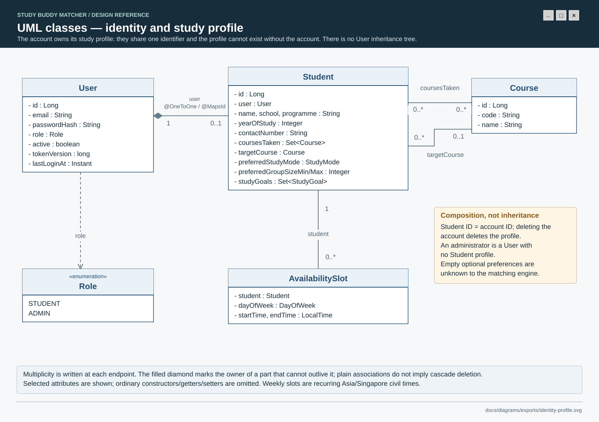](docs/diagrams/exports/identity-profile.svg)

</details>

<details>
<summary><strong>Matching engine:</strong> class and sequence diagrams</summary>

<br />

**Classes.** Each criterion is one `CriterionScorer` (`CourseScorer`,
`AvailabilityOverlapScorer`, `StudyModeScorer`, `StudyGoalScorer`, `GroupSizeScorer`). Scorers
are pure: no repository or controller access. `WeightedMatchScorer` combines them into an
immutable `MatchScore`. Ranking is a `MatchingStrategy`; the two priority strategies share
their banding through the `PriorityTierStrategy` template method and only name their criterion.
Adding a criterion or a strategy means adding a class, not editing a `switch`.

[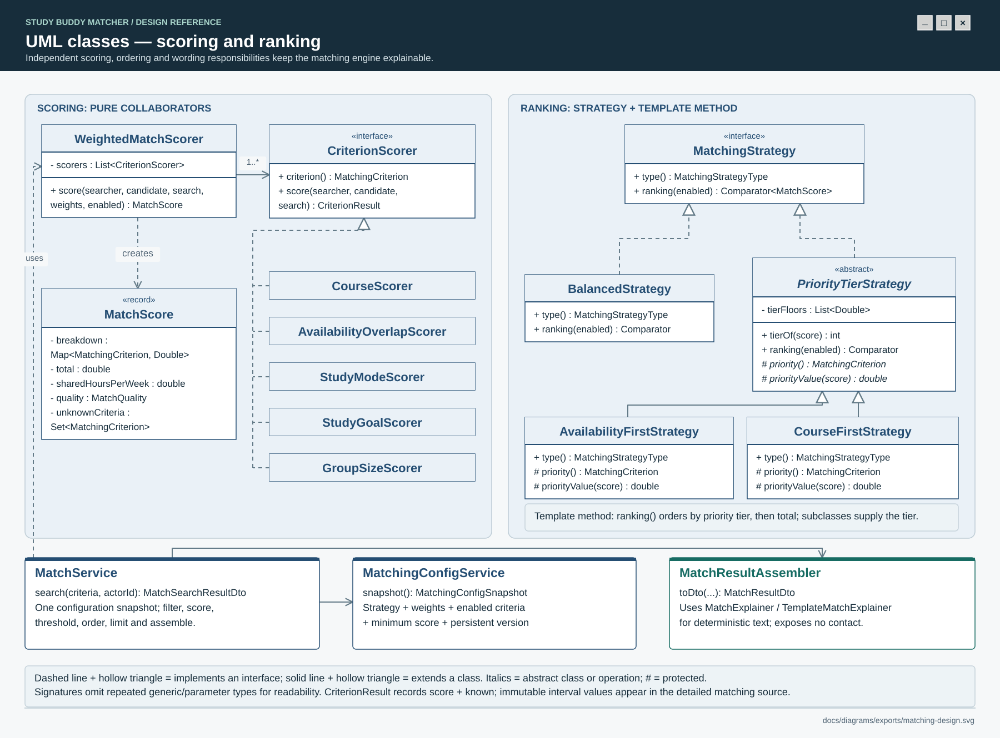](docs/diagrams/exports/matching-design.svg)

**Values.** `WeeklyAvailability` canonicalises `TimeSlot` intervals, and the sealed `ProfileDto`
has exactly two shapes, so a third, unchecked response cannot appear.

[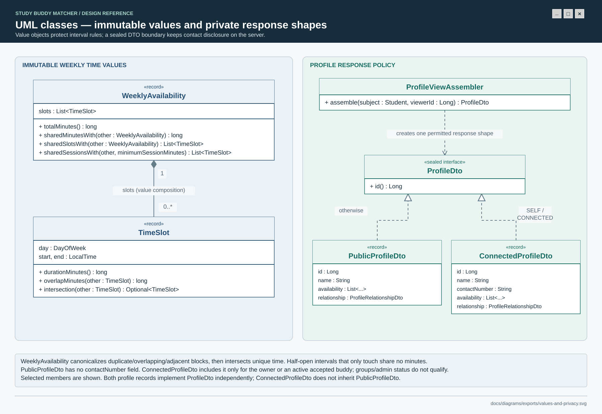](docs/diagrams/exports/values-and-privacy.svg)

**Search.** `MatchService.search` checks the account, reads one settings snapshot, scores each
candidate through the scorers, applies the threshold, ranks with the chosen strategy and hands
`MatchResultAssembler` the result. Discovery DTOs never carry a contact, email or entity.

[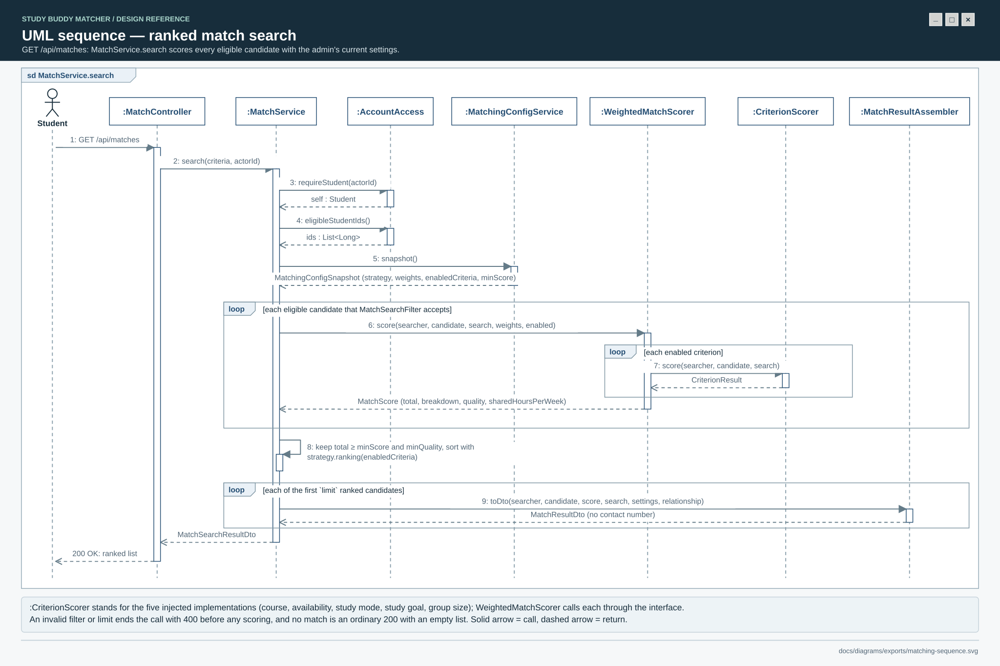](docs/diagrams/exports/matching-sequence.svg)

**Configuration.** `MatchingConfigService.update` checks the version the administrator loaded,
so a stale save is rejected instead of overwriting a colleague's change. The next search reads
the new snapshot. Defaults come from `application.yml`; stored overrides survive a restart.

[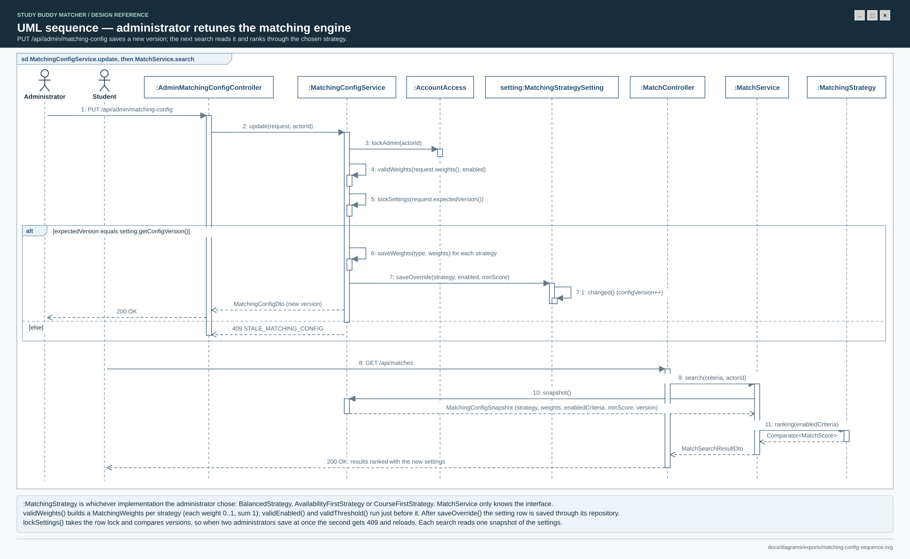](docs/diagrams/exports/matching-config-sequence.svg)

More views: [design diagrams, matching engine](docs/DESIGN_DIAGRAMS.md#matching-engine).

</details>

<details>
<summary><strong>Requests, connections, privacy and groups:</strong> class and sequence diagrams</summary>

<br />

**Classes.** Services coordinate transactions and authorisation; entities own their one-way
state transitions; assemblers choose the response fields. Group membership and connection are
separate consent relationships, and neither inherits from the other.

[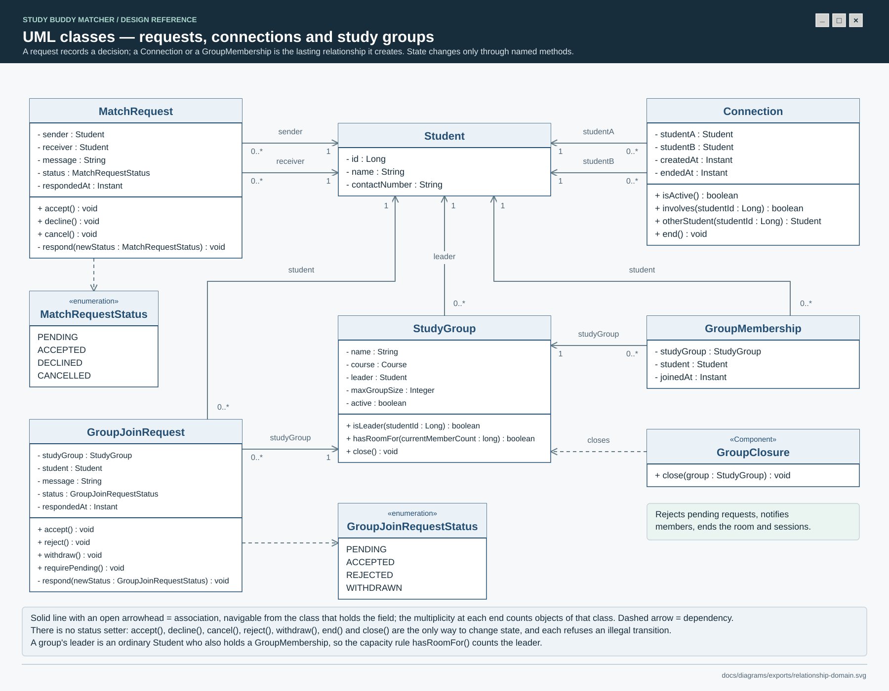](docs/diagrams/exports/relationship-domain.svg)

**Send and accept a request.** `MatchRequestService` rejects a request to yourself, to a
current buddy or over an existing pending request in either direction. Accepting and creating
the `Connection` happen in one transaction with the request row locked, so a double accept, or
an accept racing a decline, has exactly one outcome. Both notifications are written in the same
transaction.

[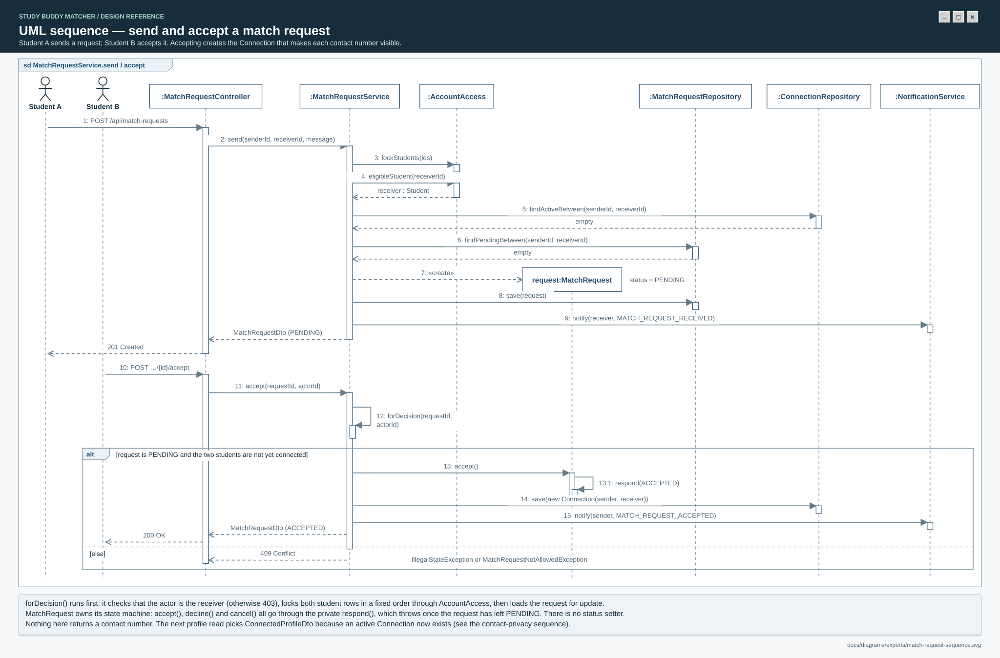](docs/diagrams/exports/match-request-sequence.svg)

**Who receives the contact number.** `ProfileViewService.view` asks `ProfileViewAssembler` for
a `ConnectedProfileDto` only when the viewer is the owner or an active accepted buddy;
everyone else, including group members and administrators, gets a `PublicProfileDto` with no
contact field. It is recomputed on every read, so the number disappears when a connection ends.

[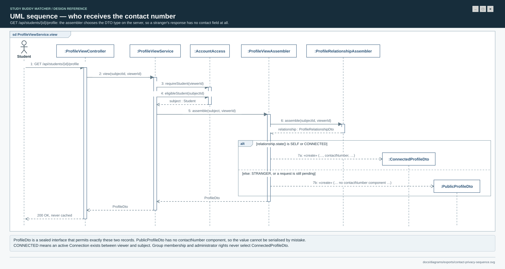](docs/diagrams/exports/contact-privacy-sequence.svg)

**Approve a group application.** `GroupJoinRequestService.accept` checks the caller leads this
group, locks the group row and checks capacity, so two approvals cannot both take the last
place.

[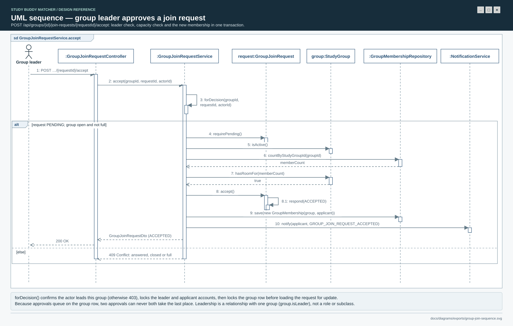](docs/diagrams/exports/group-join-sequence.svg)

More views: [design diagrams, requests, connections and contact privacy](docs/DESIGN_DIAGRAMS.md#requests-connections-and-contact-privacy)
and [study groups](docs/DESIGN_DIAGRAMS.md#study-groups).

</details>

<details>
<summary><strong>State machines:</strong> match request, connection, join request and study group</summary>

<br />

Each lifecycle is owned by its entity. The classes expose intention-revealing methods
(`accept()`, `decline()`, `cancel()`, `reject()`, `withdraw()`, `end()`, `close()`) and no
status setter, so an illegal transition cannot be written from outside the class. A transition
out of a final state throws, and the API reports it as `409`.

[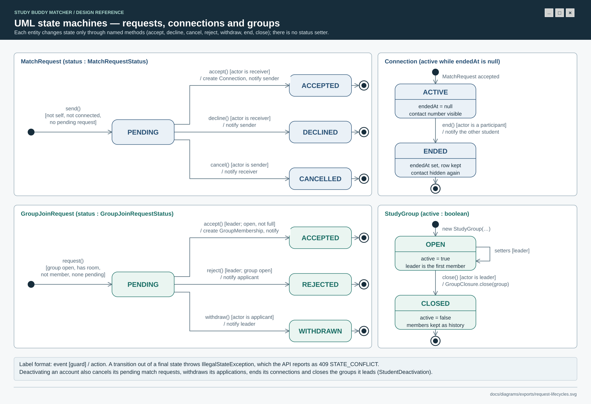](docs/diagrams/exports/request-lifecycles.svg)

| Lifecycle | Rules worth knowing |
| --- | --- |
| Match request | Only the receiver accepts or declines; only the sender withdraws. A declined or withdrawn request frees the pair to ask again |
| Connection | Either participant can end it. It keeps `endedAt` for history, and the pair may send a new request afterwards |
| Group join request | Pending applicants take no seat. Closing a group rejects its pending applications |
| Study group | A leader cannot leave their own group; they close it. A closed group rejects edits, approvals, removals and leaving |

</details>

<details>
<summary><strong>E1 AI study assistance:</strong> class and flow diagrams</summary>

<br />

**Shared AI layer.** Features depend on the `AiClient` interface, not on `GeminiClient`, so
tests supply a fake. Each feature holds its own `GeminiSettings` and `AiQuota`, so a quiz never
spends the allowance of Pixel or of match explanations. Every feature follows the same shape:
a prompt builder fills a versioned `PromptTemplate`, the client calls Gemini, and an output
validator (`QuizOutputValidator`, `StudyPlanOutputValidator`, `AssistantOutputValidator`,
`ExplanationOutputValidator`) rejects a reply before anything is saved or shown. A study-tool
failure becomes `AiUnavailableException` (`503`) and the screen offers the manual path; a
failed explanation returns the standard wording instead. `ClaudeClient` is a second `AiClient`
implementation: `AiProviders` puts it and the feature's `GeminiClient` into a
`FallbackAiClient` in the order `app.ai.primary-provider` sets, so the second provider is asked
only when the first cannot answer, and prompts and validators are the same for both. Every
feature's `ClaudeClient` shares one SDK client, built by `ClaudeConfiguration` only when Claude
is on and closed by Spring on shutdown.

[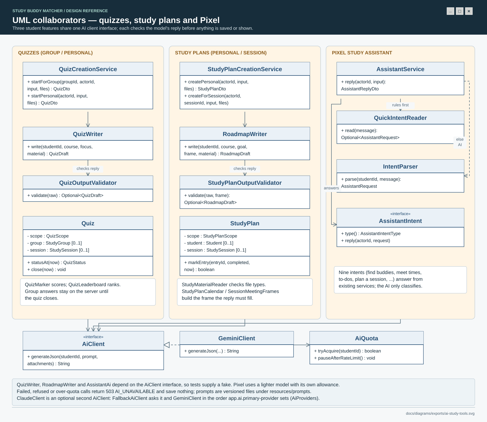](docs/diagrams/exports/ai-study-tools.svg)

| Part | Design point |
| --- | --- |
| Quiz Buddy | `QuizCreationService` runs a short checking read, the AI call, then a short write, so no database connection is held while Gemini answers. Answers stay on the server until the quiz closes |
| Study plans | `StudyPlanCalendar` frames the weeks or meetings on the server; Gemini plans only inside those blocks |
| Pixel | `QuickIntentReader` answers common questions by rules with no AI call. Otherwise `IntentParser` asks the AI only to classify; each `AssistantIntent` builds its reply from the app's own services, so the model cannot invent a buddy, time or task |

**Match explanation.** Java still calculates every score and rank; Gemini only words them, and
only when a student asks. `MatchExplanationService` first confirms the card is current (a
changed profile or configuration gives `409`), then `AiExplanationWriter` reduces it to
anonymous `ExplanationEvidence`, checks the cache and the quota, and calls the provider. Any
miss falls back to the deterministic `TemplateMatchExplainer` wording.

[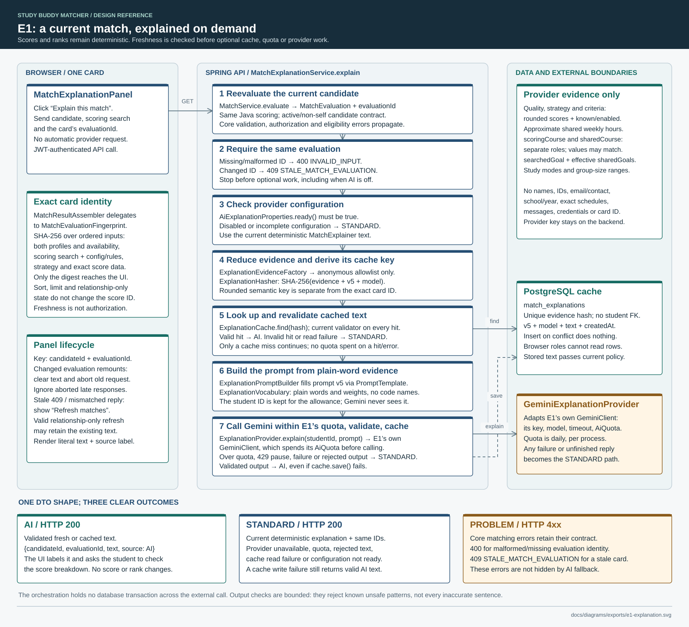](docs/diagrams/exports/e1-explanation.svg)

More views: [design diagrams, E1 AI study assistance](docs/DESIGN_DIAGRAMS.md#e1-ai-study-assistance).

</details>

<details>
<summary><strong>E2 collaborative study:</strong> use case and class diagrams</summary>

<br />

[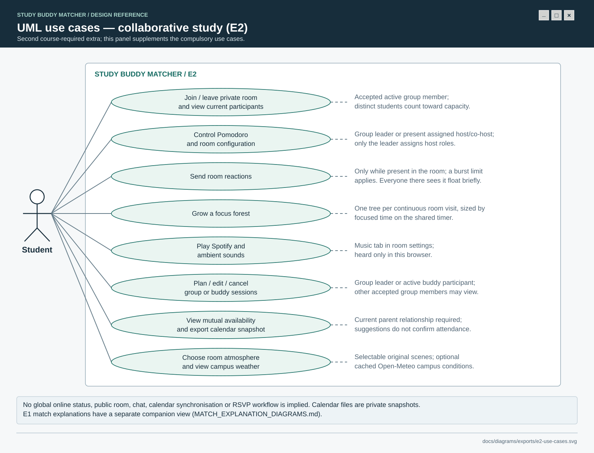](docs/diagrams/exports/e2-use-cases.svg)

Rooms, reactions, the forest, sessions and weather are separate services with separate
lifecycles. `RoomAccess` and `SessionAccess` recheck membership on every request, so leaving a
group, closing it, ending a connection or deactivating an account ends access at once.
`PomodoroTimer` is an immutable server-time value. The forest stays outside the room code:
`StudyRoomService` publishes `RoomVisitTicked` and `RoomVisitEnded`, and `ForestVisitListener`
credits focus time after the room transaction commits. `SessionAvailability` reuses the
matching engine's `WeeklyAvailability` maths to suggest times. `WeatherService` sends only
fixed campus coordinates through the `WeatherClient` interface.

[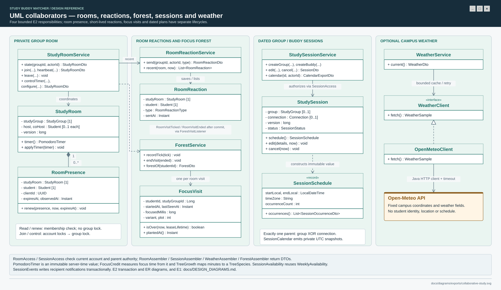](docs/diagrams/exports/collaborative-study.svg)

More views: [design diagrams, E2 collaborative study](docs/DESIGN_DIAGRAMS.md#e2-collaborative-study).

</details>

<details>
<summary><strong>Database:</strong> entity-relationship diagrams (34 tables)</summary>

<br />

Ordered SQL migrations own the schema; Hibernate runs in `validate` mode and never changes it.
`students` shares its primary key with `users`. Unique partial indexes allow one pending
request per pair of students, one active connection per pair and one pending application per
student and group, while keeping history. A `study_sessions` row belongs to exactly one group
or one connection (a database check).

**Compulsory features (17 tables)**

[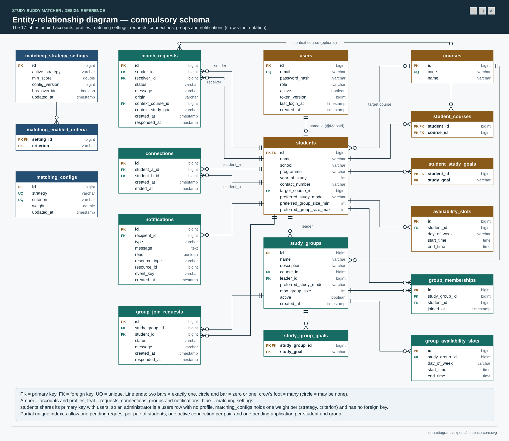](docs/diagrams/exports/database-core.svg)

**Added by the two extras (17 tables)**

[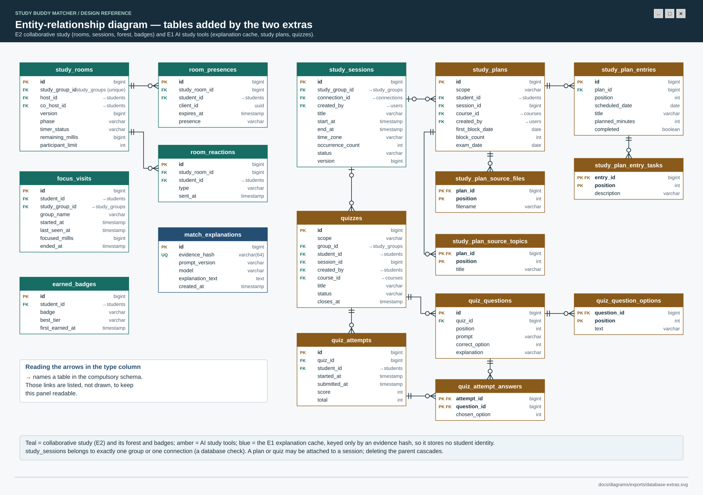](docs/diagrams/exports/database-extras.svg)

| Area | Tables |
| --- | --- |
| Accounts and profiles | `users`, `students`, `courses`, `student_courses`, `student_study_goals`, `availability_slots` |
| Buddies | `match_requests`, `connections` |
| Groups | `study_groups`, `study_group_goals`, `group_availability_slots`, `group_memberships`, `group_join_requests` |
| Notifications | `notifications` |
| Matching configuration | `matching_configs`, `matching_strategy_settings`, `matching_enabled_criteria` |
| Collaborative study | `study_rooms`, `room_presences`, `room_reactions`, `study_sessions`, `focus_visits`, `earned_badges` |
| AI features | `match_explanations`; `study_plans` and its four child tables; `quizzes`, `quiz_questions`, `quiz_question_options`, `quiz_attempts`, `quiz_attempt_answers` |

Migrations, access model and the demo seed are in the [database guide](docs/DATABASE.md).

</details>

## Matching engine

`GET /api/matches` needs a course or a study goal; mode, group-size, shared-time and quality
filters narrow it. Students never see themselves, inactive accounts or current buddies.

| Criterion | Score from 0 to 1 |
| --- | --- |
| Course | 1 if the candidate wants a buddy for the course in focus, `takes-course-score` (0.5) if they only take it, else 0 |
| Availability | Shared weekly minutes over the smaller timetable, counting shared blocks of at least 60 minutes |
| Study mode | 1 for the same mode or either student choosing `EITHER`, 0 for in-person against online |
| Study goals | Shared goals over the smaller goal set |
| Group size | 1 when the preferred size ranges overlap, else 0 |

| Strategy | Ranking |
| --- | --- |
| Balanced | Weighted total of the enabled criteria |
| Availability first | Shared-hour bands (3 h or more, 1 to 3 h, under 1 h), then the weighted total |
| Course first | Course-score bands, then the weighted total |

Compatibility is a weighted sum, not a probability of success. A preference either student left
empty scores 0 and shows as "Not shared", so missing data never outranks real compatibility.
Weekly slots are half-open Asia/Singapore times, so touching slots share no minutes. The brief's
Appendix A pair scores 0.85 Strong with 2 shared hours (`AppendixAMatchingTest`). The brief's
undefined "learning style" is covered by the defined study preferences, as recorded in the
[baseline contract](docs/DESIGN_DECISIONS.md#baseline-requirement-contract). Administrators
enable criteria and set each strategy's weights and minimum score; enabled weights sum to 1 and
stale saves are rejected. Formulas and alternatives are in the
[matching decisions](docs/DESIGN_DECISIONS.md#matching-decisions-team-a).

## Privacy and relationships

| Rule | Behaviour |
| --- | --- |
| Contact visibility | Returned only to the owner or an active accepted buddy; group membership and admin authority do not grant it |
| Contact format | An 8-digit Singapore number starting 6, 8 or 9 (stored with `+65`), or `+` and 7–15 digits |
| Connections | Accepting creates a connection; ending it removes contact access and cancels its upcoming sessions |
| Deactivation | Revokes sign-in and ends active relationships, keeping history; reactivation restores none of them |
| Deletion | Permanent; removes the account and its dependent records |

## Getting started

### Run it locally (about 5 minutes)

This path needs no shared database or keys: a local PostgreSQL in Docker, filled with the demo
data. It works on macOS, Linux and Windows.

| Install | Check it with |
| --- | --- |
| JDK 21 | `java -version` shows 21 |
| Node.js 22.22 or later (includes npm) | `node -v` shows v22.22 or higher |
| Docker Desktop, running | `docker info` succeeds |

1. **Get the code:** `git clone https://github.com/aryan12singh/study-buddy-matcher.git`, then
   `cd study-buddy-matcher`. Or use **Code → Download ZIP** on GitHub and unzip it.
2. **Start a database and create the tables** (run from the project folder):

   ```bash
   docker run -d --name studybuddy-db -e POSTGRES_PASSWORD=studybuddy -p 5432:5432 postgres:16
   docker exec studybuddy-db sh -c 'until pg_isready -h 127.0.0.1 -q; do sleep 1; done'
   cat backend/src/main/resources/db/migrations/*.sql | docker exec -i studybuddy-db psql -U postgres -q -v ON_ERROR_STOP=1 --single-transaction
   ```

   On Windows PowerShell, replace the last line with:
   `Get-Content backend/src/main/resources/db/migrations/*.sql | docker exec -i studybuddy-db psql -U postgres -q -v ON_ERROR_STOP=1 --single-transaction`
3. **Create `backend/src/main/resources/application-local.yml`** with this content. It is
   git-ignored and loads automatically. The secret can be any random text of 32 or more characters.

   ```yaml
   spring:
     datasource:
       url: jdbc:postgresql://localhost:5432/postgres
       username: postgres
       password: studybuddy
   jwt:
     secret: replace-with-any-random-text-of-at-least-32-characters
   ```

4. **Start the backend with the demo data.** The demo passwords are yours to choose (8 to 72
   characters). The three `DEMO_` variables are only needed on the first start.

   ```bash
   cd backend
   DEMO_SEED_ENABLED=true DEMO_STUDENT_PASSWORD=demo-pass-123 DEMO_ADMIN_PASSWORD=admin-pass-123 ./mvnw spring-boot:run
   ```

   On Windows PowerShell:
   `$env:DEMO_SEED_ENABLED="true"; $env:DEMO_STUDENT_PASSWORD="demo-pass-123"; $env:DEMO_ADMIN_PASSWORD="admin-pass-123"; .\mvnw.cmd spring-boot:run`

   Wait for `Started StudyBuddyApplication`. The first run downloads dependencies and takes a few minutes.

   Do not also put the demo passwords in `application-local.yml`: an
   `app.demo-seed.student-password` or `admin-password` set there overrides the `DEMO_`
   variables, so the passwords typed here would be silently ignored. If the file must keep
   them, pass `APP_DEMOSEED_STUDENTPASSWORD` and `APP_DEMOSEED_ADMINPASSWORD` instead, which do
   override it.
5. **Start the frontend** in a second terminal, from the project folder:

   ```bash
   cd frontend
   cp .env.example .env
   npm ci
   npm run dev
   ```

   (Windows: `copy .env.example .env` instead of `cp`.)
6. **Open `http://localhost:5173`** and sign in as `priya@demo.example.test` with
   `demo-pass-123`, or as `admin@demo.example.test` with `admin-pass-123`. The
   [demo data](#demo-data) table below says what each account shows.

To stop: `Ctrl+C` in both terminals, then `docker stop studybuddy-db`. To start again later,
run `docker start studybuddy-db` and repeat steps 4 to 6. Everything works without AI keys: the
AI screens say the helper is unavailable and fall back to standard wording, Pixel still answers
its suggested questions, and the Music tab's ambient sounds say they are not set up. To switch
them on, add the keys from [configuration](docs/CONFIGURATION.md#ai-match-explanations) to
`application-local.yml` and restart the backend. Each block is optional and independent:

```yaml
app:
  ai:
    explanation:
      enabled: true
      api-key: <Gemini API key>
    assistant:
      enabled: true
      api-key: <Gemini API key, ideally from a second Google project>
    # Optional second AI provider; see "Switching AI provider" in docs/CONFIGURATION.md.
    claude:
      enabled: true
      api-key: <Anthropic API key>
  ambient:
    api-key: <Freesound API key from https://freesound.org/apiv2/apply>
  spotify:
    client-id: <Spotify app client ID>
    client-secret: <Spotify app client secret>
```

Pixel's typed questions, Quiz Buddy and study plans need the `assistant` block (or `claude`);
"Explain this match" needs `explanation` (or `claude`); rain and the other ambient sounds need
`ambient`. The free Spotify playlist needs no key; "My Spotify (Premium)" needs the `spotify`
block, a Spotify Premium account, and your Spotify email added under **User Management** in the
team's Spotify app (or your own app from the
[Spotify developer dashboard](https://developer.spotify.com/dashboard), with the redirect URI
`http://127.0.0.1:8080/api/spotify/callback`). See
[configuration](docs/CONFIGURATION.md#study-room-music-spotify-and-freesound).

### Team setup (shared Supabase)

Team members use the shared Supabase database instead of Docker; its access details are shared
privately. Put its datasource in `application-local.yml` as above, apply new migrations with
`scripts/migrate-database.sh` (it needs `psql` and the `PGHOST`, `PGPORT`, `PGDATABASE`,
`PGUSER` and `PGPASSWORD` variables), and run steps 4 to 6 without the demo variables. The
migrations own the schema; the backend validates it at startup and never changes it. See the
[database guide](docs/DATABASE.md). The full backend test suite also needs Bash, Docker, the PostgreSQL client (`psql`) and OpenSSL; see
[Testing](#testing).

> [!IMPORTANT]
> Secrets live only in `application-local.yml` or the process environment. Anything prefixed
> `VITE_` is bundled into the public frontend, so never put a secret there.

<a id="demo-data"></a>
<details>
<summary><strong>Demo data</strong></summary>

<br />

Set `DEMO_SEED_ENABLED=true`, `DEMO_STUDENT_PASSWORD` and `DEMO_ADMIN_PASSWORD` for one startup
on a fresh database, then turn seeding off. The seeder adds **14 courses, 50 synthetic students
and one admin** from [`demo-data.json`](backend/src/main/resources/demo-seed/demo-data.json),
then replays a demo history through the real services. Quiz questions and roadmaps are written
in advance and pass the same checks as Gemini's replies, so every feature has something to show
with no AI keys. Repeat runs add nothing.

| Sign in as | Ready to demo |
| --- | --- |
| `priya@demo.example.test` (presenter) | A request from Marcus to accept (his contact then appears) and one to Sofia pending; Jamie connected; Alex ended; a declined and a withdrawn request in history. Leads *IS442 Design Patterns Clinic* with two applications to decide and a weekly Wednesday session with a seeded roadmap; member of *IS442 Thursday Exam Drills*. An open practice quiz to take live, a closed group quiz linked to the session with a leaderboard, an IS442 study plan, a three-week planned-session streak, seven badges and a five-tree forest |
| `appendix.a@demo.example.test` / `appendix.b@demo.example.test` | The brief's Appendix A pair: searching IS442 as Student A shows Student B at 0.85 Strong with 2 shared hours |
| `hannah@demo.example.test` / `ethan@demo.example.test` | A full group and a closed group |
| `admin@demo.example.test` | `ryan@demo.example.test` is already deactivated. Switching to Availability first moves Chen Xin Yi up Priya's IS442 results; Course first moves her down |

Contacts use the fictional +1 202-555-01xx range. Seeding and demo reset are in the
[database guide](docs/DATABASE.md).

</details>

<details>
<summary><strong>Troubleshooting</strong></summary>

<br />

| Symptom | Check |
| --- | --- |
| Java compiler or release error | Select JDK 21 and confirm `java -version` in the same terminal |
| Backend cannot connect, or a mapped column is missing | Check the datasource and that the database has every migration |
| Tests cannot connect after `./mvnw clean install` | Local YAML does not provision tests; use `scripts/test-backend.sh` |
| Browser requests fail | Check `VITE_API_BASE_URL`, backend startup and CORS; restart Vite after editing `.env` |
| AI screens or Pixel say the helper is unavailable | Expected without AI keys in your own `application-local.yml`; see [configuration](docs/CONFIGURATION.md#ai-study-assistant). Pixel's suggested questions still work |
| Rain or another ambient sound says it is not set up | Expected without `app.ambient.api-key`; see [configuration](docs/CONFIGURATION.md#study-room-music-spotify-and-freesound) |

</details>

## Testing

```bash
scripts/test-backend.sh                              # backend: disposable PostgreSQL 17, migrations, full suite
cd frontend && npm test && npm run lint && npm run build   # frontend: interactions, lint, type check, build
```

Each kind of rule is tested at the boundary where it can break. CI runs everything on every
pull request into `main`.

| Layer | What it proves |
| --- | --- |
| Unit tests | Pure rules with no I/O: scorers, `TimeSlot` interval maths, strategies, the entity state machines, the Pomodoro timer, session schedules, AI prompt builders and output validators |
| HTTP integration tests | The real Spring web, security, JWT and JPA stack on a real PostgreSQL: ownership and role checks, contact privacy, concurrency (last group place, simultaneous accept and decline), transactional rollback |
| Context-load test | Every bean wires, every configuration property binds and every entity matches the migrated schema |
| Migration tests | Fresh, legacy-upgrade, failed-preflight and repeated migrations |
| Frontend interaction tests | Rendered screens with Vitest and Testing Library: empty, loading and error states, form validation, unsaved-draft guards, confirmation dialogs |

External providers (Gemini, Claude, Open-Meteo, Spotify, Freesound) are never called by the default
suites; tests replace them through their interfaces. The brief's Appendix A example is a test
(`AppendixAMatchingTest`). The [testing guide](docs/TESTING.md) lists what each area's tests
check and gives step-by-step demo walkthroughs.

## Documentation

The [documentation index](docs/README.md) lists every document with one line each.

| Document | Contents |
| --- | --- |
| [Requirement coverage](docs/REQUIREMENT_COVERAGE.md) | Every brief requirement and extension mapped to its classes and tests |
| [Design decisions](docs/DESIGN_DECISIONS.md) | Agreed contracts, alternatives considered and scope boundaries |
| [API contract](docs/API_CONTRACT.md) | Endpoints, request and response shapes, authorisation and errors |
| [Testing](docs/TESTING.md) | Test strategy, coverage by area and demo walkthroughs |
| [Database](docs/DATABASE.md) | Access model, migrations, schema, seeding and the release runbook |
| [Configuration](docs/CONFIGURATION.md) | Every configuration key, its default and purpose |
| [Design diagrams](docs/DESIGN_DIAGRAMS.md) | The whole design in one document: system, core requirements, extras, database and state machines |
| [Diagram index](docs/diagrams/README.md) | All 21 panels with notation, editable sources and how to rebuild them |
| [Known limitations and future work](docs/LIMITATIONS_AND_FUTURE_WORK.md) | Deliberate boundaries and how the design extends |
| [AI usage](docs/AI_USAGE.md) | The application's own AI use and the AI tools used to build the project |
| [AGENTS.md](AGENTS.md), [UI guide](docs/UI_GUIDE.md), [team workflow](docs/TEAM_WORKFLOW.md) | Repository rules for people and coding assistants, the visual direction and shared components, milestones and reviews |

<a id="libraries"></a>

## Libraries and services

The [technology stack diagram](#architecture) shows what runs where. Versions match the
resolved Maven dependencies and the npm lockfile. No library outside this table may be added
without team agreement.

<details>
<summary><strong>Full library and service table:</strong> version, why we chose it, licence</summary>

<br />

| Library or service | Version | Why we chose it | Licence |
| --- | --- | --- | --- |
| Spring Boot (Web MVC, Data JPA, Security, Validation, Test) | 4.1.1 | Recommended by the brief; one framework gives layering, transactions, validation and security without wiring them by hand | Apache-2.0 |
| Hibernate ORM | 7.4.5.Final | Spring Boot's JPA provider; we use it in `validate` mode so the SQL migrations stay the source of truth | Apache-2.0 |
| PostgreSQL JDBC, on Supabase | 42.7.13 | Real constraints, partial unique indexes, row locks and row-level security, which an in-memory database would not test honestly; Supabase gives the team one shared managed instance | BSD-2-Clause |
| JJWT | 0.12.6 | We issue our own HMAC-signed tokens (HS256 to HS512, chosen by JJWT from the secret's length) with role and version claims; JJWT does exactly that, where an OAuth2 resource server expects a separate authorisation server | Apache-2.0 |
| Jackson 3 / 2 | 3.1.5 / 2.21.5 | Spring's JSON mapper; JJWT uses Jackson 2 | Apache-2.0 |
| Anthropic Java SDK (`anthropic-java`) | 3.3.0 | Official client for the optional Claude provider, used when Gemini's free quota or service is unavailable or when Claude is set as the primary provider; typed requests, errors and PDF input instead of hand-written HTTP | Apache-2.0 |
| JUnit Jupiter / Mockito | 6.0.3 / 5.23.0 | The Spring Boot test starter's defaults | EPL-2.0 / MIT |
| React / React DOM | 19.3.0 | Component model the team knew; function components and hooks keep screens small | MIT |
| React Router | 7.18.4 | Route guards per role and a navigation blocker for unsaved drafts | MIT |
| Axios | 1.20.0 | One shared client with interceptors for the token, sign-out on 401, timeouts and cancellation, which plain `fetch` would need hand-written | MIT |
| Vite / React plugin | 8.3.5 / 6.1.1 | Fast development server and build; Create React App is deprecated | MIT |
| TypeScript | 6.0.3 | DTO types mirror the API contract, so contract drift fails the build | Apache-2.0 |
| Oxlint | 1.83.0 | A fast linter that covers our React and TypeScript rules with no plugin setup | MIT |
| Vitest, jsdom, Testing Library (React, jest-dom) | 5.0.5, 30.1.0, 16.3.3 / 7.0.1 | Vitest reuses the Vite config instead of a separate Jest and Babel setup; Testing Library tests what a user sees and clicks | MIT |
| Anthropic API (optional, off by default) | Hosted | Second AI provider behind the same `AiClient` interface, so AI features keep working when Gemini's free tier runs out; receives the same minimal data as Gemini ([terms](https://www.anthropic.com/legal/commercial-terms)) | Service terms |
| Google Gemini API (free tier) | Hosted | Accepts PDFs directly and returns JSON, with a free tier for coursework; only anonymous or student-provided material is sent ([terms](https://ai.google.dev/gemini-api/terms)) | Service terms |
| Spotify Web API and Web Playback SDK | Hosted | Students play their own music; an embedded playlist works with no account ([terms](https://developer.spotify.com/terms)) | Service terms |
| Freesound API | Hosted | Ambient sounds filtered to CC0, so no per-sound credit is needed ([terms](https://freesound.org/help/tos_api/)) | CC0 sounds |
| Open-Meteo | Hosted | Free campus weather with no key or account ([terms](https://open-meteo.com/en/terms)) | CC BY 4.0 data |

</details>

<details>
<summary><strong>Visual assets</strong></summary>

<br />

Everything visual in the application is original work: the pixel-book logo, README icons (`docs/assets/icons/`),
interface icons and patterns (`PixelIcon.tsx`, `desktop.css`), achievement medallions, forest
trees and study-room scenery. Timer chimes are synthesised with Web Audio, so no sound files are
shipped. Text uses Tahoma, Verdana and system fonts. `frontend/src/index.css` carries a small
CSS reset adapted from Tailwind CSS's preflight (MIT). Weather data is attributed to Open-Meteo
on the room screen. The technology stack diagram alone uses brand marks, from Simple Icons
(CC0 1.0); they are trademarks of their owners and only name the technologies.

</details>

## Team and workflow

| Team | Members | Responsibility |
| --- | --- | --- |
| A | Natthida, Chong Yee, Joanne | Matching engine, discovery and matching configuration; the Study Room tab and its music |
| B | Angel, Averyl, Guang Hao | Platform, authentication, own profile, availability, seed, dashboard and shell; the E1 AI study tools (shared AI client, quizzes, study plans, Pixel) |
| C | Aryan, Charlize | Requests and connections, contact privacy, study groups, notifications and admin accounts; E1 match explanations; E2 rooms, sessions, weather, reactions, focus forest, help and achievements |

Within Team C, Charlize built the group and join-request rules, E1 match explanations, the help
guide, achievements, reactions and the focus forest. Aryan built requests, connections, profile
privacy, notifications and admin accounts, and the E2 rooms and sessions. Each member can explain
the implementation of their part.

**Contributing.** Read [AGENTS.md](AGENTS.md) and the [team workflow](docs/TEAM_WORKFLOW.md),
branch from an up-to-date `main`, keep commits focused, open a pull request with test evidence,
get a review from another team, then **Squash and merge**.
