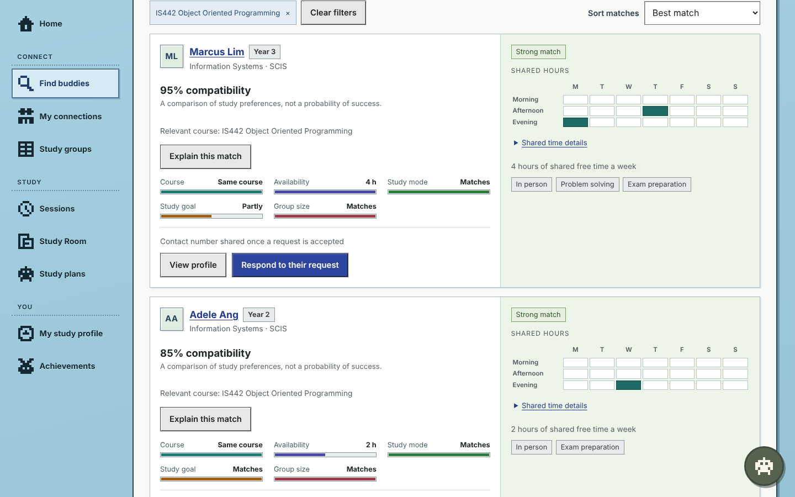
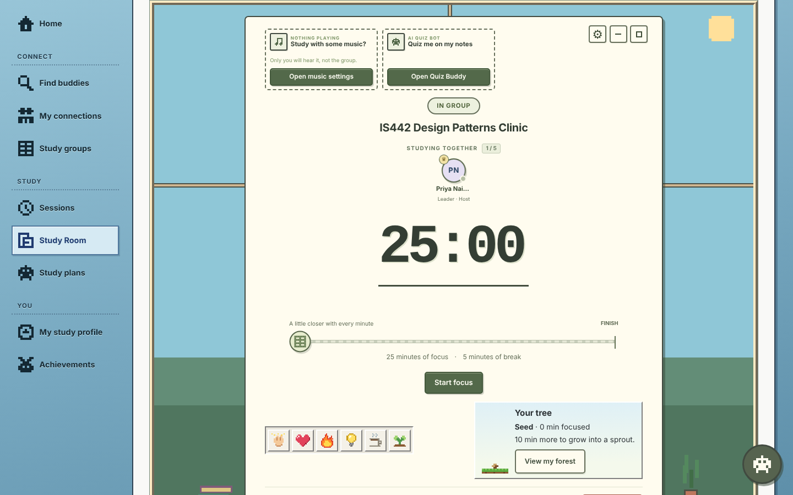
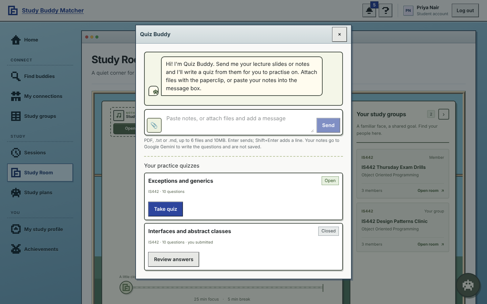
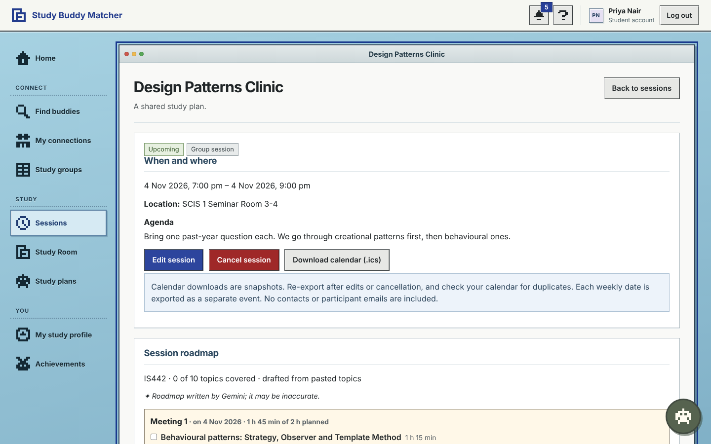
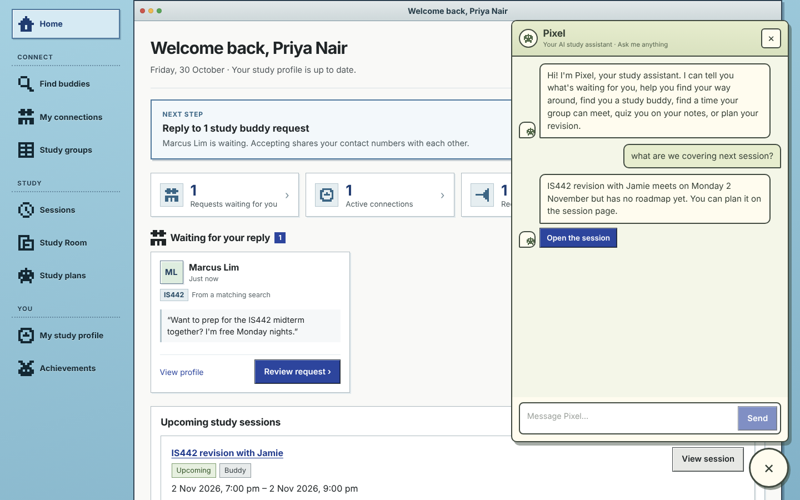
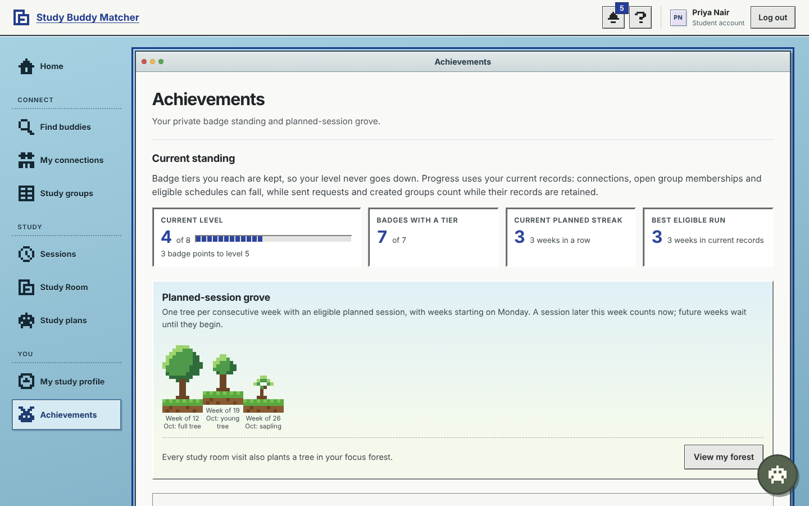
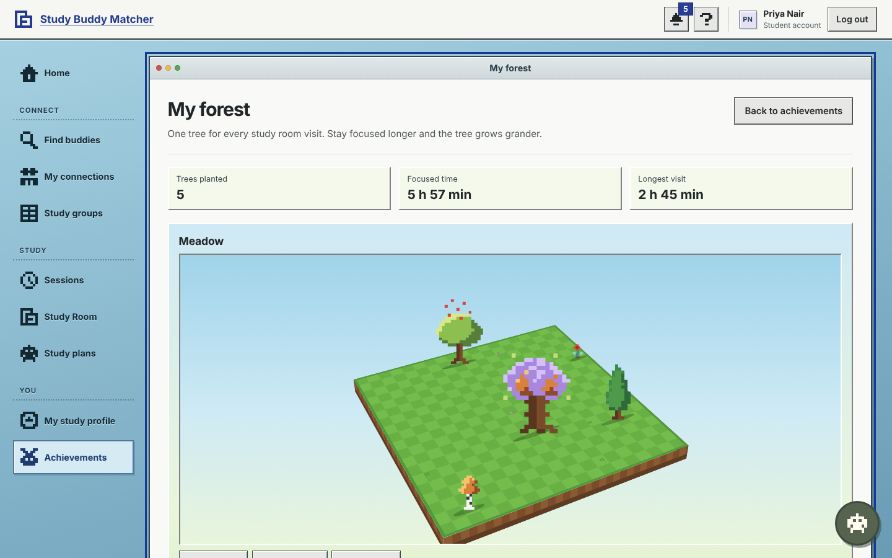

<p align="center">
  
</p>

<h1 align="center">Study Buddy Matcher</h1>

<p align="center">
  Find the right study partner, connect safely and study together.<br />
  Coursework for <strong>IS442 Object Oriented Programming</strong> at Singapore Management University.
</p>

<p align="center">
  <a href="https://github.com/aryan12singh/study-buddy-matcher/actions/workflows/ci.yml"></a>
  
  
  
  
</p>

<p align="center">
  
  
</p>

---

**Contents:** [Features](#features) · [Two extensions](#two-extensions) · [Architecture](#architecture) ·
[Matching engine](#matching-engine) · [Privacy](#privacy-and-relationships) ·
[Getting started](#getting-started) · [Testing](#testing) · [Documentation](#documentation) ·
[Libraries](#libraries) · [Team](#team-and-workflow)

## Features

| | Area | What it does |
| --- | --- | --- |
|  | **Matching** | Scores students on course, weekly availability, study mode, goals and group size, ranks them with one of three strategies and shows a breakdown of every score |
|  | **Connections and privacy** | Requests with an optional message become connections on acceptance; a contact number is revealed only to an active, accepted buddy |
|  | **Study groups** | Leaders create a group for a course, decide applications, remove members, update details and close the group |
|  | **Administration** | Create, edit, deactivate, reactivate and delete accounts, see basic usage, and configure matching criteria, weights and strategy |
|  | **Notifications and help** | Recipient-scoped updates in the menu bar, and a guide that recommends each student's next step from their real records |
|  | **E1: AI study assistance** | Match explanations, Quiz Buddy quizzes, personal and session study plans, and the Pixel assistant |
|  | **E2: Collaborative study** | Group study rooms, dated sessions with calendar export, a personal Study Room with music, reactions, a focus forest and achievements |

| Role | Can |
| --- | --- |
| Student | Edit profile, courses, preferences and weekly availability; search, compare and request buddies; end connections; browse, create and apply to groups; study in rooms; schedule buddy sessions; take quizzes, make study plans and ask Pixel; see achievements and their forest |
| Group leader | Everything a student can, plus edit the group, decide applications, remove members, close the group, schedule group sessions and their roadmap, assign room hosts and run group quizzes |
| Administrator | Manage accounts and their status, view basic usage, and configure matching criteria, weights and strategy |

A group leader is a student with authority over one group, not a separate account role. Every
requirement in the brief is mapped to its classes and tests in the
[requirement coverage map](docs/REQUIREMENT_COVERAGE.md).

## Two extensions

The course asks for two extra features beyond the compulsory requirements. Ours are one AI
extension and one collaboration extension, each built as a set of parts on a shared design.

### E1: AI study assistance

AI that explains and supports studying, grounded in the app's own data. Four parts share one
AI layer: an `AiClient` interface, per-feature `AiQuota` allowances, versioned `PromptTemplate`
files and an output validator per feature. Every Gemini reply is checked before it is saved or
shown, every part has a path that works without AI, and Gemini never receives names, emails or
contact numbers. Disclosure and data handling are in [AI usage](docs/AI_USAGE.md).

| Part | What it adds |
| --- | --- |
| **Match explanations** | "Explain this match" words a card's anonymous score evidence; the deterministic explanation is the fallback |
| **Quiz Buddy** | Ten-question group or personal quizzes from uploaded PDF, `.txt` or `.md` notes; a group quiz can be for an upcoming session |
| **Study plans** | Week-by-week roadmaps to an exam, or a shared roadmap for a session's next meetings |
| **Pixel** | One message box that finds buddies, meeting times, to-dos, quizzes, plans and pages. Common questions are answered by rules with no AI call |

<p align="center">
  
  
  
</p>

### E2: Collaborative study experience

Once students have found each other, the app gives them a place and a schedule to study together.
Each part has its own service, domain object and access check, and room and session access is
checked again on every request, so leaving a group ends access at once.

| Part | What it adds |
| --- | --- |
| **Group study rooms** | A shared Pomodoro per open group with a host and co-host, presence, reactions and weather scenes |
| **Study sessions** | One-off or weekly group and buddy sessions, times suggested from everyone's free hours, `.ics` export |
| **Study Room tab** | A personal Pomodoro beside every group room, with Spotify or Freesound ambient music in the student's own browser |
| **Focus forest and achievements** | One tree per room visit, grown by focused minutes, and seven private badges from real records |

<p align="center">
  
  
</p>

## Architecture

Feature packages follow a layered design. Controllers validate input and call one service
method; services apply domain rules and return DTOs built by assemblers. Controllers never touch
repositories and entities never leave the service layer. This is also the privacy mechanism: a
contact number is withheld by choosing a DTO, never hidden in React.

```text
Controller -> DTO / Assembler -> Service -> Domain model -> Repository -> PostgreSQL
```

[](docs/diagrams/exports/architecture.svg)

| Design principle | How it is applied |
| --- | --- |
| Single responsibility | One class per job: five `CriterionScorer`s, separate assemblers, access checks, prompt builders and validators |
| Polymorphism over `switch` | `CriterionScorer`, `MatchingStrategy` (with the `PriorityTierStrategy` template method), `AssistantIntent`, `AiClient`, `WeatherClient` |
| Immutable values | `TimeSlot`, `MatchScore`, `MatchingWeights` and `PomodoroTimer` are validated records with no setters |
| Composition over inheritance | `Student` shares its key with `User` (`@MapsId`); a group leader is an ordinary student |
| Externalised configuration | Weights, limits, timings and provider settings bind to typed `@ConfigurationProperties`; see [configuration](docs/CONFIGURATION.md) |
| Consistency under concurrency | Transitions lock accounts before their parent row and check observed versions; races are covered by tests |

```text
backend/    Spring Boot feature packages, SQL migrations and tests
frontend/   React screens in src/features; client, auth and shared UI in src/shared
scripts/    Migration runner and disposable PostgreSQL test harness
docs/       API contract, design decisions, coverage, testing, database, configuration, diagrams
```

The [diagram index](docs/diagrams/README.md) holds the UML use cases, class diagrams, the
matching sequence and the AI and collaborative-study views.

## Matching engine

`GET /api/matches` needs a course or a study goal; mode, group-size, shared-time and quality
filters narrow it. Students never see themselves, inactive accounts or current buddies.

| Criterion | Score from 0 to 1 |
| --- | --- |
| Course | 1 if the candidate wants a buddy for the course in focus, `takes-course-score` (0.5) if they only take it, else 0 |
| Availability | Shared weekly minutes over the smaller timetable, counting shared blocks of at least 60 minutes |
| Study mode | 1 for the same mode or either student choosing `EITHER`, 0 for in-person against online |
| Study goals | Shared goals over the smaller goal set |
| Group size | 1 when the preferred size ranges overlap, else 0 |

| Strategy | Ranking |
| --- | --- |
| Balanced | Weighted total of the enabled criteria |
| Availability first | Shared-hour bands (3 h or more, 1 to 3 h, under 1 h), then the weighted total |
| Course first | Course-score bands, then the weighted total |

Compatibility is a weighted sum, not a probability of success. A preference either student left
empty scores 0 and shows as "Not shared", so missing data never outranks real compatibility.
Weekly slots are half-open Asia/Singapore times, so touching slots share no minutes. The brief's
Appendix A pair scores 0.85 Strong with 2 shared hours (`AppendixAMatchingTest`). The brief's
undefined "learning style" is covered by the defined study preferences, as recorded in the
[baseline contract](docs/DESIGN_DECISIONS.md#baseline-requirement-contract). Administrators
enable criteria and set each strategy's weights and minimum score; enabled weights sum to 1 and
stale saves are rejected. Formulas and alternatives are in the
[matching decisions](docs/DESIGN_DECISIONS.md#matching-decisions-team-a).

## Privacy and relationships

| Rule | Behaviour |
| --- | --- |
| Contact visibility | Returned only to the owner or an active accepted buddy; group membership and admin authority do not grant it |
| Contact format | An 8-digit Singapore number starting 6, 8 or 9 (stored with `+65`), or `+` and 7–15 digits |
| Connections | Accepting creates a connection; ending it removes contact access and cancels its upcoming sessions |
| Deactivation | Revokes sign-in and ends active relationships, keeping history; reactivation restores none of them |
| Deletion | Permanent; removes the account and its dependent records |

## Getting started

| Requirement | Used for |
| --- | --- |
| JDK 21 in `JAVA_HOME` | Building and running the backend |
| Node.js 22 and npm | The frontend (matches CI) |
| `psql` and OpenSSL | Applying migrations and generating a signing key |
| A PostgreSQL database | The team uses shared Supabase; access is shared privately |
| Bash and Docker | The full backend test suite only |

1. **Install the frontend:** `cd frontend && cp .env.example .env && npm ci`. The `.env` points
   the frontend at `http://localhost:8080/api`.
2. **Add backend secrets** in `backend/src/main/resources/application-local.yml` (git-ignored,
   loaded by the default `local` profile):

   ```yaml
   spring:
     datasource:
       url: jdbc:postgresql://<host>:5432/postgres
       username: <database-user>
       password: <database-password>
   jwt:
     secret: <output of: openssl rand -base64 48>
   ```

3. **Apply the migrations** with `PGHOST`, `PGPORT`, `PGDATABASE`, `PGUSER` and `PGPASSWORD`
   set for that database: `scripts/migrate-database.sh`. The migrations own the schema; the
   backend validates it at startup and never changes it. See the [database guide](docs/DATABASE.md).
4. **Run** the backend (`cd backend && ./mvnw spring-boot:run`) and the frontend
   (`cd frontend && npm run dev`), then open `http://localhost:5173`.

> [!IMPORTANT]
> Secrets live only in `application-local.yml` or the process environment. Anything prefixed
> `VITE_` is bundled into the public frontend, so never put a secret there.

<details>
<summary><strong>Demo data</strong></summary>

<br />

Set `DEMO_SEED_ENABLED=true`, `DEMO_STUDENT_PASSWORD` and `DEMO_ADMIN_PASSWORD` for one startup
on a fresh database, then turn seeding off. The seeder adds **14 courses, 50 synthetic students
and one admin** from [`demo-data.json`](backend/src/main/resources/demo-seed/demo-data.json),
then replays a demo history through the real services. Quiz questions and roadmaps are written
in advance and pass the same checks as Gemini's replies, so every feature has something to show
with no AI keys. Repeat runs add nothing.

| Sign in as | Ready to demo |
| --- | --- |
| `priya@demo.example.test` (presenter) | A request from Marcus to accept (his contact then appears) and one to Sofia pending; Jamie connected; Alex ended; a declined and a withdrawn request in history. Leads *IS442 Design Patterns Clinic* with two applications to decide and a weekly Wednesday session with a seeded roadmap; member of *IS442 Thursday Exam Drills*. An open practice quiz to take live, a closed group quiz linked to the session with a leaderboard, an IS442 study plan, a three-week planned-session streak, seven badges and a five-tree forest |
| `appendix.a@demo.example.test` / `appendix.b@demo.example.test` | The brief's Appendix A pair: searching IS442 as Student A shows Student B at 0.85 Strong with 2 shared hours |
| `hannah@demo.example.test` / `ethan@demo.example.test` | A full group and a closed group |
| `admin@demo.example.test` | `ryan@demo.example.test` is already deactivated. Switching to Availability first moves Chen Xin Yi up Priya's IS442 results; Course first moves her down |

Contacts use the fictional +1 202-555-01xx range. Seeding and demo reset are in the
[database guide](docs/DATABASE.md).

</details>

<details>
<summary><strong>Troubleshooting</strong></summary>

<br />

| Symptom | Check |
| --- | --- |
| Java compiler or release error | Select JDK 21 and confirm `java -version` in the same terminal |
| Backend cannot connect, or a mapped column is missing | Check the datasource and that the database has every migration |
| Tests cannot connect after `./mvnw clean install` | Local YAML does not provision tests; use `scripts/test-backend.sh` |
| Browser requests fail | Check `VITE_API_BASE_URL`, backend startup and CORS; restart Vite after editing `.env` |
| AI screens say the helper is unavailable | Expected without Gemini keys; see [configuration](docs/CONFIGURATION.md#ai-study-assistant) |

</details>

## Testing

```bash
scripts/test-backend.sh                              # backend: disposable PostgreSQL 17, migrations, full suite
cd frontend && npm test && npm run lint && npm run build   # frontend: interactions, lint, type check, build
```

The backend harness checks fresh, repeated and legacy migrations, runs the unit, HTTP, JWT and
database suites, then removes its container. CI runs both on every pull request into `main`.
The [testing guide](docs/TESTING.md) covers the strategy, what each area's tests check and
step-by-step demo walkthroughs.

## Documentation

| Document | Contents |
| --- | --- |
| [Requirement coverage](docs/REQUIREMENT_COVERAGE.md) | Every brief requirement and extension mapped to its classes and tests |
| [Design decisions](docs/DESIGN_DECISIONS.md) | Agreed contracts, alternatives considered and scope boundaries |
| [API contract](docs/API_CONTRACT.md) | Endpoints, request and response shapes, authorisation and errors |
| [Testing](docs/TESTING.md) | Test strategy, coverage by area and demo walkthroughs |
| [Database](docs/DATABASE.md) | Access model, migrations, schema, seeding and the release runbook |
| [Configuration](docs/CONFIGURATION.md) | Every configuration key, its default and purpose |
| [Diagrams](docs/diagrams/README.md) | Architecture, UML use cases, classes and sequences, with editable sources |
| [Known limitations and future work](docs/FUTURE_WORK.md) | Deliberate boundaries and how the design extends |
| [AI usage](docs/AI_USAGE.md) | Development assistance and the application's own AI use |
| [Repository conventions](AGENTS.md) | Ownership, layering rules and review process |

<a id="libraries"></a>

## Libraries and services

Versions match the resolved Maven dependencies and the npm lockfile. No library outside this
table may be added without team agreement.

| Library or service | Version | Why we chose it | Licence |
| --- | --- | --- | --- |
| Spring Boot (Web MVC, Data JPA, Security, Validation, Test) | 4.1.1 | Recommended by the brief; one framework gives layering, transactions, validation and security without wiring them by hand | Apache-2.0 |
| Hibernate ORM | 7.4.5.Final | Spring Boot's JPA provider; we use it in `validate` mode so the SQL migrations stay the source of truth | Apache-2.0 |
| PostgreSQL JDBC, on Supabase | 42.7.13 | Real constraints, partial unique indexes, row locks and row-level security, which an in-memory database would not test honestly; Supabase gives the team one shared managed instance | BSD-2-Clause |
| JJWT | 0.12.6 | We issue our own HS256 tokens with role and version claims; JJWT does exactly that, where an OAuth2 resource server expects a separate authorisation server | Apache-2.0 |
| Jackson 3 / 2 | 3.1.5 / 2.21.5 | Spring's JSON mapper; JJWT uses Jackson 2 | Apache-2.0 |
| JUnit Jupiter / Mockito | 6.0.3 / 5.23.0 | The Spring Boot test starter's defaults | EPL-2.0 / MIT |
| React / React DOM | 19.3.0 | Component model the team knew; function components and hooks keep screens small | MIT |
| React Router | 7.18.4 | Route guards per role and a navigation blocker for unsaved drafts | MIT |
| Axios | 1.20.0 | One shared client with interceptors for the token, sign-out on 401, timeouts and cancellation, which plain `fetch` would need hand-written | MIT |
| Vite / React plugin | 8.3.0 / 6.1.1 | Fast development server and build; Create React App is deprecated | MIT |
| TypeScript | 6.0.3 | DTO types mirror the API contract, so contract drift fails the build | Apache-2.0 |
| Oxlint | 1.83.0 | A fast linter that covers our React and TypeScript rules with no plugin setup | MIT |
| Vitest, jsdom, Testing Library | 5.0.1, 30.1.0, 16.3.3 | Vitest reuses the Vite config instead of a separate Jest and Babel setup; Testing Library tests what a user sees and clicks | MIT |
| Google Gemini API (free tier) | Hosted | Accepts PDFs directly and returns JSON, with a free tier for coursework; only anonymous or student-provided material is sent ([terms](https://ai.google.dev/gemini-api/terms)) | Service terms |
| Spotify Web API and Web Playback SDK | Hosted | Students play their own music; an embedded playlist works with no account ([terms](https://developer.spotify.com/terms)) | Service terms |
| Freesound API | Hosted | Ambient sounds filtered to CC0, so no per-sound credit is needed ([terms](https://freesound.org/help/tos_api/)) | CC0 sounds |
| Open-Meteo | Hosted | Free campus weather with no key or account ([terms](https://open-meteo.com/en/terms)) | CC BY 4.0 data |

<details>
<summary><strong>Visual assets</strong></summary>

<br />

Everything visual is original work: the pixel-book logo, README icons (`docs/assets/icons/`),
interface icons and patterns (`PixelIcon.tsx`, `desktop.css`), achievement medallions, forest
trees and study-room scenery. Timer chimes are synthesised with Web Audio, so no sound files are
shipped. Text uses Tahoma, Verdana and system fonts. `frontend/src/index.css` carries a small
CSS reset adapted from Tailwind CSS's preflight (MIT). Weather data is attributed to Open-Meteo
on the room screen.

</details>

## Team and workflow

| Team | Members | Responsibility |
| --- | --- | --- |
| A | Natthida, Chong Yee, Joanne | Matching engine, discovery and matching configuration; the Study Room tab and its music |
| B | Angel, Averyl, Guang Hao | Platform, authentication, own profile, availability, seed, dashboard and shell; the E1 AI study tools (shared AI client, quizzes, study plans, Pixel) |
| C | Aryan, Charlize | Requests and connections, contact privacy, study groups, notifications and admin accounts; E1 match explanations; E2 rooms, sessions, weather, reactions, focus forest, help and achievements |

Within Team C, Charlize built the group and join-request rules, E1 match explanations, the help
guide, achievements, reactions and the focus forest. Aryan built requests, connections, profile
privacy, notifications and admin accounts, and the E2 rooms and sessions. Each member can explain
the implementation of their part.

**Contributing.** Read [AGENTS.md](AGENTS.md), branch from an up-to-date `main`, keep commits
focused, open a pull request with test evidence, get a review from another team, then **Squash
and merge**.
