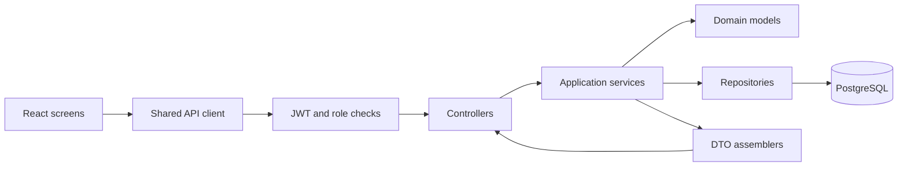

<p align="center">
  
</p>

# Study Buddy Matcher

A coursework web application for **IS442 Object Oriented Programming at SMU**. Students find
study partners from their courses, weekly availability and study preferences, then connect
and form study groups. Administrators manage accounts and configure matching rules.

**Java 21 · Spring Boot · React · Vite · PostgreSQL**

[Quick start](#getting-started) · [Architecture](#architecture) · [Matching](#matching-engine) ·
[Testing](#testing) · [Documentation](#documentation) · [Libraries](#libraries)

## Overview

The compulsory application covers Teams A, B and C. Selected E1/E2 extensions and final
presentation/submission materials are tracked separately in the
[requirement coverage map](docs/REQUIREMENT_COVERAGE.md#selected-extras-and-delivery).

| User | Supported workflows |
| --- | --- |
| Student | Register/sign in; edit profile, courses and preferences; manage weekly availability; search and compare matches; send/answer requests; end connections; browse/create/apply to groups; read notifications |
| Group leader | Edit a group, approve/reject applications, remove members and close the group |
| Administrator | Create/edit accounts, view status and usage, deactivate/reactivate or permanently delete accounts, configure matching criteria/weights/strategy |

A leader is a student with authority over one group, not a third account role. Another
student's contact number is returned only to the owner or an active accepted buddy.
Group membership and administrator authority do not grant contact read access.

## Getting Started

### Prerequisites

| Requirement | Use |
| --- | --- |
| JDK 21 selected in `JAVA_HOME` | Compile and run the backend |
| Node.js 22 and npm | Matches the frontend CI runtime |
| Git | Obtain the source |
| `psql` and OpenSSL | Apply migrations and generate private signing keys |
| A reachable PostgreSQL database | The team uses shared Supabase; access is provided privately |
| Bash and running Docker | Full backend tests only; the harness creates disposable PostgreSQL 17 |

### 1. Obtain the source and install

```bash
git clone https://github.com/aryan12singh/study-buddy-matcher.git
cd study-buddy-matcher

cd frontend
cp .env.example .env
npm ci
cd ..
```

### 2. Configure local credentials

Create **`backend/src/main/resources/application-local.yml`**. It is ignored by Git and
loads automatically because the default Spring profile is `local`.

```yaml
spring:
  datasource:
    url: jdbc:postgresql://<host>:5432/postgres
    username: <database-user>
    password: <database-password>
jwt:
  secret: <random-signing-key>
```

Generate the signing key with `openssl rand -base64 48`. Keep database credentials, signing
keys and demo passwords private. Frontend `VITE_` values are public bundle configuration;
never use them for secrets.

The copied **`frontend/.env`** contains:

```dotenv
VITE_API_BASE_URL=http://localhost:8080/api
```

### 3. Prepare the database and package

Apply the existing ordered migrations to the same target as the backend datasource. Set
`PGHOST`, `PGPORT`, `PGDATABASE`, `PGUSER` and `PGPASSWORD` privately, then run:

```bash
scripts/migrate-database.sh
cd backend
./mvnw -DskipTests package
cd ..
```

For the shared database, follow the operator's
[deployment and recovery record](docs/DATABASE_OPERATIONS.md). Do not reset it to provision
local tests. Hibernate `update` does not replace the migration constraints, legacy adoption,
indexes or RLS/grants. The test profile validates a freshly migrated schema.

The development package command skips tests. Local application YAML configures the running
app; it does not provision the test database. Use the isolated harness in [Testing](#testing).

### 4. Start both applications

```bash
# Terminal 1: backend
cd backend
./mvnw spring-boot:run
```

```bash
# Terminal 2: frontend
cd frontend
npm run dev
```

Open [http://localhost:5173](http://localhost:5173). The backend API is
[http://localhost:8080/api](http://localhost:8080/api).

### Demo data

The opt-in seeder adds **10 courses, 50 varied synthetic student profiles and one admin**.
Use `DEMO_SEED_ENABLED=true`, `DEMO_STUDENT_PASSWORD` and `DEMO_ADMIN_PASSWORD` for one approved
startup, then disable seeding. Passwords belong in private configuration or the process
environment. Repeat runs add only missing data; existing passwords, profiles and groups
are preserved.

Demo identities include `priya@demo.example.test`, `jamie@demo.example.test`,
`alex@demo.example.test`, `student04@demo.example.test` through `student50@demo.example.test`,
and `admin@demo.example.test`. Contacts are synthetic and must not be used to contact anyone.
See [safe seeding](docs/DATABASE_OPERATIONS.md#safe-demo-seed).

### Troubleshooting

| Symptom | Check |
| --- | --- |
| Java compiler/release error | Select JDK 21 and verify `java -version` in the same terminal |
| Tests cannot connect after `clean install` | Use the development package command or the isolated harness; local YAML is not test provisioning |
| Backend cannot connect or a mapped column is missing | Verify the private datasource and the target's ordered migrations |
| Test container cannot start | Start Docker; check `psql`/OpenSSL and access to `postgres:17` |
| Browser requests fail | Check `VITE_API_BASE_URL`, backend startup and CORS; restart Vite after changing `.env` |
| Courses/demo students are absent | Run the opt-in seed procedure on the approved target |

## Architecture

The backend uses feature packages and conventional layered OO design. Controllers validate
input and call services. Services apply domain rules and return DTOs assembled at the API
boundary; controllers never access repositories, and persistence entities never become API
payloads.



`Student` composes `User` through a shared `@MapsId` identity. Immutable `TimeSlot` and
`MatchScore` values, independent `CriterionScorer` implementations and polymorphic
`MatchingStrategy` implementations keep matching responsibilities separate. Relationship
and account mutations use documented lock ordering; full profile/availability replacements
serialize per account. Supabase browser roles cannot read the application tables directly.

```text
backend/   Spring Boot, feature services/domain/DTOs, SQL migrations and tests
frontend/  React screens under src/features; client/auth/UI under src/shared
scripts/   Ordered migration runner and isolated PostgreSQL test harness
docs/      Contracts, decisions, coverage, diagrams and verification
```

See [platform diagrams](docs/diagrams/PLATFORM.md), [matching diagrams](docs/diagrams/TEAM_A.md)
and [connection/group diagrams](docs/diagrams/TEAM_C.md) for class and sequence detail.

## Matching Engine

Find buddies and Home use `GET /api/matches`. A search needs a current course or study goal;
optional mode, group-size, shared-time and quality filters narrow the results. Self,
inactive/deleted accounts and active buddies are excluded. Pending requests remain visible
with a disabled duplicate-send action. Home shows up to three of the returned candidates.

Each enabled criterion produces a score from 0 to 1. Compatibility is the weighted sum,
not a probability of success. Missing preferences score a neutral 0.5; explicit filters
still require the candidate to satisfy the selected preference.

| Criterion | Rule |
| --- | --- |
| Course | Candidate targets the current course: 1; enrolled only: 0.5; no alignment: 0. Current search takes precedence over the saved target; no focus: 0.5 |
| Availability | Unique shared weekly minutes divided by the caller's unique available minutes; missing availability: 0.5 |
| Study mode | Same mode or either person's `EITHER`: 1; in-person versus online: 0; missing: 0.5 |
| Study goals | Shared selected/saved focus goals divided by focus goal count; missing: 0.5 |
| Group size | Preferred numeric ranges overlap: 1; disjoint: 0; missing: 0.5 |

Balanced ranks by weighted total. Availability-first or course-first ranks by its enabled
priority criterion, then total; disabling the priority falls back to total. Alternative
sorts start with shared hours or same-year preference, then the strategy. Name and ID break
ties. The server filters/sorts before applying the configured result limit, and the frontend
preserves its ordering across quality labels.

Weekly slots use recurring Asia/Singapore time and half-open boundaries. Touching slots
share no minutes; duplicate/overlapping/adjacent inputs are merged before counting overlap.
The categorical group-size UI maps to numeric ranges: one-to-one 2–2, small group 3–maximum,
and either 2–maximum. The team interprets the brief's undefined “learning style” wording
through the defined study preferences; no separate taxonomy or sixth scorer is invented.

Admin configuration enables criteria, edits each strategy's weights and minimum score,
and persists versioned overrides. Enabled weights sum to 1; disabled weights are 0.
Stale saves conflict, and each search uses one coherent settings snapshot. Restore defaults
uses current external startup configuration. Full formulas and alternatives are in
[design decisions](docs/DESIGN_DECISIONS.md#matching-decisions-team-a).

## Profile and Relationship Contracts

Contact input accepts an 8-digit Singapore number starting with 6, 8 or 9, or an international
number beginning `+` with 7–15 digits (first digit 1–9). Spaces, hyphens, parentheses and dots
are removed; local Singapore numbers are stored with `+65`. This is format validation,
not verification of a carrier, country assignment or reachable phone. The same rule applies
to registration, own-profile updates and admin contact replacement.

Existing legacy contacts are not rewritten by this change. They remain protected by the
same read policy; a replacement/full profile write must supply a valid contact. Omitting
contact in an admin edit preserves the existing value. New demo records use valid synthetic
formats, while reseeding preserves existing data.

Profile details and weekly availability save separately. An error refreshing one after a
successful save keeps the owner's other draft and discard warning available; logout,
identity change and lost authorization clear it. Invalid time drafts block writes.
An empty personal week is allowed while onboarding remains visibly incomplete. Personal
slots reject overlap; group schedules may be empty or overlapping.

Buddy acceptance creates an active connection; ending it removes contact access. Group
leaders decide applications, count toward capacity, remove members and close groups.
Notifications are recipient-scoped. Deactivation revokes access and ends active relationships;
reactivation requires fresh sign-in and restores none. Permanent deletion removes dependent
records. Administrator contact input is write-only. See the [API contract](docs/API_CONTRACT.md).

## Collaborative Study

Accepted members of an open group can enter a private room with a durable shared Pomodoro,
expiring presence and leader-assigned host/co-host controls. A present host/co-host can tune
durations and capacity; only the leader assigns roles. Removing membership revokes both
browser leases and delegated roles, so readmission cannot revive old room access.

Original native Web Audio supplies independently selectable music and ambience. Shared
play/pause selections persist. This browser remembers its separate layer volume and mute
preferences; playback still needs explicit enable after entering or rejoining a room.
Unavailable or malformed local storage falls back to safe mixer defaults. A discreet,
polite phase cue announces observed focus/break transitions without reading the countdown
every second or replaying missed transitions on reconnect.
The timer continues through disconnects; two-second polling reconciles shared controls with
local countdown rendering. Audio playback positions are not synchronized.

Group leaders schedule dated group sessions, and connected buddies manage private sessions
for their active connection. Sessions support agendas, locations, valid IANA timezones,
mutual weekly availability suggestions, updates/cancellation and bounded weekly repetition.
Choose a positive whole-minute duration for suggestions (60 minutes initially): a 45-minute
choice inside a shared 10:00–12:00 window fills 10:00–10:45, while shorter windows are omitted.
Choosing a duration leaves entered dates untouched until a suggestion is selected, and manual
scheduling stays available when no window fits. Existing server time/DST validation still applies.
Actual current/upcoming sessions appear on Home, group agendas and notifications. Session
labels and room shortcuts update at occurrence boundaries, including after returning to a tab;
completed and cancelled plans have no room shortcut. Safe saved room links open a preview
where joining remains explicit. Calendar downloads
contain single or explicit weekly occurrences with stable IDs and UTC times preserving local
wall time across DST. Downloads are snapshots: changed/cancelled sessions require re-export;
remove a prior import before replacing it if the calendar client does not reconcile IDs.
No calendar OAuth, attendance booking or two-way sync is included.

The room's original pixel-window scene follows live SMU-campus weather through the approved
Open-Meteo service, with selectable clear/cloud/rain/storm/snow/fog atmospheres and Singapore
day/night styling. Server caching bounds provider requests; failure uses labelled last-known
conditions or daylight/manual fallback. No device location, student information or JWT is sent
to the provider. Decorative motion respects reduced-motion settings and does not change audio.

Apply all ordered migrations before starting against a shared database. Source contracts and
verification are in [the E2 guide](docs/E2_TESTING.md) and
[bonus plan](docs/BONUS_IMPLEMENTATION_PLAN.md). E1 AI match explanations remain separate.

## Configuration

Only `VITE_`-prefixed values reach the frontend, and they end up in the public bundle, so
never put a secret there. Database credentials, the JWT secret and demo passwords belong
in `application-local.yml` or the process environment.

| Key | Default / requirement | Purpose |
| --- | --- | --- |
| `SPRING_PROFILES_ACTIVE` | `local` | Loads `application-local.yml` in development |
| `SPRING_DATASOURCE_URL` / `_USERNAME` / `_PASSWORD` | Required unless set in `application-local.yml` | Backend database connection |
| `JWT_SECRET` / `jwt.secret` | Required, at least 32 characters | Signs login tokens; use a random value |
| `JWT_EXPIRATION_MS` / `jwt.expiration-ms` | `86400000` (24 hours) | Token lifetime in milliseconds |
| `CORS_ALLOWED_ORIGINS` | `http://localhost:5173,http://127.0.0.1:5173` | Comma-separated frontend origins |
| `app.auth.secret`, `app.auth.token-lifetime`, `app.auth.allowed-origins` | Bound from the three settings above | Typed authentication config (`AuthProperties`) |
| `PROFILE_GROUP_SIZE_MAX` / `app.profile.group-size-max` | `5` (min `3`) | Largest group a "small group" or "either" preference covers |
| `PROFILE_MAX_COURSES` / `app.profile.max-courses` | `8` | Most courses a student can list as currently taken |
| `app.matching.default-strategy` | `BALANCED` | Strategy used until an admin chooses one (`BALANCED`, `AVAILABILITY_FIRST`, `COURSE_FIRST`) |
| `app.matching.default-weights.<strategy>.*` | balanced: course `0.30`, availability `0.30`, study-mode `0.20`, study-goal `0.10`, group-size `0.10`; availability-first: availability `0`, course `0.40`, study-mode `0.30`, study-goal `0.15`, group-size `0.15`; course-first: course `0`, availability `0.40`, study-mode `0.30`, study-goal `0.15`, group-size `0.15` | Every strategy has all five weights, each from 0 to 1. Enabled weights add up to 1; disabled weights must be 0. The priority criterion is editable, including 0 |
| `app.matching.default-enabled-criteria` | All five criteria | Global startup enabled criteria; disabled criteria must have zero weights |
| `app.matching.default-min-score` | `0` | Minimum total compatibility returned, before a student's additional quality filter |
| `app.matching.default-result-limit` / `app.matching.max-result-limit` | `20` / `50` | Default and largest search result count, applied after filtering and sorting |
| `app.matching.quality.strong` / `app.matching.quality.good` | `0.75` / `0.50` | Weighted-total cut-offs for the Strong and Good match labels; anything lower is Fair |
| `DEMO_SEED_ENABLED` / `app.demo-seed.enabled` | `false` | Opt in to the demo seeder for one startup |
| `DEMO_STUDENT_PASSWORD` / `app.demo-seed.student-password` | Required only when seeding | Password for newly seeded demo students |
| `DEMO_ADMIN_PASSWORD` / `app.demo-seed.admin-password` | Required only when seeding | Password for the newly seeded demo admin |
| `ROOM_DEFAULT_FOCUS_MINUTES` / `app.study-room.default-focus-minutes` | `25` | Initial focus duration |
| `ROOM_DEFAULT_BREAK_MINUTES` / `app.study-room.default-break-minutes` | `5` | Initial break duration |
| `ROOM_MAX_FOCUS_MINUTES` / `app.study-room.max-focus-minutes` | `180` | Maximum focus duration |
| `ROOM_MAX_BREAK_MINUTES` / `app.study-room.max-break-minutes` | `60` | Maximum break duration |
| `ROOM_LEASE_LIFETIME` / `app.study-room.lease-lifetime` | `30s` | Expiring browser presence |
| `ROOM_POLL_INTERVAL` / `app.study-room.poll-interval` | `2s` | Shared room refresh interval |
| `SESSION_MAXIMUM_OCCURRENCES` / `app.study-session.maximum-occurrences` | `52` | Maximum bounded weekly occurrences (1 means one-off) |
| `SESSION_MAXIMUM_DURATION_HOURS` / `app.study-session.maximum-duration-hours` | `24` | Maximum elapsed duration per occurrence |
| `app.study-session.availability-time-zone` | `Asia/Singapore` | Fixed campus timezone for weekly suggestions |
| `WEATHER_ENABLED` / `app.weather.enabled` | `true`; test profile `false` | Enable approved campus weather provider |
| `WEATHER_LATITUDE` / `app.weather.latitude` | `1.297` | Server-configured campus latitude |
| `WEATHER_LONGITUDE` / `app.weather.longitude` | `103.849` | Server-configured campus longitude |
| `WEATHER_LOCATION` / `app.weather.location` | `SMU campus` | Display label for configured coordinates |
| `WEATHER_TIMEOUT` / `app.weather.timeout` | `4s`, at most `10s` | Bounded provider connection/request timeout |
| `WEATHER_CACHE_LIFETIME` / `app.weather.cache-lifetime` | `15m`, at least `30s` | Shared successful weather cache |
| `WEATHER_RETRY_INTERVAL` / `app.weather.retry-interval` | `1m`, at least `30s` | Backoff after provider failure |
| `WEATHER_MAXIMUM_STALE_AGE` / `app.weather.maximum-stale-age` | `24h`, no shorter than cache lifetime | Last-known observation age limit |
| `VITE_API_BASE_URL` | `/api` when unset | Backend API base URL |
| `VITE_REFRESH_INTERVAL_MS` | `30000` (min `15000`, max `300000`) | Background refresh interval for lists and details |

The test profile reads `STUDYBUDDY_TEST_DATABASE_URL`, `STUDYBUDDY_TEST_DATABASE_USERNAME`,
`STUDYBUDDY_TEST_DATABASE_PASSWORD` and `STUDYBUDDY_TEST_JWT_SECRET`; the migration runner
reads the standard `PGHOST`, `PGPORT`, `PGDATABASE`, `PGUSER` and `PGPASSWORD`.
`scripts/test-backend.sh` sets all of these itself.

## Testing

The pipeline has two jobs: backend integrity/behavior and frontend interactions/lint/build.
Tests focus on scoring/interval math, validation and privacy, state transitions, concurrency,
database guarantees and meaningful user workflows. Targeted regressions cover the password
byte boundary, recoverable owner drafts and the shared contact contract. No browser-test
framework, third job or new service is required.

```bash
# Repository root: complete backend suite in private PostgreSQL 17
scripts/test-backend.sh
```

```bash
# Frontend: rendered tests, lint, types and production bundle
cd frontend
npm test
npm run lint
npm run build
```

The backend harness generates credentials, tests fresh/repeated/legacy migrations, runs the
context and real HTTP/JWT/database suite, and removes its container. Never aim destructive
fixtures at shared Supabase. CI runs these checks on every PR into main, including SQL and
setup changes. A faster local unit-only check is available:

```bash
cd backend
./mvnw test -Dtest='!com.studybuddy.integration.**,!StudyBuddyApplicationTests' \
  -Dsurefire.failIfNoSpecifiedTests=false
```

Current baseline results, red/green regressions and live workflows belong in
[BASELINE_VERIFICATION.md](docs/BASELINE_VERIFICATION.md). Older A/C records remain dated
historical evidence. Human review and projector/browser acceptance are separate from tests.

## Documentation

| Document | Purpose |
| --- | --- |
| [API contract](docs/API_CONTRACT.md) | Endpoints, DTO/input shapes, authorization and errors |
| [Design decisions](docs/DESIGN_DECISIONS.md) | Accepted contracts, alternatives and scope boundaries |
| [Requirement coverage](docs/REQUIREMENT_COVERAGE.md) | Compulsory A/B/C behavior and test/source mapping |
| [E2 verification](docs/E2_TESTING.md) | Room/session/audio/weather/calendar checks and current evidence |
| [Baseline verification](docs/BASELINE_VERIFICATION.md) | Repeatable checks and current delivery evidence |
| [Database operations](docs/DATABASE_OPERATIONS.md) | Migration, seed, access and recovery procedures |
| [Platform / Team A / Team C diagrams](docs/diagrams/PLATFORM.md) | System, class and sequence sources; detailed feature diagrams are linked within |
| [AI usage](docs/AI_USAGE.md) | Where development assistance was retained |
| [Repository conventions](AGENTS.md) | Ownership, OO/layering rules and review process |

## Libraries

Versions match the resolved Maven dependencies and the npm lockfile.

| Library/tool | Resolved version | Purpose | Licence / primary source |
| --- | --- | --- | --- |
| Spring Boot JPA, Security, Validation, WebMVC and test starters | 4.1.1 | Fixed stack, wiring and tests | Apache-2.0, [Spring Boot](https://github.com/spring-projects/spring-boot) |
| Spring Framework / Data JPA / Security | 7.0.9 / 4.1.1 / 7.1.1 | Transactions, repositories, web/security | Apache-2.0, [Spring](https://github.com/spring-projects) |
| Hibernate ORM | 7.4.5.Final | JPA persistence | Apache-2.0, [Hibernate](https://github.com/hibernate/hibernate-orm) |
| PostgreSQL JDBC | 42.7.13 | Server-side JDBC | BSD-2-Clause, [pgJDBC](https://github.com/pgjdbc/pgjdbc) |
| JJWT API/impl/Jackson | 0.12.6 | JWT signing/verification | Apache-2.0, [JJWT](https://github.com/jwtk/jjwt) |
| Jackson 3 / Jackson 2 | 3.1.5 / 2.21.5 (annotations 2.21) | Spring JSON / JJWT JSON | Apache-2.0, [Jackson](https://github.com/FasterXML) |
| JUnit Jupiter / Mockito | 6.0.3 / 5.23.0 | Backend tests/mocks | EPL-2.0 / MIT, [JUnit](https://github.com/junit-team/junit-framework), [Mockito](https://github.com/mockito/mockito) |
| Maven / wrapper | 3.9.16 / 3.3.4 | Existing build bootstrap | Apache-2.0, [Maven](https://maven.apache.org/) |
| React / React DOM | 19.3.0 | Components/rendering | MIT, [React](https://github.com/facebook/react) |
| React Router DOM | 7.18.4 | Routes and guards | MIT, [React Router](https://github.com/remix-run/react-router) |
| Axios | 1.20.0 | Shared HTTP client | MIT, [Axios](https://github.com/axios/axios) |
| Vite / React plugin | 8.3.0 / 6.1.1 | Existing dev/build pipeline | MIT, [Vite](https://github.com/vitejs/vite), [plugin](https://github.com/vitejs/vite-plugin-react) |
| TypeScript | 6.0.3 | API/component typing | Apache-2.0, [TypeScript](https://github.com/microsoft/TypeScript) |
| Tailwind CSS / Vite plugin | 4.3.3 | Existing entry styling | MIT, [Tailwind](https://github.com/tailwindlabs/tailwindcss) |
| Oxlint | 1.83.0 | Lint | MIT, [Oxc](https://github.com/oxc-project/oxc) |
| Vitest / jsdom | 5.0.1 / 30.1.0 | Frontend tests/DOM | MIT, [Vitest](https://github.com/vitest-dev/vitest), [jsdom](https://github.com/jsdom/jsdom) |
| Testing Library React / jest-dom | 16.3.3 / 7.0.1 | Rendered interactions/assertions | MIT, [React Testing Library](https://github.com/testing-library/react-testing-library), [jest-dom](https://github.com/testing-library/jest-dom) |
| @types/node / react / react-dom | 24.13.6 / 19.3.0 / 19.3.0 | Development declarations | MIT, [DefinitelyTyped](https://github.com/DefinitelyTyped/DefinitelyTyped) |
| Open-Meteo weather service | Current weather API | Approved fixed-campus decorative weather; no SDK or key | CC BY 4.0 data, non-commercial free API; [documentation](https://open-meteo.com/en/docs), [terms](https://open-meteo.com/en/terms) |
| source-map-js (transitive) | 1.2.2 | Existing source-map support; patched lock entry | BSD-3-Clause, [source-map-js](https://github.com/7rulnik/source-map-js), [advisory](https://github.com/advisories/GHSA-68fv-2mgg-jv7q) |

Supabase is the hosted PostgreSQL service, not a browser SDK dependency. Testing uses
official PostgreSQL 17; no embedded database is used.

The shared retro shell and current landing screen use original CSS pixel drawings in
`PixelIcon.tsx`, CSS shapes/patterns and Unicode glyphs. Tahoma/Verdana/system fonts are
requested from the user's system; no font or external icon-set files are bundled.
`index.css` still imports Google Fonts Inter and Fraunces under SIL OFL 1.1
([Inter licence](https://raw.githubusercontent.com/google/fonts/main/ofl/inter/OFL.txt),
[Fraunces licence](https://raw.githubusercontent.com/google/fonts/main/ofl/fraunces/OFL.txt));
network failure falls back to system fonts.

| Asset / service | Origin and distribution record |
| --- | --- |
| `frontend/public/favicon.svg` | Original project pixel-book SVG; reused as the application favicon and README identity |
| Shared/landing pixel icons, avatar initials and CSS patterns | Original project drawings in `PixelIcon.tsx`, `Avatar.tsx` and `desktop.css`; no external icon set |
| Room scenery and music/ambient synthesis | Original project CSS pixel scenery and native Web Audio; no external sound assets |
| Open-Meteo weather | Approved non-commercial API, CC BY 4.0 attribution linked on the room screen; backend sends configured campus coordinates only |
| Google Fonts stylesheet | Existing Inter/Fraunces remote import; SIL OFL 1.1 sources linked above, with system fallback |
| Supabase / PostgreSQL | Hosted database reached only by backend JDBC; local/CI tests use the official PostgreSQL 17 container |

No external music or AI-provider service ships in this branch. Open-Meteo is the sole added
extension service; it is optional, cached and has a local fallback. Development assistance is disclosed in
[AI_USAGE.md](docs/AI_USAGE.md).

## Team Workflow

| Team | Members | Responsibility |
| --- | --- | --- |
| A | Natthida, Chong Yee, Joanne | Matching engine, discovery and matching configuration |
| B | Angel, Averyl, Guang Hao | Platform, authentication, own profile, availability, seed, dashboard and shell |
| C | Aryan, Charlize | Requests/connections, contact privacy, study groups, notifications and admin accounts |

Within Team C, Charlize built group/join-request rules, queries, DTOs and services. Aryan built
requests, connections, profile privacy, notifications, admin accounts and their integrated
controllers, screens, migrations and tests. Members must confirm their retained contributions
and understand the implementation for the viva.

Read [AGENTS.md](AGENTS.md), branch from current main and keep commits focused. Open a PR
with related issues, behavior/test evidence and any shared-file effects; obtain cross-team
review, then use **Squash and merge**. Secrets and generated build output stay untracked.

The internal freeze is 24 October; extras integration targets 25 October and materials/rehearsal
8 November. The 15 November 2026 23:59 SGT handoff is a team target pending the actual LMS
deadline; the formal brief specifies Week 13. Final diagram exports, selected extras, slides,
rehearsal, peer evaluation and submission are separate delivery work. See the
[schedule record](docs/DESIGN_DECISIONS.md#schedule-and-submission-record).
