# Design diagrams

The whole design of Study Buddy Matcher in one place, organised by what the application does:
the system as a whole, the compulsory features, the two extras, then the data and the state
machines behind them.

Each section pairs a presentation panel (an SVG from [`diagrams/exports/`](diagrams/exports/))
with the detailed Mermaid views behind it. The [diagram index](diagrams/README.md) lists every
panel, explains the [notation](diagrams/README.md#notation) and shows how to rebuild the
exports. Fields and endpoints are in the [API contract](API_CONTRACT.md), the reasons behind
the choices in the [design decisions](DESIGN_DECISIONS.md), and migrations and access in the
[database guide](DATABASE.md). Who owns which area is in [AGENTS.md](../AGENTS.md#team-ownership).

## Contents

1. [System overview](#system-overview)
   - [Use cases](#use-cases)
   - [Packages and layers](#packages-and-layers)
   - [Deployment](#deployment)
   - [Technology stack](#technology-stack)
   - [External services](#external-services)
2. [Core requirements](#core-requirements)
   - [Accounts and profile](#accounts-and-profile)
   - [Matching engine](#matching-engine)
   - [Requests, connections and contact privacy](#requests-connections-and-contact-privacy)
   - [Study groups](#study-groups)
   - [Administration](#administration)
   - [Notifications](#notifications)
   - [Empty, invalid and unauthorised cases](#empty-invalid-and-unauthorised-cases)
3. [Extras](#extras)
   - [E1: AI study assistance](#e1-ai-study-assistance)
   - [E2: Collaborative study](#e2-collaborative-study)
4. [Data and behaviour](#data-and-behaviour)
   - [Database](#database)
   - [State machines](#state-machines)

## System overview

### Use cases

Three actors: Student, Study Group Leader and System Administrator, with the optional match
explanation as an «extend».

[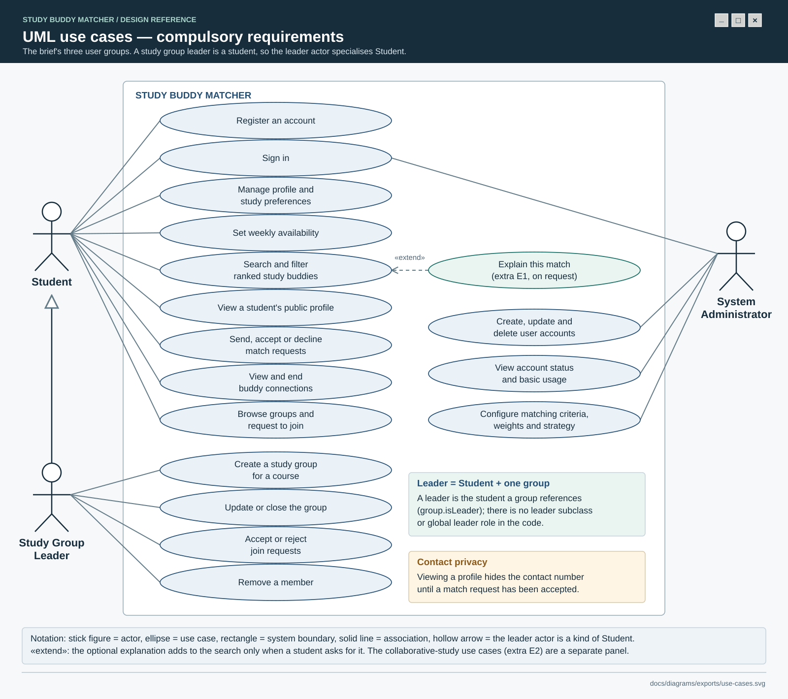](diagrams/exports/use-cases.svg)

The flowchart below is a navigation map of the same capabilities; the panel above is the formal
UML view with actors, associations, use-case ellipses and a system boundary.

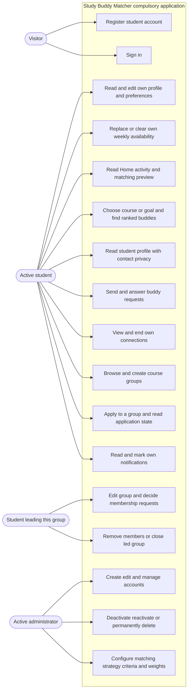

Leadership is a per-group relationship held by a student, not a third JWT role. The only
account roles are STUDENT and ADMIN. Account/receiver/participant/leader checks run on the
server; hidden or disabled controls do not confer authority. Administrator access and group
membership do not grant private contact reads.

### Packages and layers

The 25 packages under `com.studybuddy`, with one feature package opened up to show controller,
service, entity, repository, assembler and DTO and the two layering rules.

[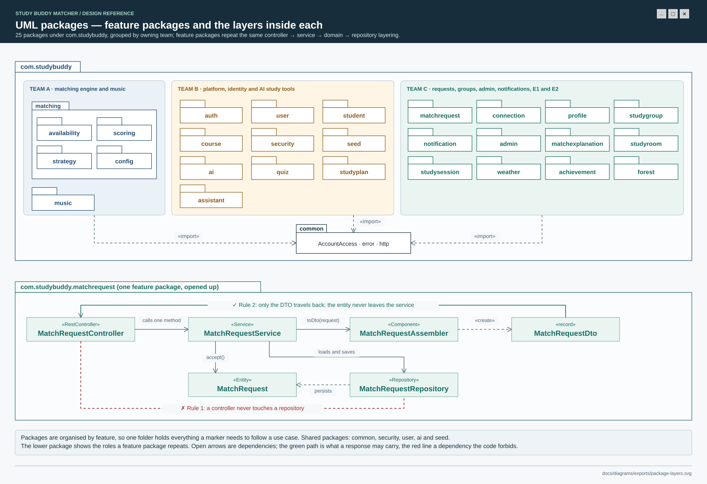](diagrams/exports/package-layers.svg)

The architecture panel shows the browser, the Spring layers top to bottom (security,
controllers, services, entities, matching, client interfaces, repositories), the DTO response
path, configuration, error handling, PostgreSQL and the external services, with the
contact-privacy boundary.

[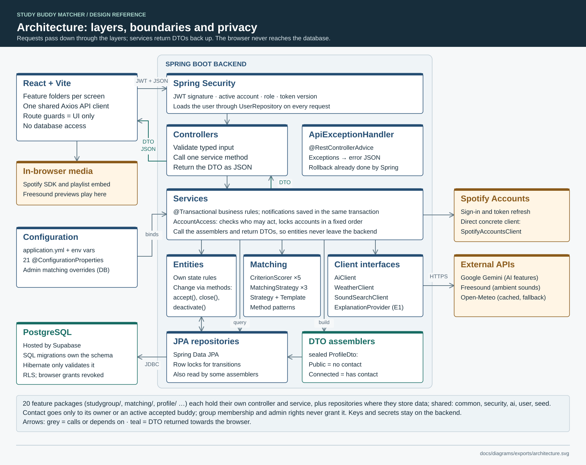](diagrams/exports/architecture.svg)

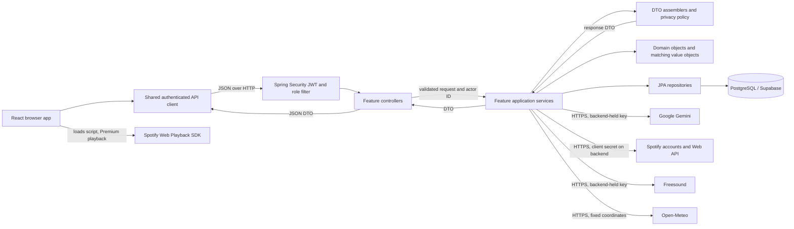

Services may use repositories and domain entities internally; controllers do not inject
repositories and services do not return entities to the API. The ordered SQL migrations own the
schema and its integrity and access rules; Hibernate only validates it at startup.

### Deployment

Client browser, application host (JVM and Vite), database host, external services and the CI
runner, with the protocol on each communication path. The browser uses only the Spring API:
application tables and sequences deny browser roles, with row-level security enabled and no
browser policies, so backend JDBC is the sole application access path.

[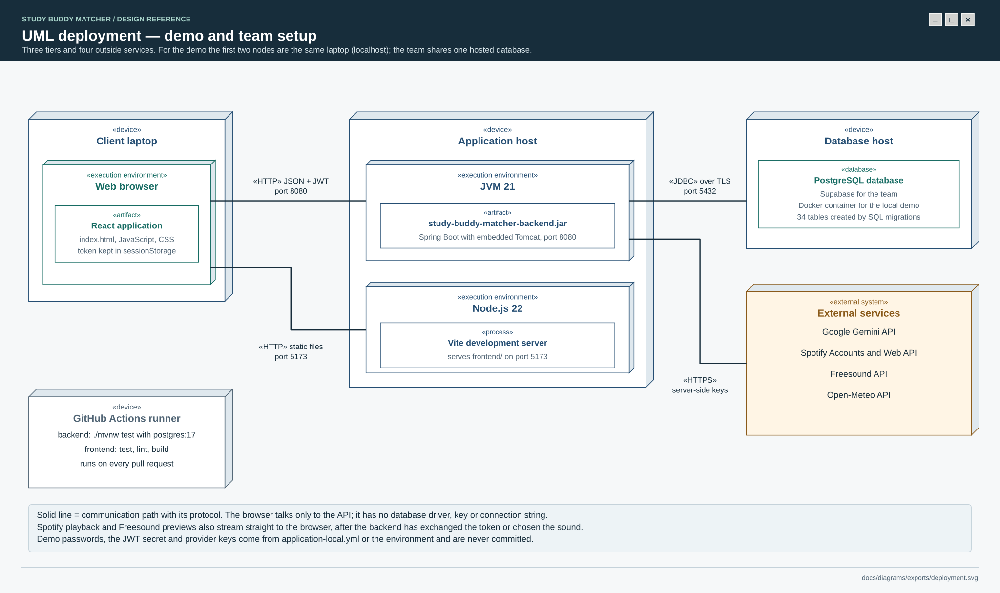](diagrams/exports/deployment.svg)

### Technology stack

Every library, tool and hosted service, grouped by tier: browser, Spring Boot API, external
services, database, and the frontend and backend tooling. Versions, reasons and licences are in
the [README](../README.md#libraries).

[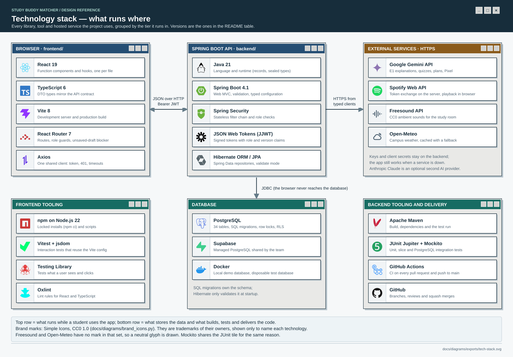](diagrams/exports/tech-stack.svg)

### External services

| External service | Called by | Used for |
| --- | --- | --- |
| Google Gemini | Backend | E1 match explanations, quizzes, study plans and the Pixel assistant |
| Spotify accounts service | Backend | Spotify sign-in and token refresh only; the student starts playback from their own Spotify app |
| Spotify Web Playback SDK | Browser | Premium playback in the study room, using an access token issued by the backend; free mode uses Spotify's embedded playlist player instead |
| Freesound | Backend (search); browser (preview audio) | CC0 ambient sounds: the backend searches with its key, the browser plays the returned preview files |
| Open-Meteo | Backend | Cached campus weather for fixed coordinates |

API keys and the Spotify client secret are configured only in the git-ignored
`application-local.yml`; none reaches the browser.

## Core requirements

### Accounts and profile

[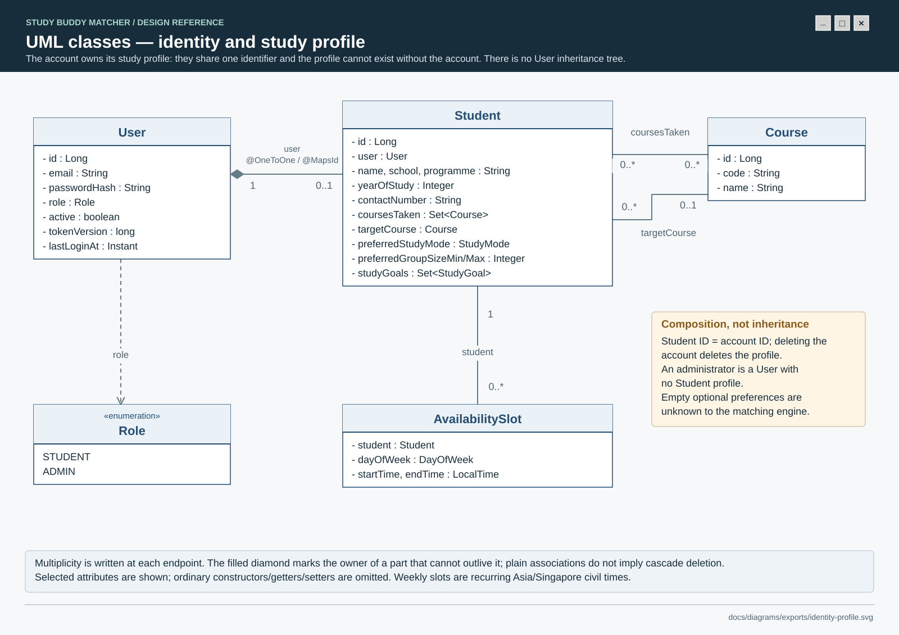](diagrams/exports/identity-profile.svg)

#### Identity, profile and how the features relate

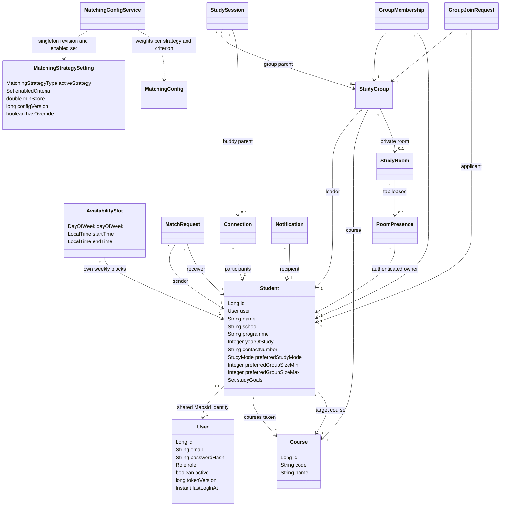

`Student` composes an identity rather than inheriting `User`: it has a one-to-one `User`
association with a shared `@MapsId` identity, and administrators have no mandatory student
fields. There is no Student/Leader inheritance either; `StudyGroup.leader` refers to an
ordinary student. Group membership and connection are separate consent relationships. Matching
reads active profiles and canonical weekly intervals but owns neither account lifecycle nor
contact visibility. Matching settings above are persistent admin configuration, not a student
profile's preferences. The [matching engine](#matching-engine) section defines the
scorer/strategy interfaces and the immutable `TimeSlot`/`MatchScore` objects; the
[state machines](#state-machines) define transition and lifecycle behaviour.

#### Authentication and own-profile services

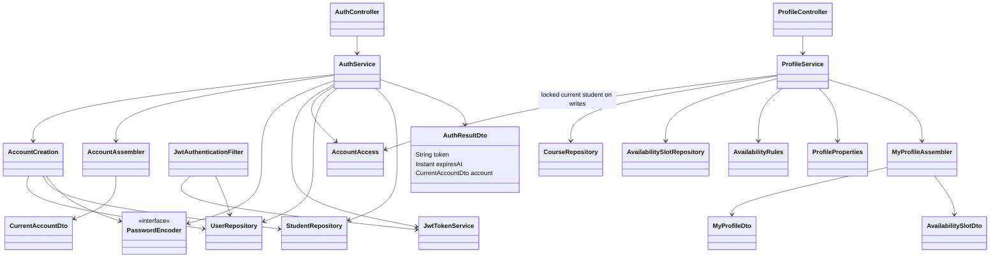

Registration atomically creates `User` and `Student` and permits only the STUDENT role.
Login validates the current identity/password/account state before issuing a token and
recording successful sign-in. JWT account ID, role, expiry and version are checked against
the active account on protected requests. Deactivation invalidates existing tokens;
reactivation requires a fresh sign-in and does not restore ended relationships.

#### Replacing the weekly availability

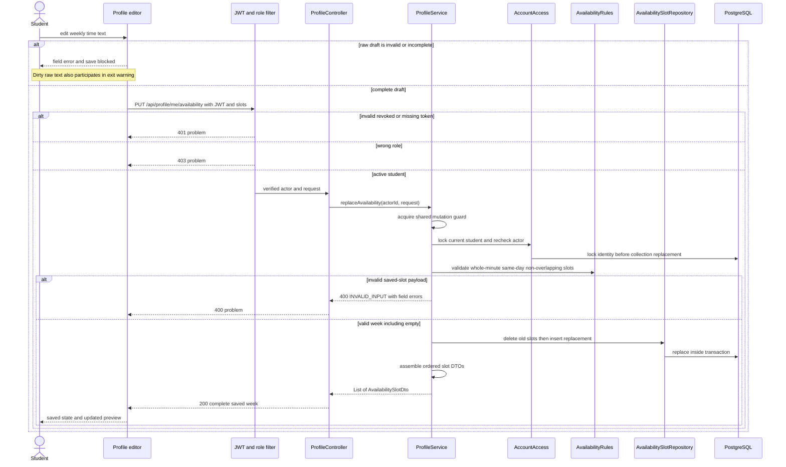

Concurrent replacements serialize on the same student's write boundary. Each completed
response represents one valid whole week; it must not contain a mixture of concurrent inputs.
Own profile course/goal collection replacements use that boundary too. Group schedules reuse
the complete time-slot shape and draft protection but allow same-day overlap.

### Matching engine

Matching algorithm, discovery API and page. Profile, security and data, and the request and
privacy services, are dependencies of matching, not duplicated matching logic. The
administrator's configuration screen is under
[Administration](#matching-configuration-versioned-save-and-restore).

#### Matching use cases and permissions

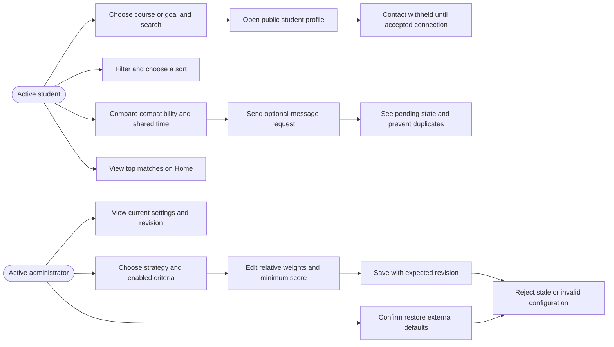

A course or goal is required for discovery; profile completion is helpful but missing
preferences are reported as unknown ("not shared") and score the configured unknown value, 0 by default. Active connections are not discovered again.
Students cannot call admin configuration, and an administrator does not gain access to a
student's private contact through matching. Every check is enforced server-side.

#### Scoring and ranking classes

[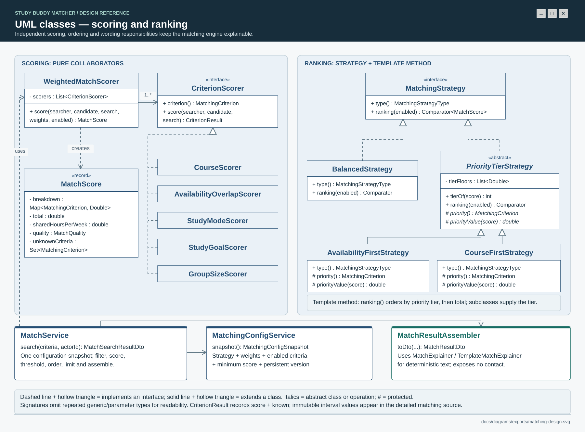](diagrams/exports/matching-design.svg)

```mermaid
classDiagram
    class MatchController {
        search(criteria, principal) MatchSearchResultDto
    }
    class MatchService {
        search(criteria, actorId) MatchSearchResultDto
    }
    class MatchSearchFilter {
        accepts(criteria, searcher, candidate) boolean
    }
    class MatchingProfile {
        <<record>>
        Student student
        WeeklyAvailability availability
    }
    class CriterionScorer {
        <<interface>>
        criterion() MatchingCriterion
        score(searcher, candidate, criteria) CriterionResult
    }
    class CriterionResult {
        <<record>>
        double score
        boolean known
    }
    class ScoringRules {
        <<record>>
        double unknownScore
        double takesCourseScore
        int minSessionMinutes
    }
    class CourseScorer
    class AvailabilityOverlapScorer
    class StudyModeScorer
    class StudyGoalScorer
    class GroupSizeScorer
    class WeightedMatchScorer {
        score(profiles, search, weights, enabled) MatchScore
    }
    class MatchScore {
        <<record>>
        Map breakdown
        double total
        double sharedHoursPerWeek
        MatchQuality quality
        Set unknownCriteria
    }
    class MatchExplainer {
        <<interface>>
        explain(score, enabled) String
    }
    class TemplateMatchExplainer
    class MatchingWeights {
        <<record>>
        Map values
        weightOf(criterion) double
    }
    class TimeSlot {
        <<record>>
        DayOfWeek day
        LocalTime start
        LocalTime end
        durationMinutes() long
        intersection(other) Optional
    }
    class WeeklyAvailability {
        <<record>>
        List slots
        totalMinutes() long
        sharedMinutesWith(other) long
        sharedSlotsWith(other) List
        sharedSessionsWith(other, minimumMinutes) List
    }
    class MatchingStrategy {
        <<interface>>
        type() MatchingStrategyType
        ranking(enabled) Comparator
    }
    class BalancedStrategy
    class PriorityTierStrategy {
        <<abstract>>
        tierOf(score) int
        priority()* MatchingCriterion
        priorityValue(score)* double
    }
    class PriorityTiers {
        <<record>>
        List availabilityHours
    }
    class AvailabilityFirstStrategy
    class CourseFirstStrategy
    class MatchSort {
        <<enumeration>>
        BEST_MATCH
        MOST_SHARED_HOURS
        SAME_YEAR_FIRST
        before(searcher) Comparator
    }
    class MatchingConfigService {
        get(actorId) MatchingConfigDto
        update(request, actorId) MatchingConfigDto
        restore(request, actorId) MatchingConfigDto
        snapshot() MatchingConfigSnapshot
    }
    class MatchingConfigSnapshot {
        <<record>>
        MatchingStrategy strategy
        MatchingWeights weights
        Set enabledCriteria
        double minScore
        long version
    }
    class MatchingProperties {
        <<record>>
        startup defaults
        quality cutoffs
        scoring rules
        priority tiers
        result limits
    }
    class MatchResultAssembler {
        toDto(profiles, score, search, enabled, relationship) MatchResultDto
    }
    class MatchingConfigAssembler
    class MatchRelationships
    class AccountAccess
    class MatchSearchResultDto {
        <<record>>
        strategy
        configurationVersion
        sort
        limit
        totalMatches
        matches
    }
    MatchController --> MatchService
    MatchService --> AccountAccess
    MatchService --> MatchSearchFilter
    MatchService --> MatchRelationships
    MatchService --> MatchingConfigService
    MatchService --> WeightedMatchScorer
    MatchService --> MatchResultAssembler
    MatchService ..> MatchSearchResultDto
    CriterionScorer <|.. CourseScorer
    CriterionScorer <|.. AvailabilityOverlapScorer
    CriterionScorer <|.. StudyModeScorer
    CriterionScorer <|.. StudyGoalScorer
    CriterionScorer <|.. GroupSizeScorer
    CriterionScorer ..> CriterionResult
    WeightedMatchScorer --> CriterionScorer
    WeightedMatchScorer --> ScoringRules
    MatchResultAssembler --> MatchExplainer
    MatchExplainer <|.. TemplateMatchExplainer
    MatchExplainer ..> MatchScore
    MatchService ..> MatchSort
    WeightedMatchScorer ..> MatchScore
    WeightedMatchScorer --> MatchingWeights
    CriterionScorer ..> MatchingProfile
    MatchingProfile --> WeeklyAvailability
    WeeklyAvailability *-- TimeSlot
    MatchingStrategy <|.. BalancedStrategy
    MatchingStrategy <|.. PriorityTierStrategy
    PriorityTierStrategy <|-- AvailabilityFirstStrategy
    PriorityTierStrategy <|-- CourseFirstStrategy
    AvailabilityFirstStrategy ..> PriorityTiers
    CourseFirstStrategy ..> ScoringRules
    MatchingStrategy ..> MatchScore
    MatchingConfigService --> MatchingProperties
    MatchingConfigService --> MatchingConfigAssembler
    MatchingConfigService ..> MatchingConfigSnapshot
    MatchingConfigSnapshot --> MatchingStrategy
    MatchingConfigSnapshot --> MatchingWeights
```

Scorers are pure collaborators: no repository or controller access. `WeeklyAvailability`
canonicalises intervals; `MatchScore`, `MatchingWeights` and interval records protect value
state. Strategy implementations encapsulate ranking; the two priority strategies share their
banded ranking through the `PriorityTierStrategy` template method and only name their criterion
and banded value. `MatchExplainer` keeps wording out of scoring and sees only the score, never a
profile. Each `MatchSort` value supplies its own comparator. The search service coordinates
authorization, candidate filtering and repositories inside its transaction. Assemblers
construct DTOs, and the controller only converts query inputs/delegates/returns DTOs.

`WeeklyAvailability` / `TimeSlot` value composition, and the sealed `ProfileDto` response
shapes chosen by `ProfileViewAssembler`:

[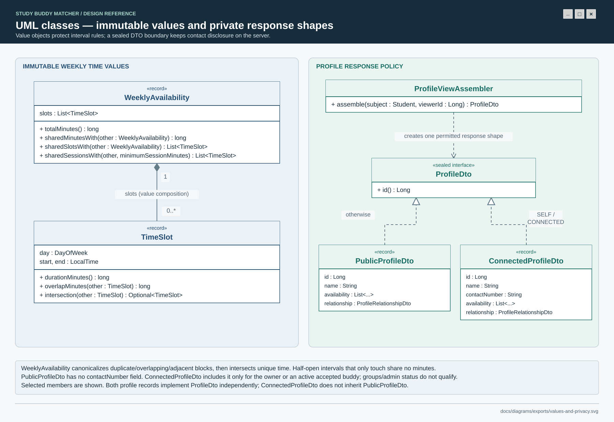](diagrams/exports/values-and-privacy.svg)

#### Search, ranking and privacy

[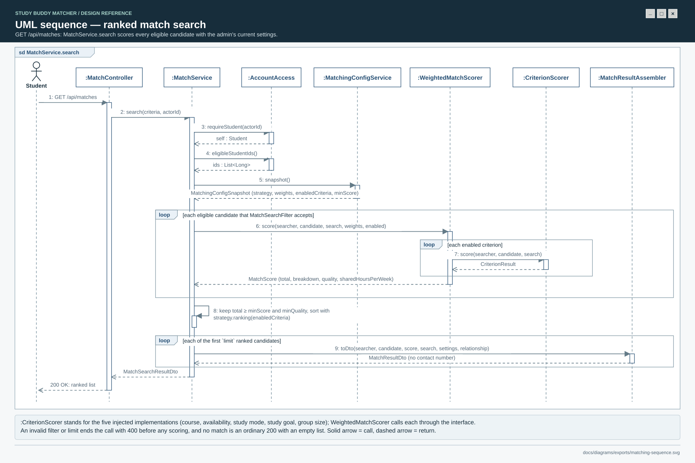](diagrams/exports/matching-sequence.svg)

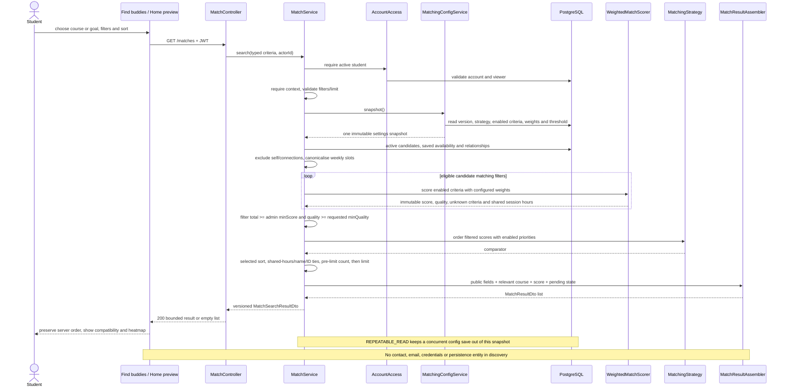

Profile and request buttons then call the profile and request services described in the
[next section](#requests-connections-and-contact-privacy). A confirmed request is
locally marked pending until its post-send (or later) authoritative response. Old pre-send
responses cannot remove that acknowledgement. The backend still rejects racing duplicate
requests or candidates who have become connected since the search.

#### Search entry, error and empty alternatives

This supplements the successful scoring and ranking sequence above with the entry, error and
empty alternatives required for an integrated demo.

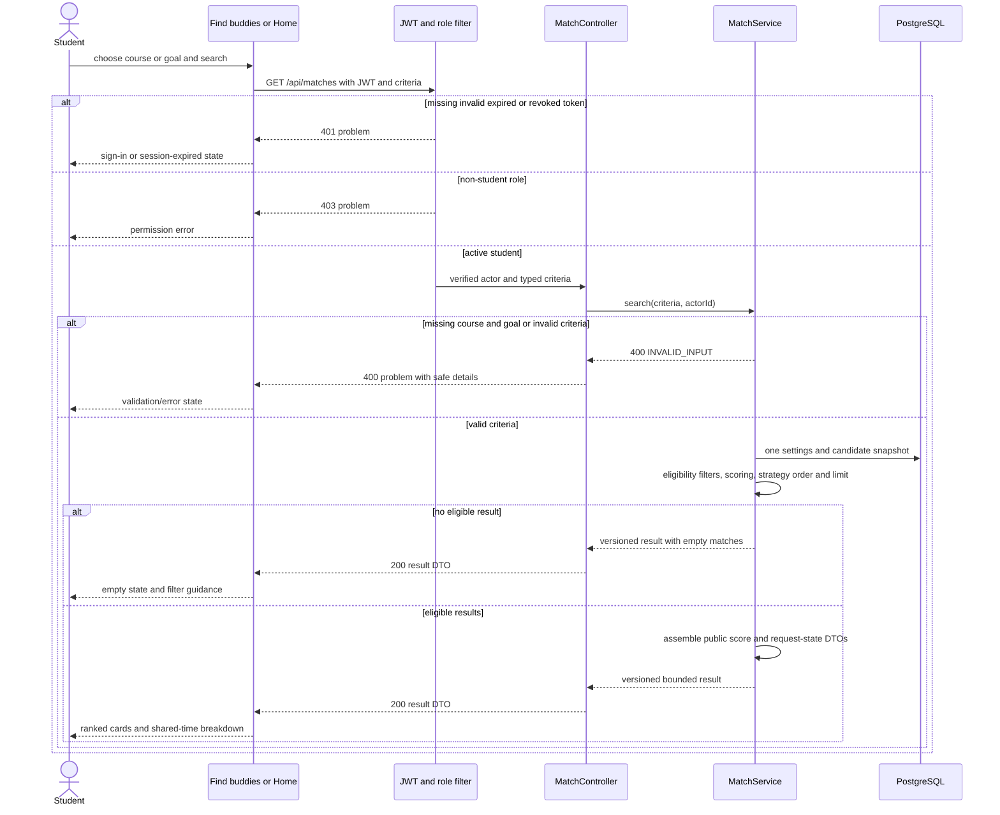

Malformed enum/numeric parameters may fail during controller binding before the service call;
the shared problem boundary still returns 400. Discovery DTOs never contain contact, email,
credentials or entities. An unexpected failure shows retryable error state, not fabricated
matches. `MatchingHttpTest` and matching rendered tests cover these branches.

### Requests, connections and contact privacy

[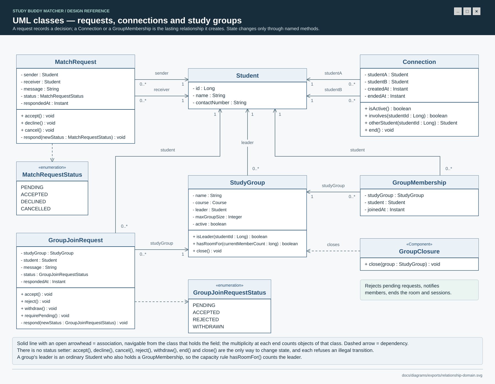](diagrams/exports/relationship-domain.svg)

#### Permissions for requests, groups and accounts

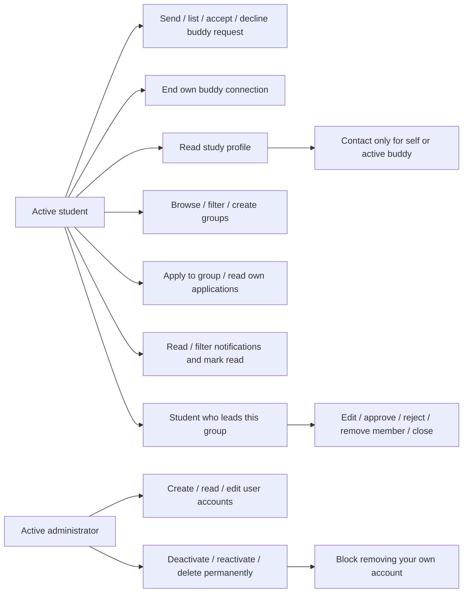

An incoming request can be answered only by its receiver; a connection can be ended only
by a participant. Leader authority is checked against the URL's particular group. The same map
covers the [study groups](#study-groups), [administration](#administration) and
[notifications](#notifications) sections below.

#### Domain classes and service boundaries

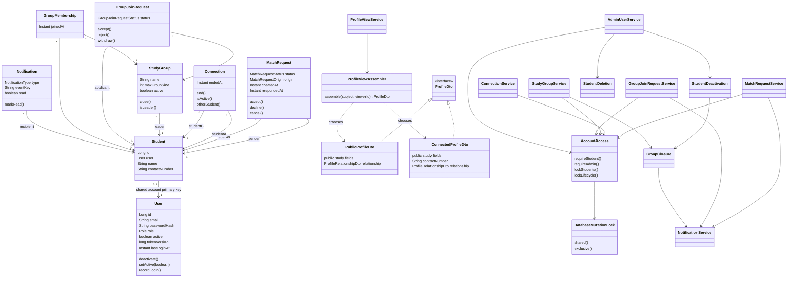

Services coordinate transactions/authorization; entities own one-way state transitions.
Assemblers select response fields while entities remain internal. Validation and lifecycle
cleanup are separate collaborators, rather than logic in controllers. Value objects and
existing domain enums are reused. Collection fields/course/availability objects omitted
from this overview are shown in the ER diagram and actual source.

#### Sending and accepting a request

`MatchRequestService.send` and `accept`: locks, the new `MatchRequest`, `respond(ACCEPTED)`,
the new `Connection` and both notifications.

[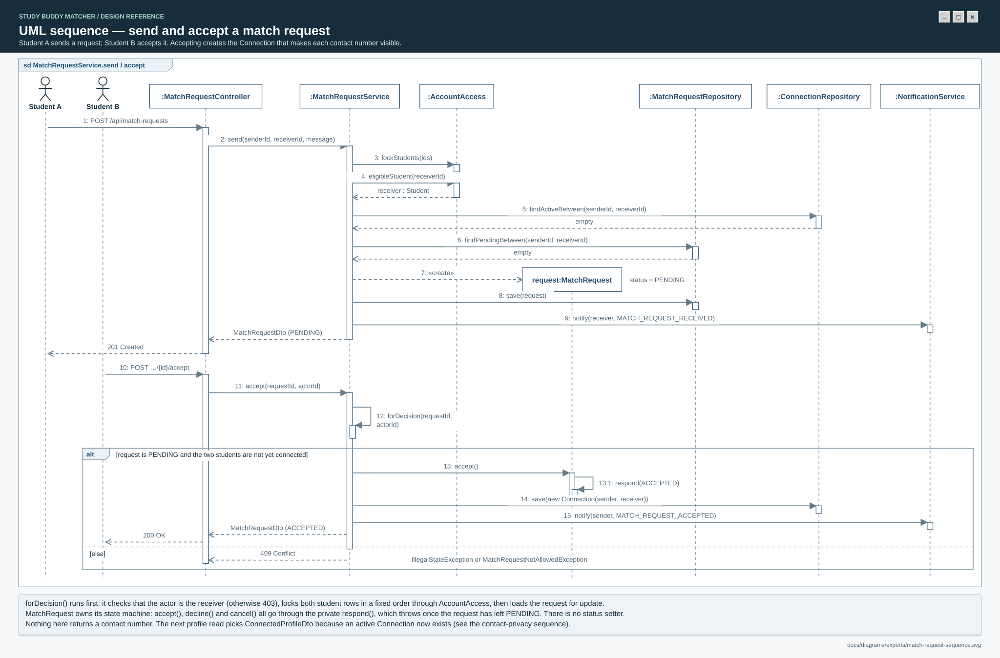](diagrams/exports/match-request-sequence.svg)

#### Who receives the contact number

`ProfileViewService.view`: `ProfileViewAssembler` creates a `ConnectedProfileDto` or a
`PublicProfileDto` from the relationship state.

[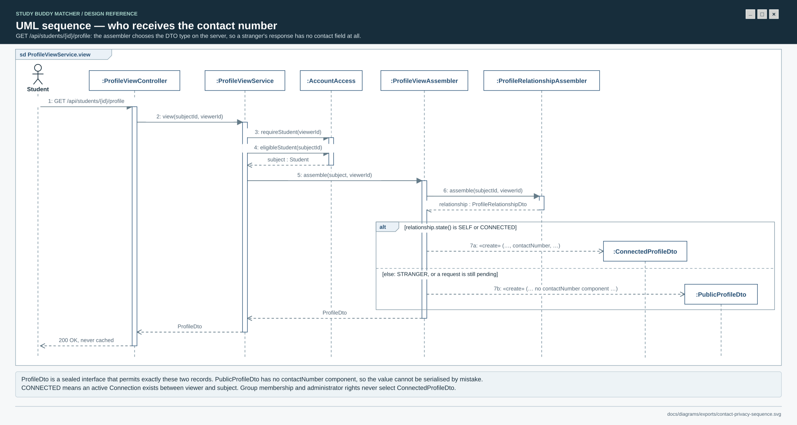](diagrams/exports/contact-privacy-sequence.svg)

The sequence below follows one acceptance through to the profile read that discloses the
contact.

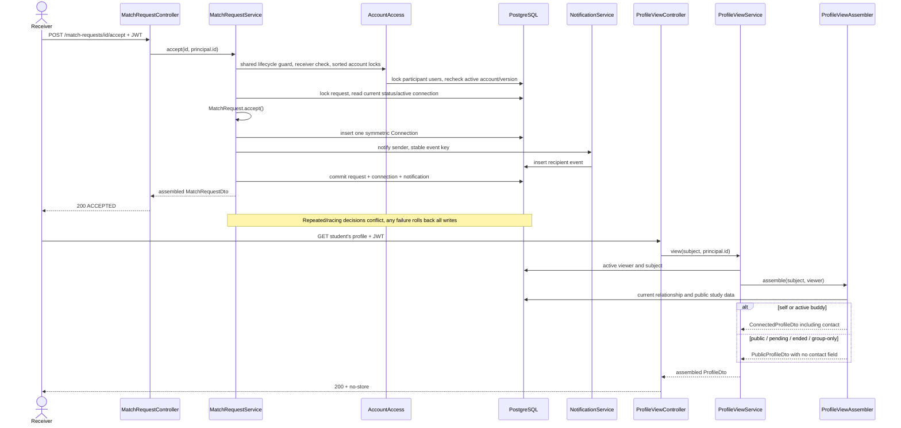

After disconnect, a later lookup selects the public shape for both sides. The client purges
its current private view and refetches; previously downloaded data cannot be erased remotely.

The request and connection lifecycles are under [State machines](#state-machines).

### Study groups

`GroupJoinRequestService.accept`: leader check, capacity check, `respond(ACCEPTED)` and the new
`GroupMembership`.

[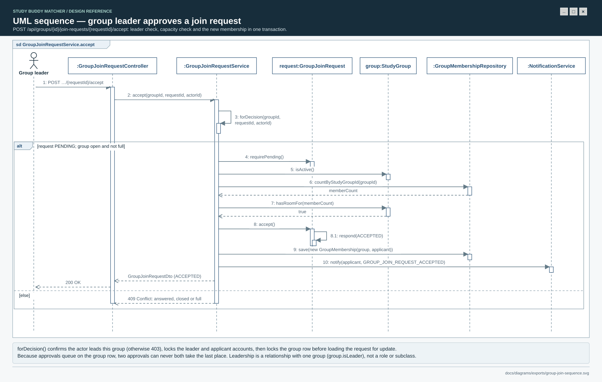](diagrams/exports/group-join-sequence.svg)

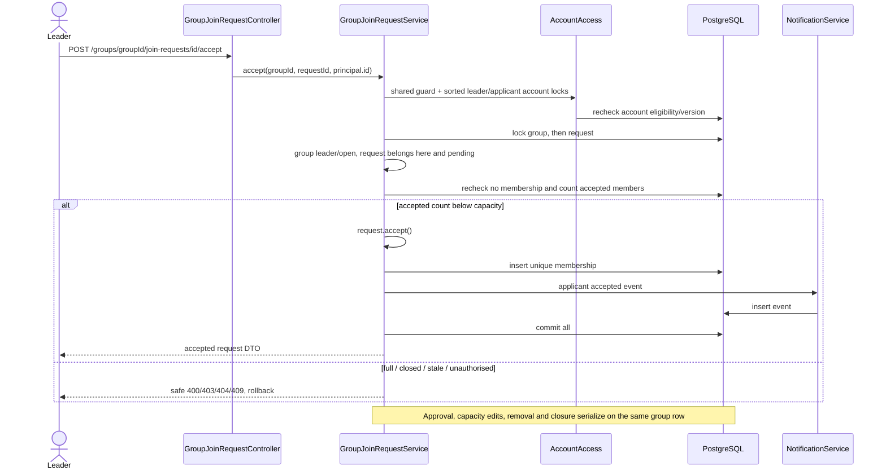

Pending applicants do not consume seats. Creation inserts the leader membership. Closure
rejects pending applicants and emits one closure event per other member; it retains history.

The join request, membership and group lifecycles are under [State machines](#state-machines);
the group's private room and dated sessions are under
[E2: Collaborative study](#e2-collaborative-study).

### Administration

#### Accounts: deactivate, reactivate and delete

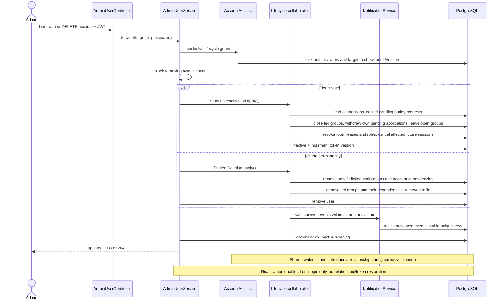

#### Matching configuration: versioned save and restore

`MatchingConfigService.update` with its version check, then the next search reading the
snapshot and ranking through the chosen `MatchingStrategy`.

[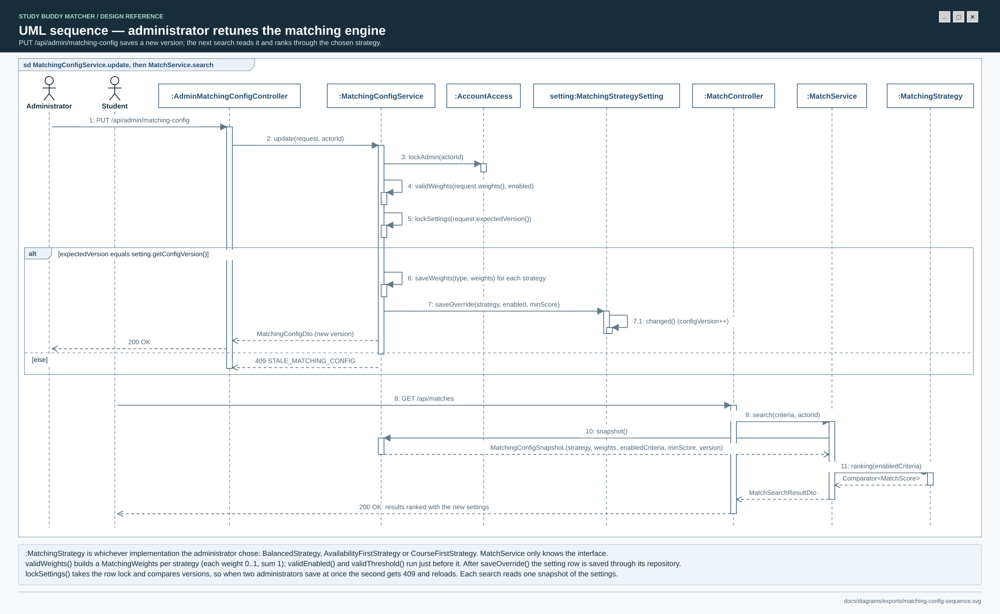](diagrams/exports/matching-config-sequence.svg)

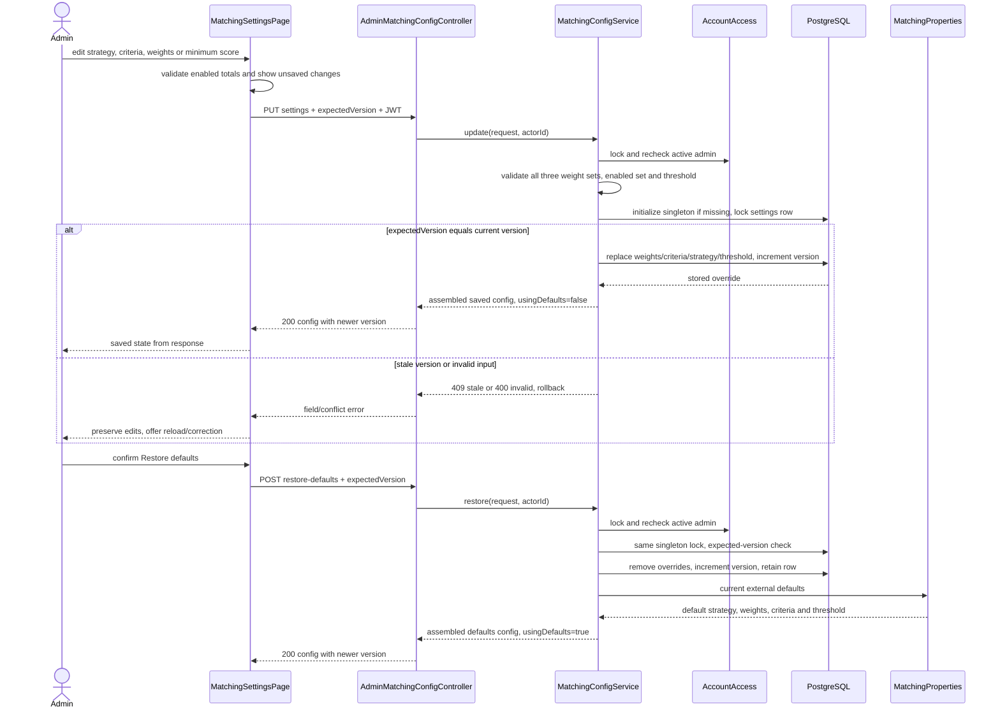

A failure rolls back the whole config mutation. Concurrent first saves also meet the same
singleton lock; stale edits cannot overwrite another administrator's changes. Stored
settings/version survive restart. The tables behind it are under
[Matching configuration tables](#matching-configuration-tables).

### Notifications

Notifications are written by `NotificationService` inside the transaction that causes them, as
the acceptance, approval and account-cleanup sequences above show: a failed event write rolls
back the triggering transition. Events are recipient-scoped with stable unique keys.

Read/read-all operations check the authenticated recipient, persist `read=true`, and are
idempotent. The badge counts all unread events independently of the currently selected
Requests/Groups filter.

### Empty, invalid and unauthorised cases

| Flow | Empty / invalid / unauthorised alternative | Evidence |
| --- | --- | --- |
| Registration/login | Creation missing fields or short/oversize password → 400; duplicate normalised email → 409; incorrect or otherwise-valid over-byte login password → 401; correct password for inactive account → 403 | `AccountCreationTest`, `AccountHttpTest`, auth rendered tests |
| Own profile | Unknown/excess courses or missing preferences → 400; other role → 403; raw time draft remains local until complete | Profile, availability and editor tests |
| Buddy requests | No requests → empty list; self/duplicate/connected pair or repeat decision → conflict; wrong receiver → 403 | `BuddyHttpTest`, request/connection tests |
| Privacy | Stranger/pending/group-only viewer → public DTO; inactive or missing subject → 404; after disconnect → contact withheld | Privacy assembler and HTTP tests |
| Groups | No browse result → empty state; full/closed/repeated request → conflict; invalid capacity/time → 400; non-leader decision → 403 | `GroupHttpTest`, group and rendered tests |
| Notifications | Empty list → empty state; another recipient's mark-read → 403; failed event write rolls back triggering transition | Notification and HTTP rollback/direction tests |
| Admin accounts | Student/unauthenticated caller rejected; self-removal → conflict; removal never leaves an unusable last admin; deleted dependencies are removed safely | `AccountHttpTest`, admin/JWT tests |

The contact-format and learning-style interpretations are recorded in the
[design decisions](DESIGN_DECISIONS.md).

## Extras

### E1: AI study assistance

Match explanations, Quiz Buddy, study plans and the Pixel assistant share one Gemini
integration, but each holds its own API key, model and daily allowance so one feature can never
spend another's. The [API contract](API_CONTRACT.md#quizzes-ai-study-assistant) defines the
endpoints, and [testing](TESTING.md#e1-quizzes-study-plans-and-the-assistant) covers how they
are tested.

[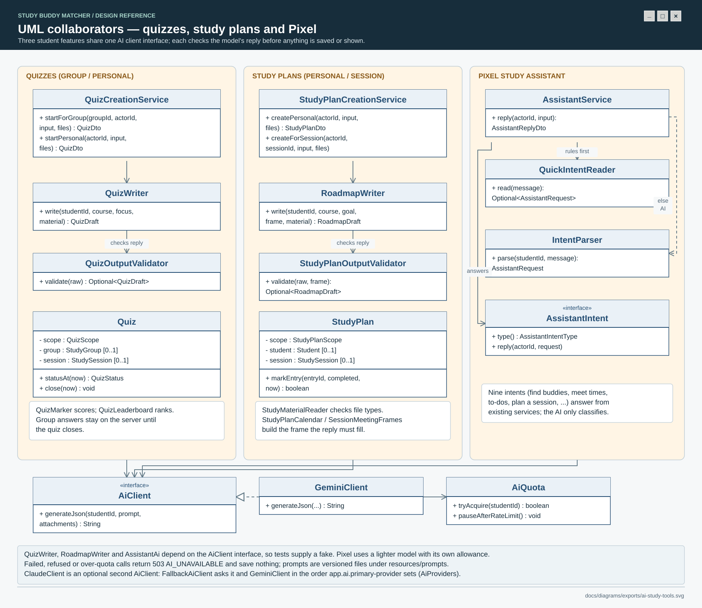](diagrams/exports/ai-study-tools.svg)

#### Match explanations

Match explanations supplement the compulsory matching design: Java still calculates every
score and rank; the optional provider (Google Gemini) writes an explanation only after a
student asks, and never supplies ranks or compatibility numbers. The
[API contract](API_CONTRACT.md#match-explanation-e1) defines the endpoint, and
[testing](TESTING.md) covers how it is tested.

[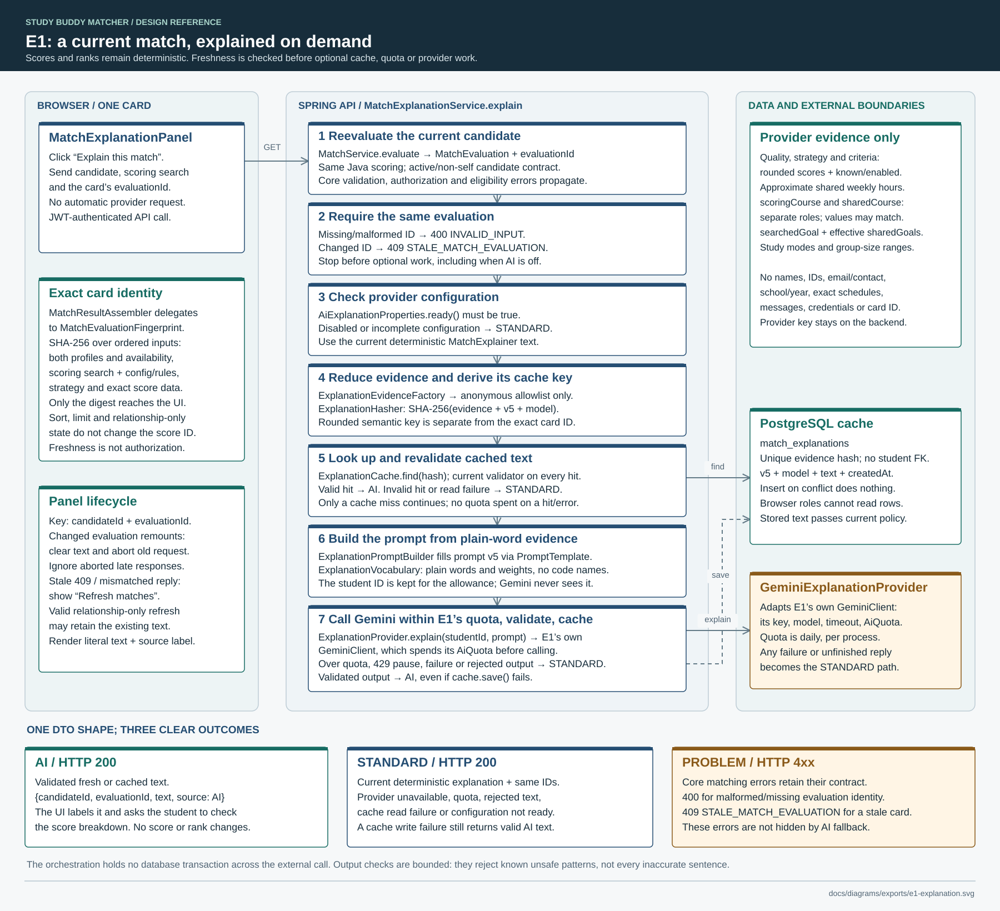](diagrams/exports/e1-explanation.svg)

The SVG is a standalone, hand-edited vector file with native text and shapes; it is not
built by `render_diagrams.py`. Its numbered stages follow `MatchExplanationService.explain`
and `AiExplanationWriter.write`. When the contract changes, update both the SVG and the
Mermaid below.

##### Two identities with different responsibilities

| Identity | Built from | Used for |
| --- | --- | --- |
| Card `evaluationId` | SHA-256 of ordered scoring profiles and availability, scoring search context, strategy/configuration version, weights/enabled criteria, rules and exact score data | Confirms the requested card still represents the current evaluation before optional cache/quota/provider work. Only the opaque digest reaches the browser; its source inputs remain on the server |
| Semantic evidence hash | SHA-256 of serialized allowlisted evidence, prompt version `v5` and configured model | Reuses explanation text for equivalent anonymous evidence. Scores are rounded to two decimal places and shared hours to the nearest half hour; this hash deliberately omits account and exact card identity |

`MatchService` asks `MatchResultAssembler` to assemble the card; the assembler delegates
its exact identity to `MatchEvaluationFingerprint`. Sort and limit affect discovery order,
so they are excluded from the card fingerprint.
Relationship-only changes do not invalidate unchanged scoring evidence. A changed profile,
availability, scoring search context or configuration can invalidate it even when the rounded
evidence would reuse an existing cache row. Freshness is therefore checked **before** cache
lookup. The digest is a freshness contract, not an authorization token.

Direct evaluation retains the active, non-self candidate contract. It does not add discovery
membership authorization or require that the candidate still passes search filters, discovery
thresholds or connection exclusion. Authentication, search validation and current candidate
eligibility still run through `MatchService.evaluate`.

##### Explanation collaborators

Selected public operations are shown below. Dependencies describe actual constructor-injected
collaborators; `ExplanationProvider` is the replaceable interface. `AiExplanationConfiguration`
builds the provider: E1's own `GeminiClient`, with `GeminiSettings` and an `AiQuota` from
`app.ai.explanation.*`, wrapped by `GeminiExplanationProvider`. Cache entities remain behind
`ExplanationCache`, and the controller receives `MatchExplanationDto` from the assembler.

```mermaid
classDiagram
    direction TB
    class MatchExplanationController {
        +explain(...) MatchExplanationDto
    }
    class MatchExplanationService {
        +explain(search, actorId, candidateId, evaluationId) MatchExplanationDto
    }
    class MatchService {
        +evaluate(search, actorId, candidateId) MatchEvaluation
    }
    class MatchResultAssembler {
        +toDto(...) MatchResultDto
    }
    class MatchEvaluationFingerprint {
        +create(searcher, candidate, search, settings, score, rules) String
    }
    class ExplanationEvidenceFactory {
        +from(evaluation) ExplanationEvidence
    }
    class AiExplanationWriter {
        +write(evidence, studentId) Optional~String~
    }
    class ExplanationCache {
        +find(evidence) Optional~String~
        +save(evidence, text) void
    }
    class ExplanationHasher {
        +hash(evidence, promptVersion, model) String
    }
    class MatchExplanationRepository {
        <<interface>>
        +findByEvidenceHash(hash) Optional~MatchExplanation~
        +insertIfAbsent(hash, promptVersion, model, text) void
    }
    class ExplanationPromptBuilder {
        +PROMPT_VERSION String
        +build(evidence) String
    }
    class ExplanationVocabulary {
        +describe(evidence)$ Map
    }
    class PromptTemplate {
        +load(classpathPath)$ PromptTemplate
        +fill(values) String
    }
    class ExplanationProvider {
        <<interface>>
        +explain(studentId, prompt) Optional~String~
    }
    class GeminiExplanationProvider {
        +explain(studentId, prompt) Optional~String~
    }
    class GeminiClient {
        +generateJson(studentId, prompt) String
    }
    class AiQuota {
        +tryAcquire(studentId) boolean
        +pauseAfterRateLimit() void
    }
    class ExplanationOutputValidator {
        +validate(raw, evidence) Optional~String~
        +validateText(text, evidence) Optional~String~
    }
    class MatchExplanationAssembler {
        +ai(candidateId, evaluationId, text) MatchExplanationDto
        +standard(candidateId, evaluationId, text) MatchExplanationDto
    }
    MatchExplanationController --> MatchExplanationService
    MatchExplanationService --> MatchService : reevaluates current inputs
    MatchService --> MatchResultAssembler : assembles evaluated card
    MatchResultAssembler --> MatchEvaluationFingerprint : exact card identity
    MatchExplanationService --> ExplanationEvidenceFactory
    MatchExplanationService --> AiExplanationWriter : AI wording or nothing
    MatchExplanationService --> MatchExplanationAssembler
    AiExplanationWriter --> ExplanationCache
    ExplanationCache --> ExplanationHasher : semantic cache identity
    ExplanationCache --> MatchExplanationRepository
    AiExplanationWriter --> ExplanationPromptBuilder
    ExplanationPromptBuilder --> ExplanationVocabulary : plain words, no code names
    ExplanationPromptBuilder --> PromptTemplate : match-explanation-v5.txt
    AiExplanationWriter --> ExplanationProvider
    GeminiExplanationProvider ..|> ExplanationProvider
    GeminiExplanationProvider --> GeminiClient : E1's own instance
    GeminiClient --> AiQuota : spends allowance, pauses after HTTP 429
    AiExplanationWriter --> ExplanationOutputValidator
```

##### Explanation request sequence and early exits

`MatchExplanationService` checks that the card is current and chooses AI or standard text;
`AiExplanationWriter` owns the optional AI steps. Neither is transactional: current evaluation
and cache operations complete without holding a database connection across the external HTTP
call. The sequence shows prompt and validator collaborators as writer self-calls; their class
names appear in the OO view above.

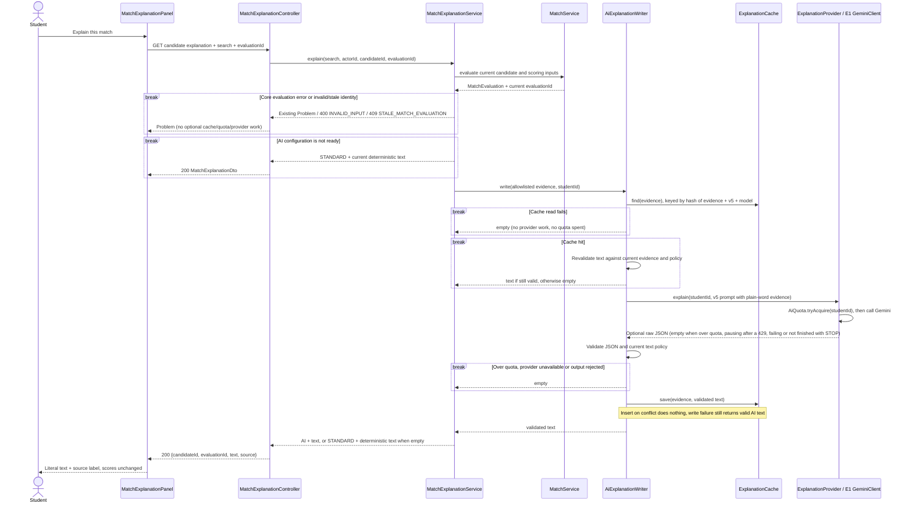

##### Explanation privacy, fallback and lifecycle constraints

- The provider receives only `ExplanationEvidence`: quality, rounded total/criterion scores,
  enabled/known flags, strategy, approximate shared weekly hours, course code/name context,
  searched/shared goals, study modes and group-size preferences. `scoringCourse` identifies
  the course used by the scorer; `sharedCourse` separately identifies a genuinely shared course.
  `searchedGoal` retains unsaved intent, while `sharedGoals` intersects the candidate's goals
  with the caller's effective saved-plus-searched goals.
- Names, account IDs, email/contact details, school/year, exact weekly schedules, credentials,
  messages and the evaluation ID are absent from provider evidence. The provider key stays on
  the backend. The cache has a unique evidence hash and no student foreign key; browser roles
  cannot read it directly.
- Both fresh and cached text pass the current validator. Its checks cover JSON/length, obvious
  success or percentage claims, code-shaped course references and numeric weekly-hour
  references. The checks are bounded: they catch known unsafe patterns, not every inaccurate sentence. Invalid cached text
  produces `STANDARD`; it does not trigger automatic regeneration or cache repair.
- E1's daily quota is its own `AiQuota` inside its `GeminiClient`, spent only on a cache
  miss. It is synchronised and process-local, with its configured day boundary; a restart
  resets it. The student ID is used only for the per-student share and never reaches Gemini. Simultaneous identical misses may call the provider more than once;
  insert-on-conflict prevents duplicate rows, not duplicate external requests.
- The UI requests text only on a click. Its child is keyed by candidate and evaluation ID;
  a changed evaluation remounts it, clears completed text and aborts the obsolete request.
  Aborted late replies are ignored. A mismatched response identity or stale 409 asks the user
  to **Refresh matches**; ordinary errors offer a retry. Relationship-only refreshes may keep
  valid text. AI text is labelled and rendered as text, with advice to check the score breakdown.

#### Quiz Buddy

##### Study tools use cases and permissions

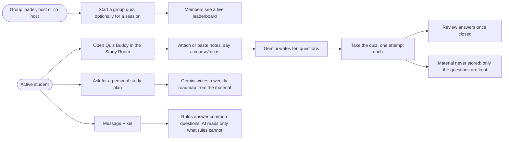

An invisible quiz is 404, so its ID reveals nothing; a group's quiz list is 403, like its room
and sessions. Answers and the correct option stay server-side until a quiz closes. A student's
study plan and a session's plan are visible only to their owner or current participants.

##### Quiz collaborators

`QuizWriter` depends on `AiClient`, not `GeminiClient` directly, so tests supply a fake that
returns fixed replies or fails on demand. `AiAssistantConfiguration` builds the one `GeminiClient`
instance that quizzes and study plans share, holding its own `GeminiSettings` and
`AiQuota` from `app.ai.assistant.*`. The chat assistant and match explanations build their own
instances of the same `GeminiClient` class from their own settings.

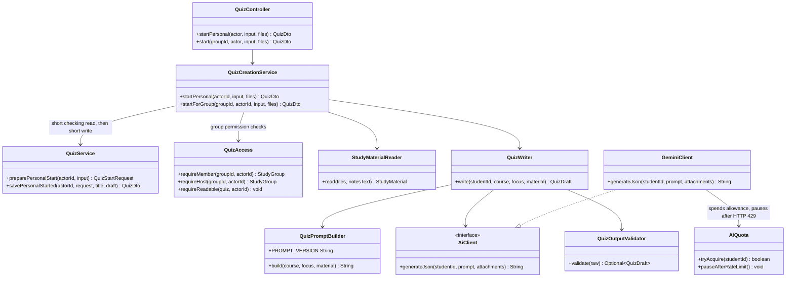

##### Quiz domain

A quiz owns its questions outright (cascade-deleted with it); an attempt references a quiz and a
student but is owned by neither. The database allows only one attempt per student per quiz, so
starting twice returns the existing attempt rather than creating a new one.

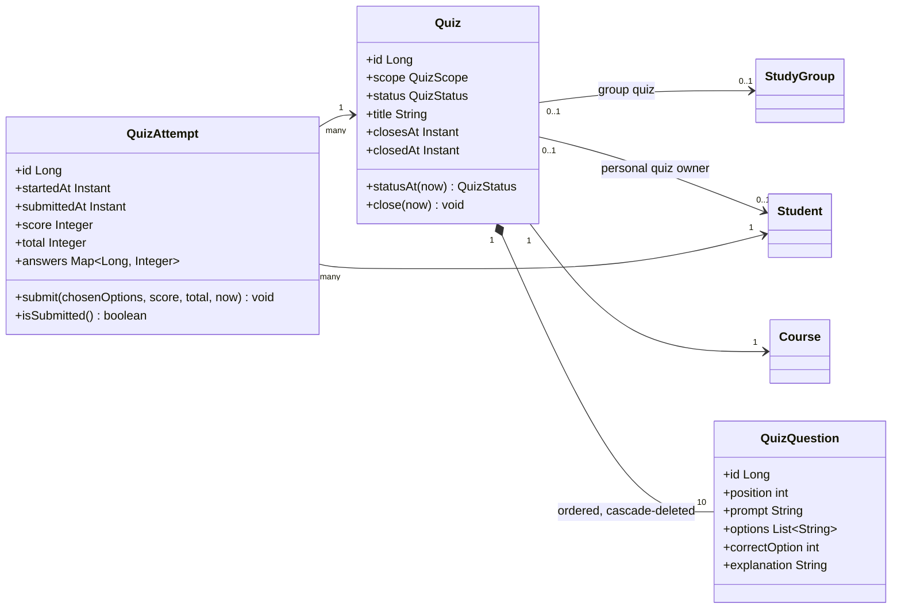

The quiz and attempt lifecycle is under [State machines](#quiz-and-attempt).

##### Quiz request sequence and early exits

Deliberately not transactional: creation runs as a short checking read, the AI call, then a short
write, so no database connection or account lock is held while Gemini answers (which can take
many seconds for a PDF). The `ready()` check on `AiAssistantProperties` — on by default only when
`application-local.yml` sets `enabled: true` and `api-key` — runs before the quota, so a
switched-off feature never spends a student's daily allowance.

```mermaid
sequenceDiagram
    actor Student
    participant UI as QuizBotChat
    participant API as QuizController
    participant Creation as QuizCreationService
    participant Quiz as QuizService
    participant Material as StudyMaterialReader
    participant Writer as QuizWriter
    participant AI as AiClient / GeminiClient
    participant Quota as AiQuota
    participant Gemini as Google Gemini
    participant Validator as QuizOutputValidator
    Student->>UI: Attach notes/PDF, say focus + course
    UI->>API: POST /api/quizzes (multipart: files, notesText, focus, courseId)
    API->>Creation: startPersonal(actorId, input, files)
    Creation->>Quiz: preparePersonalStart(actorId, input)
    Quiz-->>Creation: QuizStartRequest (course and student checked)
    Creation->>Material: read(files, notesText)
    Material-->>Creation: StudyMaterial
    Creation->>Writer: write(studentId, course, focus, material)
    Writer->>Writer: QuizPromptBuilder.build(course, focus, material)
    Writer->>AI: generateJson(studentId, prompt, attachments)
    break Switched off, or no api-key configured
        AI-->>Writer: throw AiUnavailableException
        Writer-->>Creation: propagate
        Creation-->>API: propagate
        API-->>UI: 503 AI_UNAVAILABLE
        UI-->>Student: "try again" message
    end
    AI->>Quota: tryAcquire(studentId)
    break Over the daily or per-student limit, or pausing after a rate limit
        Quota-->>AI: false
        AI-->>Writer: throw AiUnavailableException
        Writer-->>Creation: propagate
        Creation-->>API: propagate
        API-->>UI: 503 AI_UNAVAILABLE
        UI-->>Student: "try again" message
    end
    AI->>Gemini: POST /models/{model}:generateContent (x-goog-api-key header)
    Gemini-->>AI: JSON reply, or an HTTP error / rate limit
    AI-->>Writer: reply text
    Writer->>Validator: validate(reply)
    break Reply fails the quiz's shape checks
        Validator-->>Writer: empty
        Writer-->>Creation: propagate
        Creation-->>API: propagate
        API-->>UI: 503 AI_UNAVAILABLE
        UI-->>Student: "try again" message
    end
    Validator-->>Writer: QuizDraft
    Writer-->>Creation: QuizDraft
    Creation->>Quiz: savePersonalStarted(actorId, request, title, draft)
    Quiz-->>Creation: QuizDto (quiz and questions saved)
    Creation-->>API: QuizDto
    API-->>UI: 201 Created
    UI-->>Student: "Your quiz is ready!"
```

#### Study plans and Pixel

Both reuse the quiz collaborators above with their own prompt builder and output validator;
neither has its own sequence diagram. Full decisions are in the design decisions for
[study plans](DESIGN_DECISIONS.md#study-plans) and
[Pixel](DESIGN_DECISIONS.md#pixel-study-assistant).

| Feature | What differs from the quiz flow |
| --- | --- |
| Study plan | `StudyPlanCalendar` frames the weeks/meetings server-side before Gemini plans only those blocks; `StudyPlanOutputValidator` checks every block is covered and fits its limits |
| Pixel assistant | `QuickIntentReader` answers common questions with rules and no AI call at all; only a message needing a time, date or other free-text detail reaches `IntentParser`. The AI classifies intent and extracts details only — every fact in the reply still comes from existing services, so the model cannot invent a buddy, time or task |

Study plans follow the same owned-children shape as quizzes: `StudyPlan` *(scope, course, block
calendar, source filenames/topics)* cascade-owns its `StudyPlanEntry` rows *(sequence, scheduled
date, title, planned minutes, completed, tasks)*, and belongs to either a `Student` (personal)
or a `StudySession` (session), never both.

#### Study tools privacy, limits and fallback

- Uploaded or pasted material is sent to Gemini for that one request and never stored. A quiz
  keeps only its questions and a title; a study plan keeps only the extracted topic titles and
  file names; Pixel keeps no history at all.
- Prompt injection: student text and material are marked as data, never instructions.
  `PromptTemplate` fills `{{slot}}` markers in one pass over the template only.
- Any failure — switched off, over quota, rate limited, a timeout or a reply that fails its
  output checks — is `AiUnavailableException`, surfaced as `503 AI_UNAVAILABLE`. Logs never
  contain the prompt, file, reply or key.
- `app.ai.assistant.*` is off unless `application-local.yml` sets `enabled: true` and `api-key`;
  the chat assistant shares that key and switch but keeps its own lighter model, quota and
  rate-limit pause under `app.ai.assistant.chat.*`.

### E2: Collaborative study

[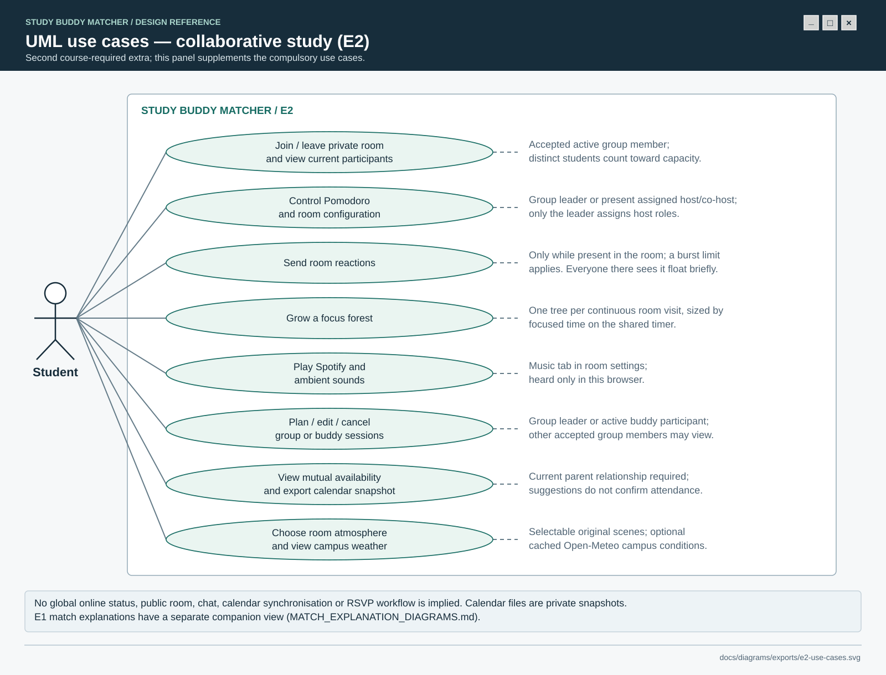](diagrams/exports/e2-use-cases.svg)

```mermaid
flowchart LR
    Member[Accepted active group member]
    Buddy[Participant in active buddy connection]
    Leader[Group leader]
    Host[Present assigned host or co-host]
    subgraph E2[Authenticated E2 application]
        Room[Private group room and live presence]
        Timer[Authoritative shared Pomodoro]
        Reactions[Short-lived room reactions]
        Forest[Focus forest: one tree per room visit]
        Badges[Private achievements and Forester badge]
        Music[Personal Spotify and ambient sounds]
        Sessions[Dated group and buddy sessions]
        Suggestions[Mutual weekly availability]
        Home[Actual Home and agenda data]
        Events[Recipient session notifications]
        Calendar[Private UTC calendar snapshot]
        Weather[Cached campus-weather DTO]
        Theme[Original local pixel atmosphere]
    end
    Member --> Room
    Member --> Sessions
    Buddy --> Sessions
    Leader -->|assign roles| Host
    Leader -->|manage group series| Sessions
    Host --> Timer
    Room --> Timer
    Room --> Music
    Room --> Reactions
    Timer -->|focus time| Forest
    Forest --> Badges
    Sessions --> Suggestions
    Sessions --> Home
    Sessions --> Events
    Sessions --> Calendar
    Calendar --> Offline[Independent calendar import]
    OpenMeteo[Open-Meteo service] --> Weather
    Weather --> Theme
    Theme --> Room
```

Room leases, durable timer state, short-lived reactions, focus visits and dated sessions have
distinct lifecycles. The browser reconciles authenticated HTTP snapshots.

Membership removal, closed groups, ended connections and inactive accounts are
server authorization boundaries on every room/session request. Lifecycle changes
also revoke leases/roles and cancel affected future schedules; prior offline
calendar copies cannot be revoked.

[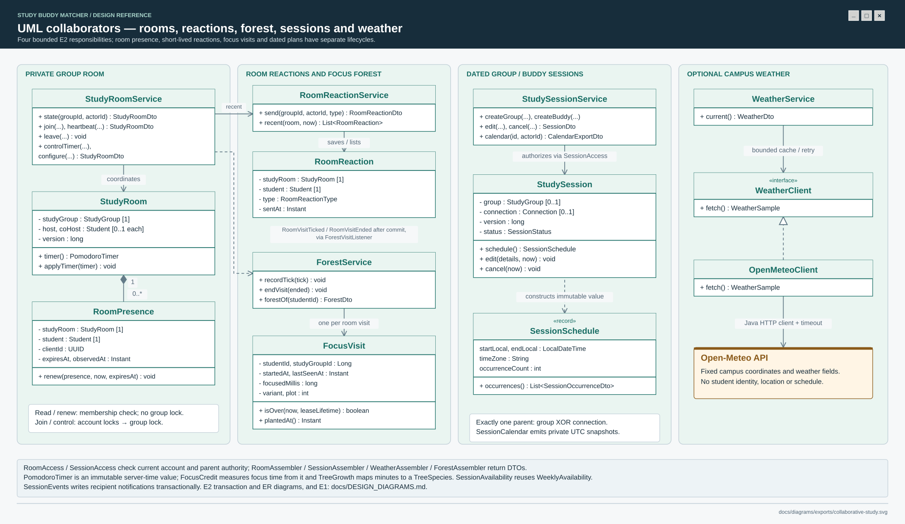](diagrams/exports/collaborative-study.svg)

```mermaid
classDiagram
    StudyGroup "1" --> "0..1" StudyRoom
    StudyRoom --> PomodoroTimer : reconstructs immutable value
    StudyRoom "1" --> "0..*" RoomPresence
    RoomPresence --> Student : authenticated owner
    StudyRoom --> Student : optional host and coHost
    StudyRoomController --> StudyRoomService
    StudyRoomService --> RoomAccess
    StudyRoomService --> RoomAssembler
    StudyRoomService --> StudyRoomRepository
    StudyRoomService --> RoomPresenceRepository
    RoomAccess --> AccountAccess
    RoomAccess --> StudyGroupLookup
    RoomAccess --> GroupMembershipRepository
    RoomAssembler --> StudyRoomDto
    StudyGroupService --> RoomLifecycle : revoke member leases and roles
    GroupClosure --> RoomLifecycle : close room
    StudentDeactivation --> RoomLifecycle : revoke account leases and roles
    RoomLifecycle --> RoomPresenceRepository
    RoomLifecycle --> StudyRoomRepository
    StudyRoom "1" --> "0..*" RoomReaction
    RoomReaction --> Student : sender
    StudyRoomController --> RoomReactionService
    RoomReactionService --> RoomAccess
    RoomReactionService --> RoomReactionRepository
    StudyRoomService --> RoomReactionService : recent reactions for the snapshot
    StudyRoomService ..> RoomVisitTicked : publishes on join and heartbeat
    StudyRoomService ..> RoomVisitEnded : publishes when the last tab leaves
    ForestVisitListener --> ForestService : forest worker, after commit
    ForestController --> ForestService
    ForestService --> FocusVisitRepository
    ForestService --> FocusCredit
    ForestService --> TreeLottery
    ForestService --> ForestAssembler
    ForestAssembler --> TreeGrowth
    FocusVisitRepository --> FocusVisit
    AchievementService --> ForestService : Forester tree count
    StudyGroup "0..1" --> "0..*" StudySession
    Connection "0..1" --> "0..*" StudySession
    StudySession --> SessionSchedule : immutable local-time series
    StudySessionController --> StudySessionService
    StudySessionService --> SessionAccess
    StudySessionService --> SessionAssembler
    StudySessionService --> SessionAvailability
    StudySessionService --> SessionCalendar
    StudySessionService --> SessionEvents
    StudySessionService --> StudySessionRepository
    SessionAssembler --> SessionDto
    SessionAvailability --> WeeklyAvailability : reuse matching intersection
    SessionEvents --> NotificationService
    StudySessionLifecycle --> StudySessionRepository
    StudySessionLifecycle --> SessionEvents
    class SessionSchedule {
        LocalDateTime startLocal
        LocalDateTime endLocal
        String timeZone
        int occurrenceCount
        occurrences()
    }
    class PomodoroTimer {
        Duration focusDuration
        Duration breakDuration
        TimerPhase phase
        TimerStatus status
        Duration remainingAtAnchor
        Instant anchor
        snapshot(now)
        start(now)
        pause(now)
        resume(now)
        reset()
    }
```

#### Group rooms

Room controls persist a versioned timer snapshot; presence heartbeats update
separate expiring leases. State reads use `RoomAccess.readMember` without row locks.
Heartbeats use that same authorization check and renew only an existing unexpired
lease; concurrent deletion fails renewal. Join/leave and timer/configuration
changes use `lockMember`: account locks precede the group lock, followed by a current
membership check. Assemblers expose only DTOs. The leader retains controls, delegated
hosts must be present, and distinct students count toward capacity. Membership/account/
closure operations revoke leases and roles transactionally, so readmission needs a fresh join.

#### Reactions, the focus forest and achievements

Reactions are sent only by a student with a live lease in the room, limited per student by a
burst window, and listed in every member's room snapshot for a short window; old rows are
deleted when someone next reacts. The forest stays outside the room code: `StudyRoomService`
publishes `RoomVisitTicked` and `RoomVisitEnded`, and `ForestVisitListener` hands each one, after
the room transaction commits, to a single forest worker. `ForestService` credits the focus time
`FocusCredit` measures on the shared timer to the student's open `FocusVisit`; one continuous
visit grows one tree, and a gap longer than the lease lifetime starts a new one.

Trees grow only from focus time on a group room's shared timer. Achievements are private;
`AchievementService` reads the tree count from `ForestService` for the Forester badge.

#### Study Room tab, music and weather

The personal Study Room timer is browser-only and grows no trees. Music is personal: each
student's study room Music settings tab plays only in their browser and holds no room state.
The optional weather request sends only fixed configured campus coordinates/options from the
backend, with bounded timeout/cache and local selectable fallback; no student's device location
or profile is sent to the provider.

#### Sessions

Each dated session belongs to exactly one group or connection. Group leaders and
the relevant buddy pair manage their own series; current parent eligibility gates
detail, suggestions and calendar export. `SessionSchedule` generates bounded UTC
occurrences from local civil time and an IANA zone; missing/ambiguous DST endpoints
are rejected. Assemblers expose no private contact/email/token fields. Session availability
reuses the matching engine's interval maths and does not modify matching rankings. Calendar
downloads contain no attendee/contact/token payload and provide no OAuth/live client sync.

```mermaid
sequenceDiagram
    actor Student
    participant UI as Session screen
    participant API as StudySessionController
    participant Service as StudySessionService
    participant Access as SessionAccess
    participant Schedule as SessionSchedule
    participant Events as SessionEvents
    participant Calendar as SessionCalendar
    participant DB as PostgreSQL
    Student->>UI: save whole group or buddy series
    UI->>API: input and expectedVersion plus JWT
    API->>Service: validated input and principal ID
    Service->>Access: lock current parent and verify manager
    Access->>DB: accounts before group or connection
    Service->>Schedule: validate zone and each weekly start/end
    Schedule-->>Service: bounded UTC occurrences
    Service->>DB: save observed-version change
    Service->>Events: notify current active recipients
    Events->>DB: revision/change/recipient event keys
    Service-->>UI: SessionDto after successful transaction
    Student->>UI: download calendar
    UI->>API: authenticated export request
    API->>Service: calendar(sessionId, principal ID)
    Service->>Access: recheck current parent eligibility
    Service->>Calendar: export authorized session
    Calendar-->>UI: private single/bounded UTC event snapshot
    Note over UI,Calendar: Stable occurrence UIDs, no contact payload or automatic client sync
    Note over Service,DB: Notification failure rolls back the saved session change
```

Parent closure/connection end/deactivation cancels affected future schedules and
revokes access; a notification link does not restore authorization. Cancellation
files are available only while the parent remains accessible. Offline imported
events are independent copies, so shortening/cancellation/revocation cannot erase
them.

## Data and behaviour

### Database

Ordered SQL migrations own the schema; Hibernate runs in `validate` mode and never changes it.
The two panels are crow's-foot entity-relationship diagrams: the 17 tables behind the
compulsory features, and the 17 tables added by the two extras (rooms, sessions, forest,
badges, explanation cache, study plans and quizzes).

[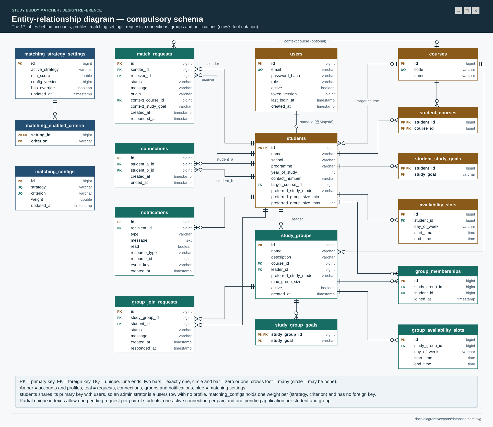](diagrams/exports/database-core.svg)

[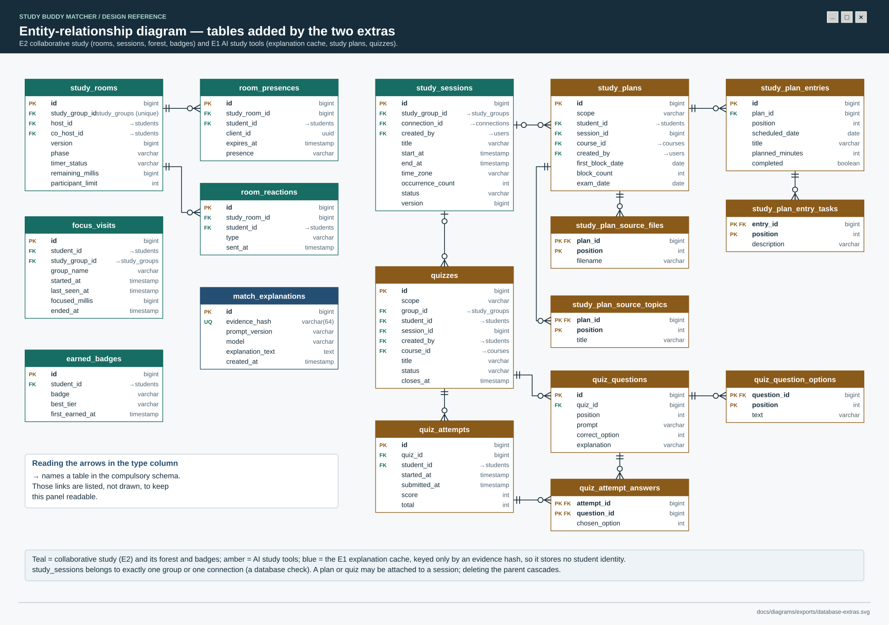](diagrams/exports/database-extras.svg)

#### Accounts, relationships, groups, rooms and sessions

```mermaid
erDiagram
    users ||--o| students : shared_id
    students ||--o{ student_courses : enrolled
    courses ||--o{ student_courses : course
    students ||--o{ student_study_goals : goals
    students ||--o{ availability_slots : weekly_slots
    courses o|--o{ students : optional_target
    students ||--o{ match_requests : sender
    students ||--o{ match_requests : receiver
    courses o|--o{ match_requests : optional_context
    students ||--o{ connections : student_a
    students ||--o{ connections : student_b
    courses ||--o{ study_groups : course
    students ||--o{ study_groups : leader
    study_groups ||--o{ study_group_goals : goals
    study_groups ||--o{ group_availability_slots : weekly_slots
    study_groups ||--o{ group_memberships : accepted_members
    students ||--o{ group_memberships : member
    study_groups ||--o{ group_join_requests : requests
    students ||--o{ group_join_requests : applicant
    students ||--o{ notifications : recipient
    study_groups ||--o| study_rooms : private_room
    study_rooms ||--o{ room_presences : tab_leases
    students ||--o{ room_presences : owner
    study_groups o|--o{ study_sessions : group_parent
    connections o|--o{ study_sessions : buddy_parent
    users {
        bigint id PK
        varchar email UK
        varchar password_hash
        varchar role
        boolean active
        bigint token_version
        timestamptz last_login_at
    }
    match_requests {
        bigint id PK
        bigint sender_id FK
        bigint receiver_id FK
        varchar status
        varchar origin
        bigint context_course_id FK
        varchar context_study_goal
    }
    connections {
        bigint id PK
        bigint student_a_id FK
        bigint student_b_id FK
        timestamptz ended_at
    }
    group_memberships {
        bigint id PK
        bigint study_group_id FK
        bigint student_id FK
        timestamptz joined_at
    }
    notifications {
        bigint id PK
        bigint recipient_id FK
        varchar type
        text message
        boolean read
        varchar resource_type
        bigint resource_id
        varchar event_key
    }
    study_rooms {
        bigint id PK
        bigint study_group_id FK
        bigint version
        bigint host_id FK
        bigint co_host_id FK
        varchar music_preset "unused, no longer mapped"
        boolean music_playing "unused, no longer mapped"
        varchar ambient_preset "unused, no longer mapped"
        boolean ambient_playing "unused, no longer mapped"
    }
    room_presences {
        bigint id PK
        bigint study_room_id FK
        bigint student_id FK
        uuid client_id
        timestamptz expires_at
    }
    study_sessions {
        bigint id PK
        bigint version
        uuid calendar_uid UK
        bigint study_group_id FK
        bigint connection_id FK
        timestamp start_local
        timestamp end_local
        varchar time_zone
        integer occurrence_count
        timestamptz start_at
        timestamptz end_at
        varchar status
    }
```

Natural collection keys are `(student_id,course_id)`, `(student_id,study_goal)` and
`(study_group_id,study_goal)`. Membership is unique per group/student. Partial unique
indexes protect unordered pending buddy pairs, unordered active connections and pending
group/applicant pairs while allowing terminal history. Non-null recipient/event keys are
unique. Notification resource IDs are safe navigation metadata, not cascading foreign keys;
permanent account cleanup explicitly removes links to deleted records. The matching
configuration tables are shown separately below.
E2 sessions require exactly one non-null group/connection parent. Room/student tab
leases are unique by `(study_room_id,student_id,client_id)`; distinct students,
not lease rows, determine current capacity.

#### Matching configuration tables

```mermaid
erDiagram
    matching_strategy_settings ||--o{ matching_enabled_criteria : enabled
    matching_strategy_settings {
        bigint id PK
        varchar active_strategy
        double min_score
        bigint config_version
        boolean has_override
        timestamp updated_at
    }
    matching_enabled_criteria {
        bigint setting_id FK
        varchar criterion
    }
    matching_configs {
        bigint id PK
        varchar strategy
        varchar criterion
        double weight
        timestamp updated_at
    }
```

Settings are a singleton (`id=1`). Enabled rows belong to that setting; weight rows are
unique per `(strategy,criterion)`, not per student. `has_override=false` selects external
startup defaults while retaining the persistent version. Restore removes weight overrides
and enabled override rows but never resets the version. The migration preserves existing
settings and provides the constraints.

### State machines

[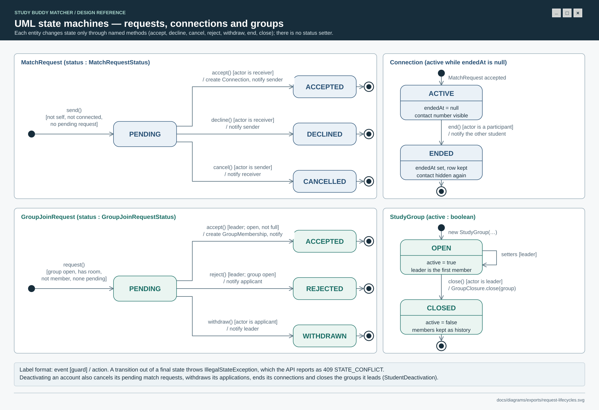](diagrams/exports/request-lifecycles.svg)

Each lifecycle is owned by its entity. `MatchRequest`, `GroupJoinRequest`, `Connection` and
`StudyGroup` expose intention-revealing transition methods (`accept()`, `decline()`,
`cancel()`, `reject()`, `withdraw()`, `end()`, `close()`) and no status setter, so an illegal
transition cannot be written from outside the class. Every transition out of a final state
throws, and the API reports it as 409.

#### Match request and connection

```mermaid
stateDiagram-v2
    direction LR
    [*] --> PENDING : sender sends request<br/>(optional message)
    PENDING --> ACCEPTED : receiver accepts
    PENDING --> DECLINED : receiver declines<br/>(after confirming)
    PENDING --> CANCELLED : sender withdraws it, or<br/>either account deactivated
    ACCEPTED --> [*]
    DECLINED --> [*]
    CANCELLED --> [*]

    state ACCEPTED {
        direction LR
        [*] --> Active : Connection created<br/>(contact number visible)
        Active --> Ended : a participant ends it, or<br/>an account is deactivated
        Ended --> [*] : contact hidden again
    }
```

`MatchRequestService.send` rejects these before a request is created:

- **409:** sending to yourself, an active connection already exists between the pair, or a
  pending request already exists in *either* direction.
- **404:** the receiver is inactive or unknown.

Only the receiver may accept or decline, and only the sender may withdraw (cancel); anyone
else gets 403. The other student is notified of a decline or a withdrawal. Accepting and
creating the `Connection` happen in one transaction with the request row locked, so a double
accept, or an accept racing a decline or withdrawal, resolves to a single outcome.

An ended connection keeps `endedAt` for history. Contact privacy is recomputed on every read,
so the contact number disappears as soon as the connection ends, and the pair may send a new
request afterwards. A withdrawn request likewise frees the pair to send a new one.

#### Group join request and membership

```mermaid
stateDiagram-v2
    direction LR
    [*] --> PENDING : student applies<br/>(group active, not already<br/>member or pending)
    PENDING --> ACCEPTED : leader approves<br/>(group not full)
    PENDING --> REJECTED : leader rejects (after<br/>confirming), or group closed
    PENDING --> WITHDRAWN : applicant withdraws, or<br/>applicant deactivated
    ACCEPTED --> [*] : GroupMembership created
    REJECTED --> [*]
    WITHDRAWN --> [*]
```

```mermaid
stateDiagram-v2
    direction LR
    [*] --> Member : application approved
    Member --> [*] : member leaves (after confirming),<br/>leader removes them, or<br/>member deactivated (open<br/>groups only, closed groups<br/>keep members as history)
```

```mermaid
stateDiagram-v2
    direction LR
    [*] --> Open : leader creates group<br/>(leader becomes first member)
    Open --> Open : leader edits details<br/>(max size ≥ current members)
    Open --> Closed : leader closes, or<br/>leader account deactivated
    Closed --> [*] : pending applications rejected,<br/>members notified
```

Approval is serialised on the group row, so two approvals cannot both take the last place.
Leaving or being removed deletes the `GroupMembership` row, and the leader is notified when a
member leaves or an applicant withdraws. A leader cannot leave their own group; they close it
instead. A closed group rejects edits, approvals, rejections, removals and leaving.

#### Quiz and attempt

`Quiz` exposes `close(now)` and no status setter, so an illegal transition cannot be written from
outside the class. A quiz's own status and a member's attempt state are independent: the quiz can
stay `OPEN` while one member has submitted and another has not started.

```mermaid
stateDiagram-v2
    direction LR
    [*] --> OPEN : Quiz written and saved
    OPEN --> CLOSED : closing time passes, or<br/>a host/owner closes it early
    CLOSED --> [*]

    state OPEN {
        direction LR
        [*] --> NotStarted : member has not opened it
        NotStarted --> Started : QuizAttempt.start()<br/>(timer begins)
        Started --> Submitted : QuizAttempt.submit()<br/>(answers, score recorded)
        Submitted --> [*]
    }
```

`close(now)` is idempotent and records `closedAt` only when closed early, so takers who already
finished keep their results; a group quiz past its `closesAt` reads as closed without a
scheduler. `QuizAttempt.submit()` may run exactly once — a second call throws, reported as 409.
