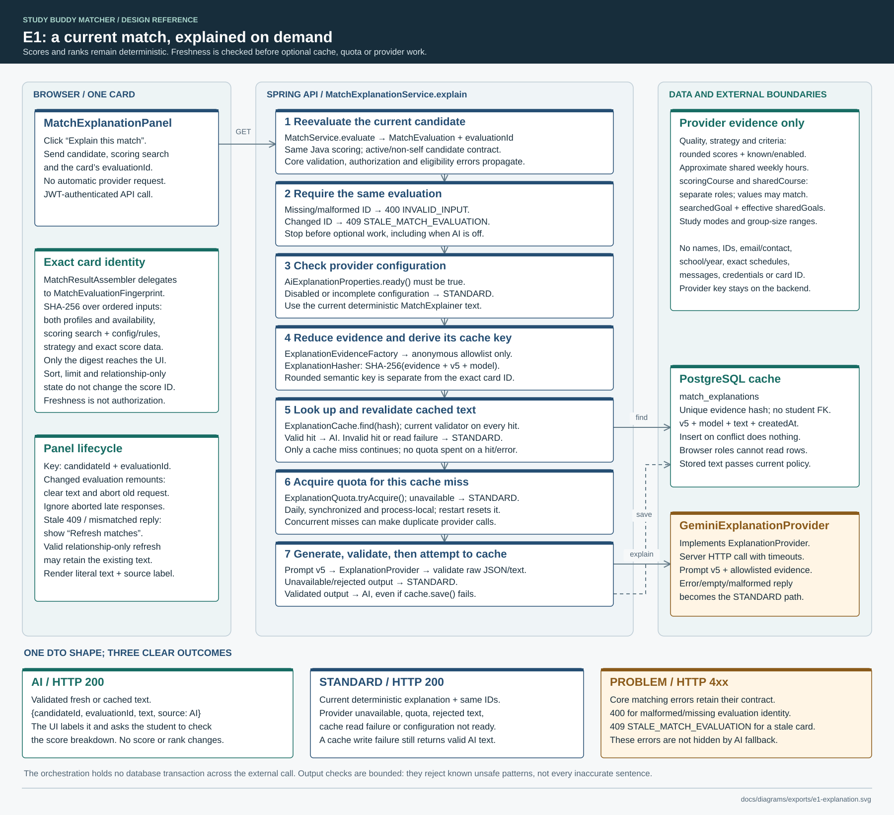

# E1: match explanation design

This companion describes the E1 match explanation. It supplements the compulsory matching
design: Java still calculates every score and rank; the optional provider (Google Gemini)
writes an explanation only after a student asks. The
[API contract](../API_CONTRACT.md#match-explanation-e1) defines the endpoint, and
[testing](../TESTING.md) covers how it is tested.

[](exports/e1-explanation.svg)

The SVG is a standalone, hand-edited vector file with native text and shapes; it is not
built by `render_diagrams.py`. Its numbered stages follow `MatchExplanationService.explain`
and `AiExplanationWriter.write`. When the contract changes, update both the SVG and the
Mermaid below.

## Two identities with different responsibilities

| Identity | Built from | Used for |
| --- | --- | --- |
| Card `evaluationId` | SHA-256 of ordered scoring profiles and availability, scoring search context, strategy/configuration version, weights/enabled criteria, rules and exact score data | Confirms the requested card still represents the current evaluation before optional cache/quota/provider work. Only the opaque digest reaches the browser; its source inputs remain on the server |
| Semantic evidence hash | SHA-256 of serialized allowlisted evidence, prompt version `v5` and configured model | Reuses explanation text for equivalent anonymous evidence. Scores are rounded to two decimal places and shared hours to the nearest half hour; this hash deliberately omits account and exact card identity |

`MatchService` asks `MatchResultAssembler` to assemble the card; the assembler delegates
its exact identity to `MatchEvaluationFingerprint`. Sort and limit affect discovery order,
so they are excluded from the card fingerprint.
Relationship-only changes do not invalidate unchanged scoring evidence. A changed profile,
availability, scoring search context or configuration can invalidate it even when the rounded
evidence would reuse an existing cache row. Freshness is therefore checked **before** cache
lookup. The digest is a freshness contract, not an authorization token.

Direct evaluation retains the active, non-self candidate contract. It does not add discovery
membership authorization or require that the candidate still passes search filters, discovery
thresholds or connection exclusion. Authentication, search validation and current candidate
eligibility still run through `MatchService.evaluate`.

## OO collaborators

Selected public operations are shown below. Dependencies describe actual constructor-injected
collaborators; `ExplanationProvider` is the replaceable interface. `AiExplanationConfiguration`
builds the provider: E1's own `GeminiClient`, with `GeminiSettings` and an `AiQuota` from
`app.ai.explanation.*`, wrapped by `GeminiExplanationProvider`. The study tools and the
assistant chat use the same client class with their own settings and quotas, so E1 never
spends their allowance. Cache entities remain behind
`ExplanationCache`, and the controller receives `MatchExplanationDto` from the assembler.

```mermaid
classDiagram
    direction TB
    class MatchExplanationController {
        +explain(...) MatchExplanationDto
    }
    class MatchExplanationService {
        +explain(search, actorId, candidateId, evaluationId) MatchExplanationDto
    }
    class MatchService {
        +evaluate(search, actorId, candidateId) MatchEvaluation
    }
    class MatchResultAssembler {
        +toDto(...) MatchResultDto
    }
    class MatchEvaluationFingerprint {
        +create(searcher, candidate, search, settings, score, rules) String
    }
    class ExplanationEvidenceFactory {
        +from(evaluation) ExplanationEvidence
    }
    class AiExplanationWriter {
        +write(evidence, studentId) Optional~String~
    }
    class ExplanationCache {
        +find(evidence) Optional~String~
        +save(evidence, text) void
    }
    class ExplanationHasher {
        +hash(evidence, promptVersion, model) String
    }
    class MatchExplanationRepository {
        <<interface>>
        +findByEvidenceHash(hash) Optional~MatchExplanation~
        +insertIfAbsent(hash, promptVersion, model, text) void
    }
    class ExplanationPromptBuilder {
        +PROMPT_VERSION String
        +build(evidence) String
    }
    class ExplanationVocabulary {
        +describe(evidence)$ Map
    }
    class PromptTemplate {
        +load(classpathPath)$ PromptTemplate
        +fill(values) String
    }
    class ExplanationProvider {
        <<interface>>
        +explain(studentId, prompt) Optional~String~
    }
    class GeminiExplanationProvider {
        +explain(studentId, prompt) Optional~String~
    }
    class GeminiClient {
        +generateJson(studentId, prompt) String
    }
    class AiQuota {
        +tryAcquire(studentId) boolean
        +pauseAfterRateLimit() void
    }
    class ExplanationOutputValidator {
        +validate(raw, evidence) Optional~String~
        +validateText(text, evidence) Optional~String~
    }
    class MatchExplanationAssembler {
        +ai(candidateId, evaluationId, text) MatchExplanationDto
        +standard(candidateId, evaluationId, text) MatchExplanationDto
    }
    MatchExplanationController --> MatchExplanationService
    MatchExplanationService --> MatchService : reevaluates current inputs
    MatchService --> MatchResultAssembler : assembles evaluated card
    MatchResultAssembler --> MatchEvaluationFingerprint : exact card identity
    MatchExplanationService --> ExplanationEvidenceFactory
    MatchExplanationService --> AiExplanationWriter : AI wording or nothing
    MatchExplanationService --> MatchExplanationAssembler
    AiExplanationWriter --> ExplanationCache
    ExplanationCache --> ExplanationHasher : semantic cache identity
    ExplanationCache --> MatchExplanationRepository
    AiExplanationWriter --> ExplanationPromptBuilder
    ExplanationPromptBuilder --> ExplanationVocabulary : plain words, no code names
    ExplanationPromptBuilder --> PromptTemplate : match-explanation-v5.txt
    AiExplanationWriter --> ExplanationProvider
    GeminiExplanationProvider ..|> ExplanationProvider
    GeminiExplanationProvider --> GeminiClient : E1's own instance
    GeminiClient --> AiQuota : spends allowance, pauses after HTTP 429
    AiExplanationWriter --> ExplanationOutputValidator
```



## Request sequence and early exits

`MatchExplanationService` checks that the card is current and chooses AI or standard text;
`AiExplanationWriter` owns the optional AI steps. Neither is transactional: current evaluation
and cache operations complete without holding a database connection across the external HTTP
call. The sequence shows prompt and validator collaborators as writer self-calls; their class
names appear in the OO view above.

```mermaid
sequenceDiagram
    actor Student
    participant UI as MatchExplanationPanel
    participant API as MatchExplanationController
    participant Service as MatchExplanationService
    participant Matching as MatchService
    participant Writer as AiExplanationWriter
    participant Cache as ExplanationCache
    participant Provider as ExplanationProvider / E1 GeminiClient
    Student->>UI: Explain this match
    UI->>API: GET candidate explanation + search + evaluationId
    API->>Service: explain(search, actorId, candidateId, evaluationId)
    Service->>Matching: evaluate current candidate and scoring inputs
    Matching-->>Service: MatchEvaluation + current evaluationId
    break Core evaluation error or invalid/stale identity
        Service-->>API: Existing Problem / 400 INVALID_INPUT / 409 STALE_MATCH_EVALUATION
        API-->>UI: Problem (no optional cache/quota/provider work)
    end
    break AI configuration is not ready
        Service-->>API: STANDARD + current deterministic text
        API-->>UI: 200 MatchExplanationDto
    end
    Service->>Writer: write(allowlisted evidence, studentId)
    Writer->>Cache: find(evidence), keyed by hash of evidence + v5 + model
    break Cache read fails
        Writer-->>Service: empty (no provider work, no quota spent)
    end
    break Cache hit
        Writer->>Writer: Revalidate text against current evidence and policy
        Writer-->>Service: text if still valid, otherwise empty
    end
    Writer->>Provider: explain(studentId, v5 prompt with plain-word evidence)
    Provider->>Provider: AiQuota.tryAcquire(studentId), then call Gemini
    Provider-->>Writer: Optional raw JSON (empty when over quota, pausing after a 429, failing or not finished with STOP)
    Writer->>Writer: Validate JSON and current text policy
    break Over quota, provider unavailable or output rejected
        Writer-->>Service: empty
    end
    Writer->>Cache: save(evidence, validated text)
    Note over Writer,Cache: Insert on conflict does nothing; write failure still returns valid AI text
    Writer-->>Service: validated text
    Service-->>API: AI + text, or STANDARD + deterministic text when empty
    API-->>UI: 200 {candidateId, evaluationId, text, source}
    UI-->>Student: Literal text + source label; scores unchanged
```

## Privacy, fallback and lifecycle constraints

- The provider receives only `ExplanationEvidence`: quality, rounded total/criterion scores,
  enabled/known flags, strategy, approximate shared weekly hours, course code/name context,
  searched/shared goals, study modes and group-size preferences. `scoringCourse` identifies
  the course used by the scorer; `sharedCourse` separately identifies a genuinely shared course.
  `searchedGoal` retains unsaved intent, while `sharedGoals` intersects the candidate's goals
  with the caller's effective saved-plus-searched goals.
- Names, account IDs, email/contact details, school/year, exact weekly schedules, credentials,
  messages and the evaluation ID are absent from provider evidence. The provider key stays on
  the backend. The cache has a unique evidence hash and no student foreign key; browser roles
  cannot read it directly.
- Both fresh and cached text pass the current validator. Its checks cover JSON/length, obvious
  success or percentage claims, code-shaped course references and numeric weekly-hour
  references. The checks are bounded: they catch known unsafe patterns, not every inaccurate sentence. Invalid cached text
  produces `STANDARD`; it does not trigger automatic regeneration or cache repair.
- E1's daily quota is its own `AiQuota` inside its `GeminiClient`, spent only on a cache
  miss. It is synchronised and process-local, with its configured day boundary; a restart
  resets it. The student ID is used only for the per-student share and never reaches Gemini. Simultaneous identical misses may call the provider more than once;
  insert-on-conflict prevents duplicate rows, not duplicate external requests.
- The UI requests text only on a click. Its child is keyed by candidate and evaluation ID;
  a changed evaluation remounts it, clears completed text and aborts the obsolete request.
  Aborted late replies are ignored. A mismatched response identity or stale 409 asks the user
  to **Refresh matches**; ordinary errors offer a retry. Relationship-only refreshes may keep
  valid text. AI text is labelled and rendered as text, with advice to check the score breakdown.
