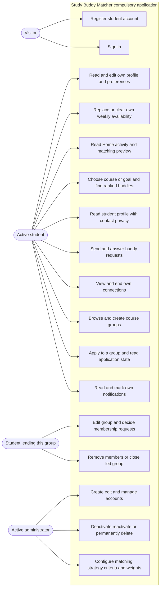
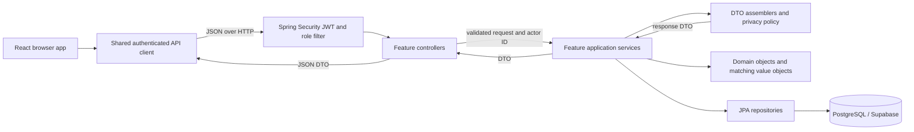
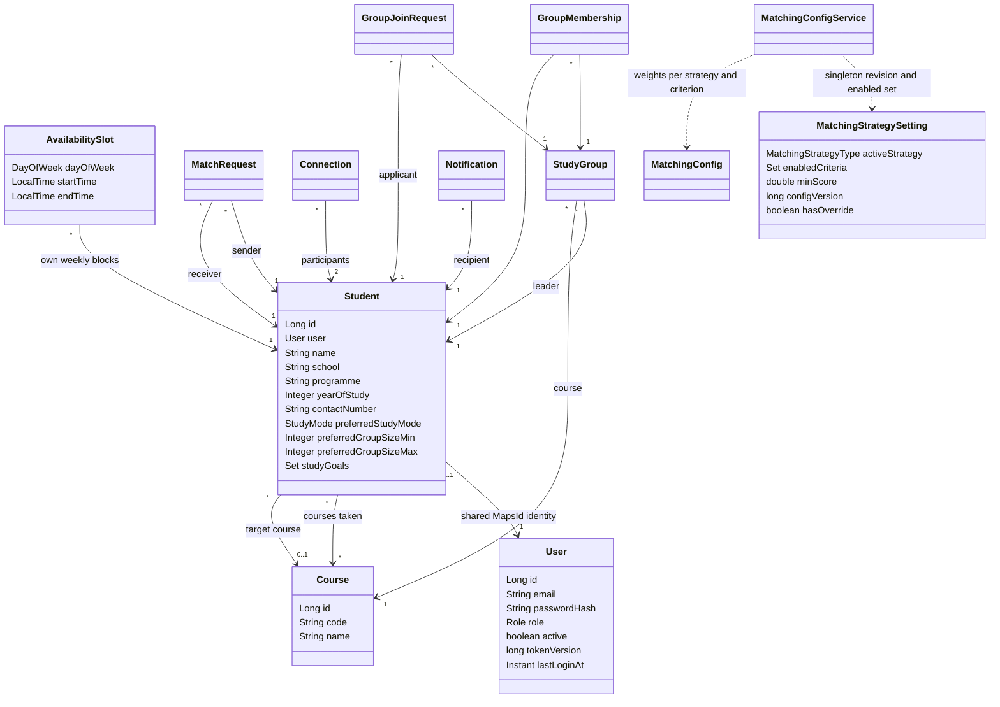
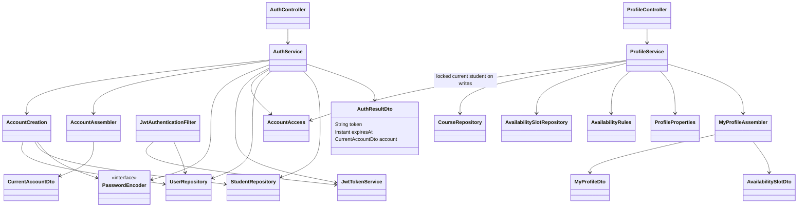
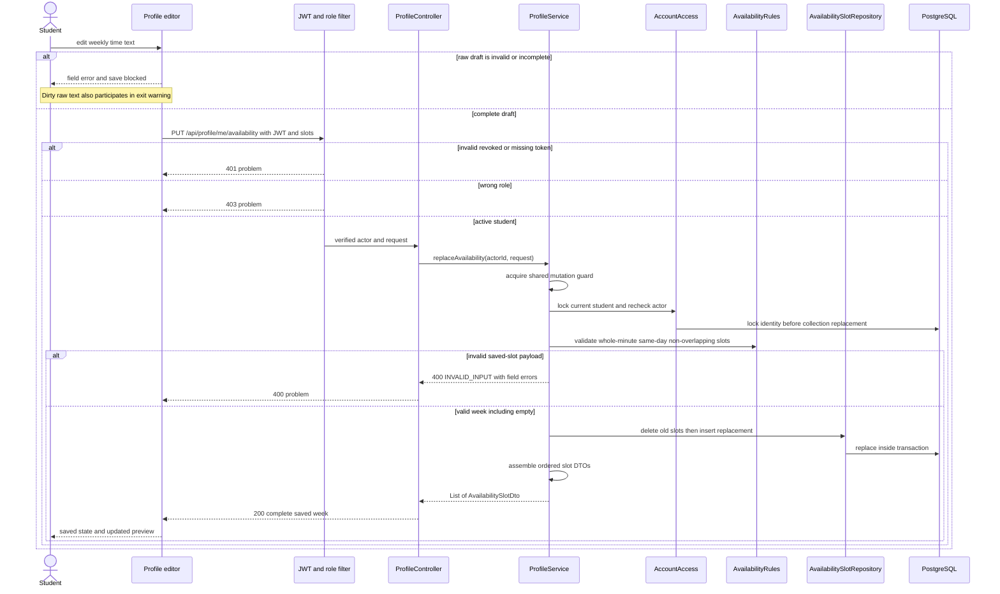

# Platform and whole-system diagrams

These diagrams connect the compulsory Team B authentication/profile/data foundation with
Team A matching and Team C requests, privacy, groups, notifications and administration.
They describe the implemented system, including the confirmed completion fixes. E1 and E2
are tracked extensions and are not shown as shipped application features.

Detailed OO and transaction diagrams remain in [TEAM_A.md](TEAM_A.md) and [TEAM_C.md](TEAM_C.md).
The [API contract](../API_CONTRACT.md), [decisions](../DESIGN_DECISIONS.md),
[coverage map](../REQUIREMENT_COVERAGE.md) and [test record](../TEAM_C_TESTING.md) explain fields,
validation choices and verification limits. Export these diagrams legibly and review them
with the team before using them in the presentation.

## Compulsory use cases and system boundary

Leadership is a per-group relationship held by a student, not a third JWT role. The only
account roles are STUDENT and ADMIN. Account/receiver/participant/leader checks run on the
server; hidden or disabled controls do not confer authority. Administrator access and group
membership do not grant private contact reads.

## Runtime and layer boundaries

The browser uses the Spring API. Application tables/sequences deny browser roles, with RLS
enabled and no browser policies. Services may use repositories and domain entities internally;
controllers do not inject repositories and services do not return entities to the API. The
ordered SQL migrations define project-specific integrity/adoption/access rules beyond the
mapped DDL that Hibernate may update.

## Identity, profile and cross-team domain relationships

`Student` composes an identity rather than inheriting `User`; administrators have no mandatory
student fields. Group membership and connection are separate consent relationships. Matching
reads active profiles and canonical weekly intervals but owns neither account lifecycle nor
contact visibility. Matching settings above are persistent admin configuration, not a student
profile's preferences. Team A's diagram defines the scorer/strategy interfaces and immutable
`TimeSlot`/`MatchScore` objects; Team C's diagram defines transition and lifecycle behavior.

## Authentication and own-profile service boundary

Registration atomically creates `User` and `Student` and permits only the STUDENT role.
Login validates the current identity/password/account state before issuing a token and
recording successful sign-in. JWT account ID, role, expiry and version are checked against
the active account on protected requests. Deactivation invalidates existing tokens;
reactivation requires a fresh sign-in and does not restore ended relationships.

## Own-week replacement and alternatives

Concurrent replacements serialize on the same student's write boundary. Each completed
response represents one valid whole week; it must not contain a mixture of concurrent inputs.
Own profile course/goal collection replacements use that boundary too. Group schedules reuse
the complete time-slot shape and draft protection but allow same-day overlap.

## Matching boundary alternatives

This supplements Team A's detailed successful scoring/ranking sequence with the entry/error/
empty alternatives required for an integrated demo.

```mermaid
sequenceDiagram
    actor Student
    participant UI as Find buddies or Home
    participant Filter as JWT and role filter
    participant API as MatchController
    participant Service as MatchService
    participant DB as PostgreSQL
    Student->>UI: choose course or goal and search
    UI->>Filter: GET /api/matches with JWT and criteria
    alt missing invalid expired or revoked token
        Filter-->>UI: 401 problem
        UI-->>Student: sign-in or session-expired state
    else non-student role
        Filter-->>UI: 403 problem
        UI-->>Student: permission error
    else active student
        Filter->>API: verified actor and typed criteria
        API->>Service: search(criteria, actorId)
        alt missing course and goal or invalid criteria
            Service-->>API: 400 INVALID_INPUT
            API-->>UI: 400 problem with safe details
            UI-->>Student: validation/error state
        else valid criteria
            Service->>DB: one settings and candidate snapshot
            Service->>Service: eligibility filters, scoring, strategy order and limit
            alt no eligible result
                Service-->>API: versioned result with empty matches
                API-->>UI: 200 result DTO
                UI-->>Student: empty state and filter guidance
            else eligible results
                Service->>Service: assemble public score and request-state DTOs
                Service-->>API: versioned bounded result
                API-->>UI: 200 result DTO
                UI-->>Student: ranked cards and shared-time breakdown
            end
        end
    end
```

Malformed enum/numeric parameters may fail during controller binding before the service call;
the shared problem boundary still returns 400. Discovery DTOs never contain contact, email,
credentials or entities. An unexpected failure shows retryable error state, not fabricated
matches. `MatchingHttpTest` and matching rendered tests cover these branches.

## Other compulsory alternatives

| Flow | Empty / invalid / unauthorized alternative | Evidence |
| --- | --- | --- |
| Registration/login | Missing fields or short/oversize password → 400; duplicate normalized email → 409; incorrect password → 401; correct password for inactive account → 403 | `AccountCreationTest`, `AccountHttpTest`, auth rendered tests |
| Own profile | Unknown/excess courses or missing preferences → 400; other role → 403; raw time draft remains local until complete | Profile/availability/editor tests and compulsory record |
| Buddy requests | No requests → empty list; self/duplicate/connected pair or repeat decision → conflict; wrong receiver → 403 | `BuddyHttpTest`, request/connection tests |
| Privacy | Stranger/pending/group-only viewer → public DTO; inactive or missing subject → 404; after disconnect → contact withheld | Privacy assembler and HTTP tests |
| Groups | No browse result → empty state; full/closed/repeated request → conflict; invalid capacity/time → 400; non-leader decision → 403 | `GroupHttpTest`, group and rendered tests |
| Notifications | Empty list → empty state; another recipient's mark-read → 403; failed event write rolls back triggering transition | Notification and HTTP rollback/direction tests |
| Admin accounts | Student/unauthenticated caller rejected; self-removal → conflict; removal never leaves an unusable last admin; deleted dependencies are removed safely | `AccountHttpTest`, admin/JWT tests |

The [coverage map](../REQUIREMENT_COVERAGE.md#compulsory-integrated-acceptance-map) links the
cross-feature checklist. Human cross-team review, author explanations, professor clarification,
hosted rollout, Figma/projector acceptance and submission remain separately recorded gates.
