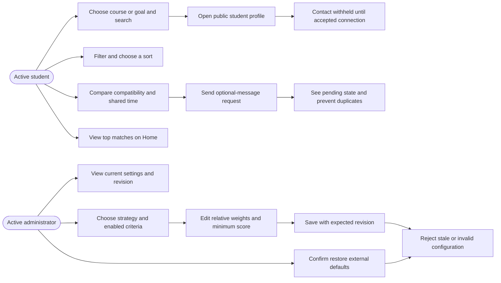
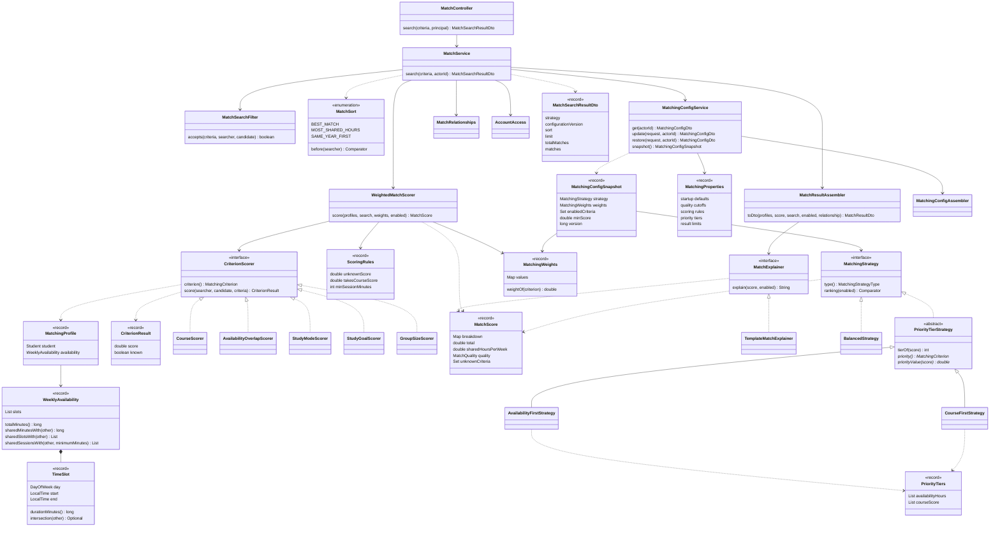
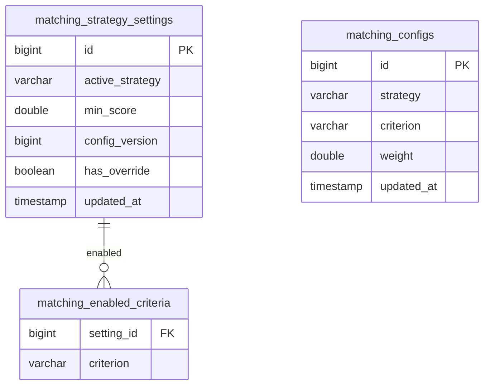

# Team A diagrams

Matching algorithm, discovery API/page and admin configuration for issues
[#1](https://github.com/aryan12singh/study-buddy-matcher/issues/1),
[#2](https://github.com/aryan12singh/study-buddy-matcher/issues/2),
[#3](https://github.com/aryan12singh/study-buddy-matcher/issues/3) and
[#4](https://github.com/aryan12singh/study-buddy-matcher/issues/4).
These diagrams describe the implemented matching boundary. Team B's profile/security/data
and Team C's request/privacy collaborators are dependencies, not duplicated matching logic.
Use [TEAM_C.md](TEAM_C.md) for the request/contact-disclosure and account-lifecycle diagrams.

## Use cases and permissions



A course or goal is required for discovery; profile completion is helpful but missing
preferences are reported as unknown ("not shared") and score the configured unknown value, 0 by default. Active connections are not discovered again.
Students cannot call admin configuration, and an administrator does not gain access to a
student's private contact through matching. Every check is enforced server-side.

## OO class boundary



Scorers are pure collaborators: no repository or controller access. `WeeklyAvailability`
canonicalizes intervals; `MatchScore`, `MatchingWeights` and interval records protect value
state. Strategy implementations encapsulate ranking; the two priority strategies share their
banded ranking through the `PriorityTierStrategy` template method and only name their criterion
and banded value. `MatchExplainer` keeps wording out of scoring and sees only the score, never a
profile. Each `MatchSort` value supplies its own comparator. The search service coordinates
authorization, candidate filtering and repositories inside its transaction. Assemblers
construct DTOs, and the controller only converts query inputs/delegates/returns DTOs.

## Persistence owned by matching



Settings are a singleton (`id=1`). Enabled rows belong to that setting; weight rows are
unique per `(strategy,criterion)`, not per student. `has_override=false` selects external
startup defaults while retaining the persistent version. Restore removes weight overrides
and enabled override rows but never resets the version. The migration preserves existing
settings and provides constraints; Hibernate schema update alone is not the migration.

## Search, ranking and privacy

```mermaid
sequenceDiagram
    actor Student
    participant UI as Find buddies / Home preview
    participant API as MatchController
    participant Service as MatchService
    participant Access as AccountAccess
    participant Config as MatchingConfigService
    participant DB as PostgreSQL
    participant Scoring as WeightedMatchScorer
    participant Strategy as MatchingStrategy
    participant Assembler as MatchResultAssembler
    Student->>UI: choose course or goal, filters and sort
    UI->>API: GET /matches + JWT
    API->>Service: search(typed criteria, actorId)
    Service->>Access: require active student
    Access->>DB: validate account and viewer
    Service->>Service: require context; validate filters/limit
    Service->>Config: snapshot()
    Config->>DB: read version, strategy, enabled criteria, weights and threshold
    Config-->>Service: one immutable settings snapshot
    Service->>DB: active candidates, saved availability and relationships
    Service->>Service: exclude self/connections; canonicalize weekly slots
    loop eligible candidate matching filters
        Service->>Scoring: score enabled criteria with configured weights
        Scoring-->>Service: immutable score, quality, unknown criteria and shared session hours
    end
    Service->>Strategy: order filtered scores with enabled priorities
    Strategy-->>Service: comparator
    Service->>Service: selected sort, shared-hours/name/ID ties, pre-limit count, then limit
    Service->>Assembler: public fields + relevant course + score + pending state
    Assembler-->>Service: MatchResultDto list
    Service-->>API: versioned MatchSearchResultDto
    API-->>UI: 200 bounded result or empty list
    UI-->>Student: preserve server order, show compatibility and heatmap
    Note over Service,DB: REPEATABLE_READ keeps a concurrent config save out of this snapshot
    Note over Assembler,UI: No contact, email, credentials or persistence entity in discovery
```

Profile and request buttons then call Team C's existing services. A confirmed request is
locally marked pending until its post-send (or later) authoritative response. Old pre-send
responses cannot remove that acknowledgement. The backend still rejects racing duplicate
requests or candidates who have become connected since the search.

## Versioned save and restore

```mermaid
sequenceDiagram
    actor Admin
    participant UI as MatchingSettingsPage
    participant API as AdminMatchingConfigController
    participant Service as MatchingConfigService
    participant Access as AccountAccess
    participant DB as PostgreSQL
    participant Defaults as MatchingProperties
    Admin->>UI: edit strategy, criteria, weights or minimum score
    UI->>UI: validate enabled totals and show unsaved changes
    UI->>API: PUT settings + expectedVersion + JWT
    API->>Service: update(request, actorId)
    Service->>Access: lock and recheck active admin
    Service->>Service: validate all three weight sets, enabled set and threshold
    Service->>DB: initialize singleton if missing; lock settings row
    alt expectedVersion equals current version
        Service->>DB: replace weights/criteria/strategy/threshold; increment version
        DB-->>Service: stored override
        Service-->>API: assembled saved config, usingDefaults=false
        API-->>UI: 200 config with newer version
        UI-->>Admin: saved state from response
    else stale version or invalid input
        Service-->>API: 409 stale or 400 invalid; rollback
        API-->>UI: field/conflict error
        UI-->>Admin: preserve edits; offer reload/correction
    end
    Admin->>UI: confirm Restore defaults
    UI->>API: POST restore-defaults + expectedVersion
    API->>Service: restore(request, actorId)
    Service->>Access: lock and recheck active admin
    Service->>DB: same singleton lock; expected-version check
    Service->>DB: remove overrides; increment version, retain row
    Service->>Defaults: current external defaults
    Defaults-->>Service: default strategy, weights, criteria and threshold
    Service-->>API: assembled defaults config, usingDefaults=true
    API-->>UI: 200 config with newer version
```

A failure rolls back the whole config mutation. Concurrent first saves also meet the same
singleton lock; stale edits cannot overwrite another administrator's changes. Stored
settings/version survive restart. Future E1 wording can key caches by this revision and
search/profile inputs; E1 never supplies ranks or compatibility numbers.
