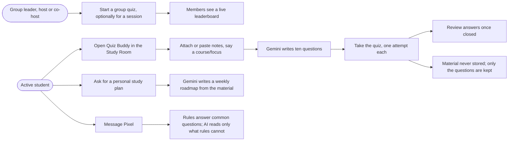
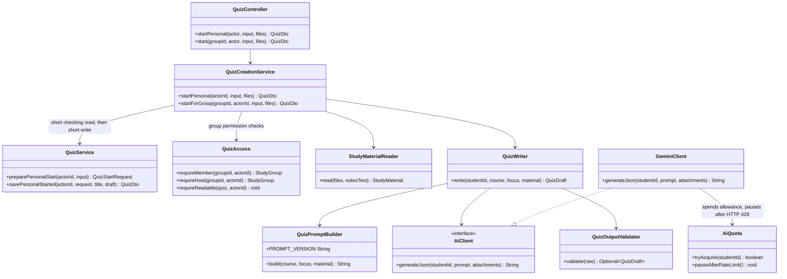
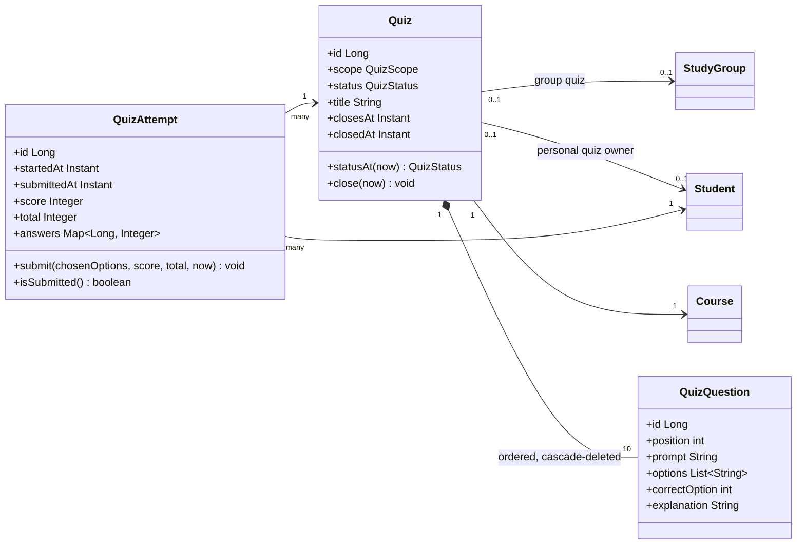
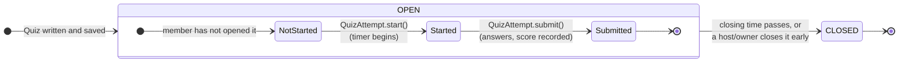
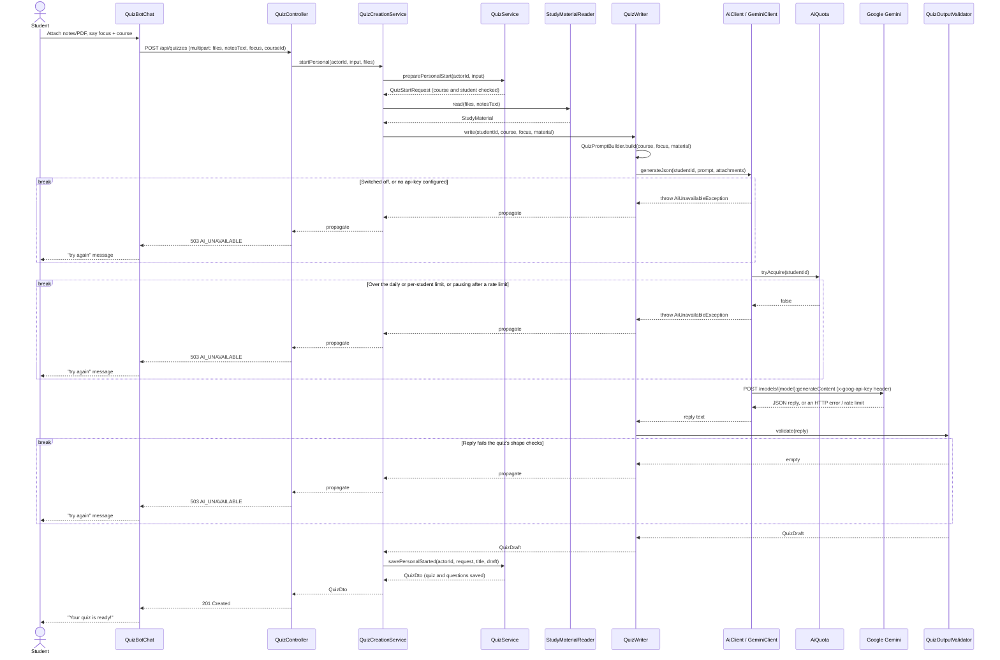

# Team B: platform and AI study tools

This companion covers Team B's two areas. The platform foundation — identity, authentication and
own-profile — already has its boundary and use cases in [PLATFORM.md](PLATFORM.md) and its
decisions in [DESIGN_DECISIONS.md](../DESIGN_DECISIONS.md#platform-and-own-profile-team-b), so it
is not repeated here. This document instead covers the AI study tools: Quiz Buddy, study plans and
the Pixel assistant. All three share one Gemini integration with match explanations (E1, Team C's
[E1.md](E1.md)), but each holds its own API key, model and daily allowance so one feature can never
spend another's. Presentation panel: [AI study tools](exports/ai-study-tools.svg); the
[API contract](../API_CONTRACT.md#quizzes-ai-study-assistant) defines the endpoints, and
[testing](../TESTING.md#e1-quizzes-study-plans-and-the-assistant) covers how they are tested.

## Use cases and permissions

An invisible quiz is 404, so its ID reveals nothing; a group's quiz list is 403, like its room
and sessions. Answers and the correct option stay server-side until a quiz closes. A student's
study plan and a session's plan are visible only to their owner or current participants.

## OO collaborators

`QuizWriter` depends on `AiClient`, not `GeminiClient` directly, so tests supply a fake that
returns fixed replies or fails on demand. `AiAssistantConfiguration` builds the one `GeminiClient`
instance that quizzes and study plans share, each client holding its own `GeminiSettings` and
`AiQuota` from `app.ai.assistant.*`. The chat assistant and E1 build their own instances of the
same `GeminiClient` class from their own settings, so a quiz never spends the chat's or E1's
allowance, and vice versa.

## Persisted domain

A quiz owns its questions outright (cascade-deleted with it); an attempt references a quiz and a
student but is owned by neither. The database allows only one attempt per student per quiz, so
starting twice returns the existing attempt rather than creating a new one.

Study plans follow the same owned-children shape: `StudyPlan` *(scope, course, block calendar,
source filenames/topics)* cascade-owns its `StudyPlanEntry` rows *(sequence, scheduled date,
title, planned minutes, completed, tasks)*, and belongs to either a `Student` (personal) or a
`StudySession` (session), never both.

## Lifecycles

`Quiz` exposes `close(now)` and no status setter, so an illegal transition cannot be written from
outside the class. A quiz's own status and a member's attempt state are independent: the quiz can
stay `OPEN` while one member has submitted and another has not started.

`close(now)` is idempotent and records `closedAt` only when closed early, so takers who already
finished keep their results; a group quiz past its `closesAt` reads as closed without a
scheduler. `QuizAttempt.submit()` may run exactly once — a second call throws, reported as 409.

## Quiz request sequence and early exits

Deliberately not transactional: creation runs as a short checking read, the AI call, then a short
write, so no database connection or account lock is held while Gemini answers (which can take
many seconds for a PDF). The `ready()` check on `AiAssistantProperties` — on by default only when
`application-local.yml` sets `enabled: true` and `api-key` — runs before the quota, so a
switched-off feature never spends a student's daily allowance.

## Study plans and the Pixel assistant

Both reuse the collaborators above with their own prompt builder and output validator; neither
has its own sequence diagram yet. Full decisions are in
[DESIGN_DECISIONS.md](../DESIGN_DECISIONS.md#study-plans) and
[DESIGN_DECISIONS.md](../DESIGN_DECISIONS.md#pixel-study-assistant).

| Feature | What differs from the quiz flow |
| --- | --- |
| Study plan | `StudyPlanCalendar` frames the weeks/meetings server-side before Gemini plans only those blocks; `StudyPlanOutputValidator` checks every block is covered and fits its limits |
| Pixel assistant | `QuickIntentReader` answers common questions with rules and no AI call at all; only a message needing a time, date or other free-text detail reaches `IntentParser`. The AI classifies intent and extracts details only — every fact in the reply still comes from existing services, so the model cannot invent a buddy, time or task |

## Privacy, limits and fallback constraints

- Uploaded or pasted material is sent to Gemini for that one request and never stored. A quiz
  keeps only its questions and a title; a study plan keeps only the extracted topic titles and
  file names; Pixel keeps no history at all.
- Prompt injection: student text and material are marked as data, never instructions.
  `PromptTemplate` fills `{{slot}}` markers in one pass over the template only.
- Any failure — switched off, over quota, rate limited, a timeout or a reply that fails its
  output checks — is `AiUnavailableException`, surfaced as `503 AI_UNAVAILABLE`. Logs never
  contain the prompt, file, reply or key.
- `app.ai.assistant.*` is off unless `application-local.yml` sets `enabled: true` and `api-key`;
  the chat assistant shares that key and switch but keeps its own lighter model, quota and
  rate-limit pause under `app.ai.assistant.chat.*`.
